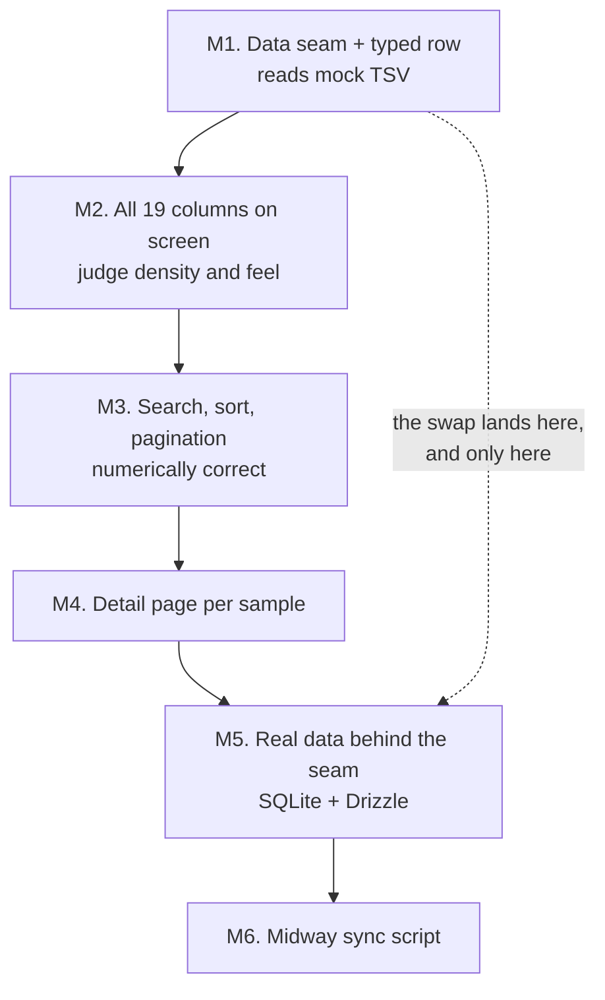

# Build Planning Framework

## Summary

A planning framework for building the genome browser: an ordered ladder of six
milestones, each ending in an app you can open in a browser and judge by eye; a
visible register of decisions deliberately deferred; and one pre-drawn seam at
the data-access boundary so the eventual mock-to-real data swap is a single
change. The framework's purpose is build velocity, not risk control.

---

## Problem Frame

The repo is a bare `create-next-app` scaffold. `app/` holds the untouched
starter page, and none of `db/`, `scripts/`, or `data/` existed before this
brainstorm. No data or table dependencies are installed. Everything the app
will be gets built from here.

Two things make the obvious build order wrong. First, the real source database
is currently out of date, so designing a schema against it now would be
designing against data that will change. Second, the only data available today
is a flat 109-row tab-separated export whose purpose is narrow: see how the
browse table renders and feels with realistic values. It is not the schema, and
column-level display decisions are explicitly not being made yet.

That combination means the app has to be built in an order where the data
source is the *last* thing pinned down rather than the first — the inverse of
how a database-backed app is normally sequenced. The framework exists to make
that inversion deliberate and cheap instead of accidental and expensive.

There is no history of prior failures motivating this. The goal is a foundation
that makes building fast, so the framework should stay as light as it can while
still keeping deferred decisions visible.

---

## Key Decisions

**A milestone ladder, not layer contracts.** Work is sequenced as an ordered
list of milestones rather than a set of interfaces filled in independently.
Contracts-first pays off when several people or agents build in parallel
against stable boundaries; here one person is building start to finish, and
specifying interfaces before seeing the table render would mean guessing at
shapes the UI hasn't yet justified.

**Every milestone ends in something openable.** A milestone is not complete
because code exists or a test passes — it is complete when the app runs and has
been looked at. This is a data *browser*; how it reads on screen is the product,
and the mock data exists specifically to support that judgment.

**Exactly one seam, at the data-access boundary.** The one interface drawn in
advance is the module the app calls to get rows. Everything above it — table,
sorting, detail page — depends on a typed row shape, never on where rows came
from. This is the single place the mock-to-real swap lands. One seam is worth
pre-drawing because its location is already certain; more would be the
contracts-first guessing rejected above.

**The real database is deferred to the end, on purpose.** Schema
reconciliation, SQLite and Drizzle adoption, and the Midway sync are the last
two rungs. The app is built and judged against mock data first.

**`sample` is the record key for now.** `sample` is unique across all 109 mock
rows, and `output_dir` — half of the composite key documented in CLAUDE.md §6 —
is absent from the export. So `sample` serves as the record identifier and
detail-page URL slug through the mock phase. This is a knowingly temporary bet,
revisited at the real-data milestone.

**All columns render; none are chosen.** Every one of the 19 columns displays
during the mock phase, including the two that are entirely empty. Deciding what
to show, hide, or reformat requires first seeing everything on screen at once.

**Deferred decisions are written down, not remembered.** Anything consciously
postponed goes in a register in the repo. A deferred decision that lives only
in conversation is indistinguishable later from one nobody thought about.

---

## The Ladder

Milestones 1 through 4 run entirely on mock data. Only M5 introduces the real
database, and it changes one module because M1 put the seam there.

---

## Requirements

**The milestone ladder**

- R1. The framework defines exactly six ordered milestones: the data seam, the
  full-column table, the working browse controls, the detail page, real data
  behind the seam, and the sync script.
- R2. M1 establishes a single module that returns typed rows, reading from the
  mock export. Nothing above it references the file format or its location.
- R3. M2 renders all 19 columns for all 109 mock rows using the shadcn
  data-table on TanStack Table — the components the finished app will use — so
  what is judged is representative of the real thing.
- R4. M3 makes search, sorting, and pagination correct, not merely present.
  Numeric columns sort numerically, date columns chronologically, and `"NA"`
  has a defined and consistent position in every ordering.
- R5. M4 adds a per-`sample` detail page. It is expected to be thin during the
  mock phase, since file paths and run parameters are absent from the export.
- R6. M5 replaces the seam's implementation with SQLite reads through Drizzle,
  reconciling the real schema at that point and not before.
- R7. M6 delivers the Midway sync script, which must be idempotent and must
  leave existing data intact when the source is unreachable.
- R8. Milestones are worked in order. Reordering is allowed, but is recorded in
  the register as a decision rather than done silently.

**Milestone gates**

- R9. A milestone is done only when the app has been started, opened in a
  browser, and visually confirmed. Passing code is necessary but not
  sufficient.
- R10. Before writing code against a Next.js API, the relevant page under
  `node_modules/next/dist/docs/` is read first. This version's APIs differ from
  older Next.js, and the bundled docs are authoritative over recollection.
- R11. Each milestone produces at least one commit, so the ladder's progress is
  legible in history.

**The deferred-decision register**

- R12. The repo carries a register of consciously deferred decisions. Each entry
  names the decision, why it is deferred, and what would force it.
- R13. The register opens with at least these entries: which columns to display,
  how `frip` is formatted, how the two all-empty columns are handled, how the
  export's shape reconciles with CLAUDE.md §6, and the Midway access method.
- R14. A decision leaves the register only by being made and recorded, never by
  being forgotten.

**Data handling**

- R15. All pipeline data lives under `data/`, which is gitignored wholesale. No
  research data is committed, ever.
- R16. `drizzle-kit migrate` and `drizzle-kit push` are never run against the
  database. The pipeline owns the schema; this app reads it. CLAUDE.md §8
  currently lists both commands and contradicts §6 on this point — §6 governs.
- R17. The app never writes to the database and never contacts Midway. Only the
  sync script from R7 touches the source.

---

## Key Flows

- F1. Working a milestone
  - **Trigger:** The previous milestone has been visually confirmed.
  - **Steps:** Read the Next.js docs pages the milestone requires (R10) → build
    the smallest version that satisfies the milestone → run the dev server and
    look at it → record any decision hit and postponed in the register (R12) →
    commit (R11).
  - **Outcome:** An app that still runs, one rung further along.
  - **Covers R9, R10, R11, R12.**

- F2. Swapping mock data for real data
  - **Trigger:** A current database export becomes available (M5).
  - **Steps:** Reconcile the real schema against the mock row shape → resolve
    the register's schema entry → reimplement the seam module against SQLite via
    Drizzle, leaving its signature intact → confirm the table and detail page
    still render.
  - **Outcome:** The app reads real data; nothing above the seam changed.
  - **Covers R2, R6, R13.**

---

## Acceptance Examples

- AE1. **Covers R9.** Given M2's table code is written and type-checks, when it
  has not been opened in a browser, then M2 is not done.
- AE2. **Covers R4.** Given `num_peaks` values of `5`, `101`, and `10132`, when
  sorted ascending, then they appear in that order — not `101`, `10132`, `5`.
- AE3. **Covers R4.** Given rows whose `experiment_date` is `"NA"`, when sorting
  by date, then those rows land in one defined position consistently rather than
  scattered by string comparison.
- AE4. **Covers R2, R6.** Given M5 swaps the seam to SQLite, when the table page
  is loaded, then no file above the seam required modification.
- AE5. **Covers R7.** Given the sync script runs and Midway is unreachable, when
  it exits, then it fails loudly and the previous data is still intact and
  servable.
- AE6. **Covers R15.** Given a data file is added anywhere under `data/`, when
  `git status` is checked, then git reports nothing to commit.

---

## Success Criteria

- Starting the next piece of work never requires re-deriving what comes next or
  re-litigating a settled decision.
- The mock-to-real data swap touches one module.
- At every point after M2, the app can be opened and demonstrated to someone.
- No deferred decision is discovered later to have been silently decided.
- The framework stays short enough to actually read before working. If it starts
  feeling like paperwork, it has failed on its own terms.

---

## Scope Boundaries

- Choosing which columns to display, how to format `frip`, and what to do with
  the two all-empty columns — deferred until the full table has been seen.
- Reconciling the export's shape with the two tables in CLAUDE.md §6 — deferred
  to M5, when current data exists to reconcile against.
- The Midway access method (SFTP, mounted path, scheduled export) — deferred to
  M6 and still undecided.
- Full layer contracts beyond the single data seam.
- Authentication, deployment, and multi-user concerns. The app is a read-only
  browser over a local file.
- Correcting CLAUDE.md's internal inconsistencies. R16 records which side
  governs; editing the file is separate work.

---

## Dependencies / Assumptions

- One person builds this, with AI agents assisting. Ceremony that exists to
  coordinate a team is not warranted, and the framework is sized accordingly.
- No prior project failure motivates this framework. It is optimizing for speed
  and clarity, not guarding against a known failure mode — which is why it stays
  minimal.
- The 109-row mock export is assumed representative enough for judging table
  layout and feel. It is not assumed representative of the real schema.
- `sample` is unique in the mock data (verified: 109 distinct values across 109
  rows). If real data breaks that, the record key and detail-page URLs change.
- The mock export contains no file paths, so M4's detail page will be thin until
  real data arrives.
- The real dataset's size is unknown. Mock data fits in memory trivially; if the
  real dataset is very large, pagination and sorting decisions from M3 may need
  revisiting at M5.
- The pipeline, not this app, owns the database schema.

---

## Outstanding Questions

**Deferred to planning**

- How thin is too thin for M4's detail page? It may be worth building against
  mock data anyway to establish routing, or worth deferring until file paths
  exist. Either is defensible; the ladder currently assumes it gets built.
- Where the framework artifact and the deferred-decision register live in the
  repo, and whether they are one file or two.
- Whether the seam returns rows already coerced to numbers and dates, or raw
  strings with coercion above it. This determines where the `"NA"` handling from
  R4 belongs.

---

## Sources / Research

- `CLAUDE.md` §3 (read-only app, sync as separate concern), §6 (the two
  pipeline-owned tables, all-TEXT columns, `"NA"` sentinel, numeric-sort
  warning), §8 (commands), §9 (guardrails).
- `AGENTS.md` — this Next.js version differs from older releases; the bundled
  docs must be read before writing code.
- `node_modules/next/dist/docs/01-app/01-getting-started/` — the pages most
  relevant to the early rungs are `03-layouts-and-pages.md`,
  `05-server-and-client-components.md`, `06-fetching-data.md`, and
  `11-css.md`.
- `data/mock/qc_results.tsv` (gitignored) — 109 rows, 19 columns, tab-delimited.
  Profiled findings that shaped R4 and R13: `sample` is unique; `frip` is a
  percentage of `mapped_reads`, not a 0–1 fraction, with 26 rows exceeding 1 and
  a maximum of 14.25; `subsampled_frags` and `num_peaks_rmsk` are `"NA"` in all
  109 rows; the peak columns form a strictly monotonic funnel
  (`num_peaks` ≥ `num_peaks_filt` ≥ `num_peaks_bl`); `output_dir`,
  `alignment_rate`, and all run parameters are absent; `HALO_*` rows behave like
  negative controls.
