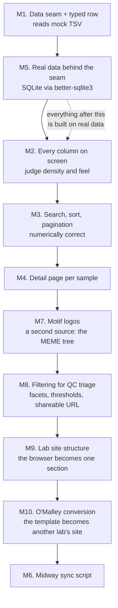

# Build Ladder

How this site gets built, in order. Read this before starting work.

**The frame widened at M9.** This was "how the data browser gets built" through M8; the
pivot to a lab website makes the browser one section of a larger site, and later rungs are
about the site. The browser's own rungs (M1–M5, M7, M8) are unchanged and still describe how
it came to be.

This project was originally sequenced with the data source **last**. The source
database was out of date, so designing against it would have meant designing
against data about to change, and the only thing available was a 109-row export
good for judging layout but not for defining a schema.

That premise expired once current data became reachable, so real data moved to
the front — see the reorder entry in the register for the reasoning and what it
cost. Milestones keep their original identities; only the order they are worked
in changed.

M7, M8 and M9 were added later, as new rungs between M4 and M6 rather than after it. Each is
a reorder under the gate below, and each is recorded in the register.

Decisions consciously postponed live in [deferred-decisions.md](deferred-decisions.md).

---

## The ladder

**M1. Data seam + typed row.** One module under `lib/data/` returns typed rows,
reading the mock export. Nothing above it references the file format or its
location. Done when the rows render on screen from behind the seam.

**M5. Real data behind the seam.** *Done.* The seam reads the database through
`better-sqlite3` with its signature unchanged, and the row type carries 37 columns
— the 34 per-sample ones, plus derived `frip`/`frip_filt`, plus the sourceless
`num_peaks_bl`, with the 18 run-scoped constants held out. `app/page.tsx` was never touched by the swap, which is the
seam paying for itself.

Two things worth knowing before the next rung. The read path fails loudly and
that is verified, but only in dev: there is no `error.tsx`, so production shows a
scrubbed message. And `frip` is now derived rather than read, so it renders at full
float precision where the export served it pre-rounded — a formatting decision M2
inherits.

The signature-preserving guarantee still has not been *demonstrated*, only
satisfied: with a throwaway page as the sole consumer, "nothing above changed"
proves little on its own. The real demonstration is M2 through M4 getting built
without ever learning that SQLite exists.

**M2. Every column on screen.** *Done.* All 37 columns render for all 109 rows
through shadcn's Table over TanStack Table. Every column shows and none are chosen,
which was the point: the judgment this rung exists to produce could not have been
predicted from the column list.

What it produced: the table was **12,715px wide, about eight screens**, and the 16
file-path columns were roughly 80% of that while carrying almost no information —
every value shares one long prefix and varies only by the sample name already in
column 1. Losing `sample` on horizontal scroll turned out to matter more than the
column count itself.

Both were acted on afterwards, once the detail page existed to receive the paths:
18 columns by default with a Columns control, a pinned `sample`, and a sticky
header. 1.4 screens instead of 8.2. See the resolved columns-to-display,
table-readability and frip-formatting entries in the register.

The compatibility risk this rung was sequenced around did not materialise: shadcn
initialized against Tailwind 4 cleanly, and the hand-rolled fallback was not needed.
Two things init got wrong are recorded in the commit — a self-referential
`--font-sans`, and `shadcn` being a genuine runtime dependency rather than a CLI.

**M3. Search, sort, pagination.** *Done.* All three work over every column, in
memory — 109 rows makes that free, and the register records what would push them
into SQL.

Correct rather than merely present, and verified in a browser: ascending
`num_peaks` runs 5, 9, 11, 12 where a lexicographic sort would have led with 101;
dates sort chronologically; and missing values sit terminal in *both* directions.

That last one was briefly wrong in a way worth remembering. TanStack negates a
column's comparator for a descending sort, so a comparator that puts absent values
last ascending puts them first descending. Every comparator unit test passed while
the table did the wrong thing, because those tests never go through the table. The
fix is to let TanStack place absent values (`sortUndefined: "last"`, applied before
direction) rather than encoding it in the comparator.

**M4. Detail page per sample.** *Done.* A page per sample at `/[sample]`,
prerendered for all 109 at build time so both halves of the app agree about when
they read the database. Columns are grouped into Identity, Sequencing, Peaks,
Not-recorded and Files, which is where the 16 file paths belong.

It exercised the record-key bet rather than settling it. `sample` works as a slug
because every value is distinct and URL-safe, and the reader's single-`output_dir`
guard is what turns a second run directory into a loud failure instead of a page
serving whichever duplicate came first. The register entry stays open.

Run parameters are still not shown anywhere: the 18 run-scoped columns were held
out of the row type at M5, and surfacing them needs both a decision about where
run-level metadata lives and a fix for the coercion gap that keeps them out.

**M7. Motif logos.** *Done.* Each sample's summits motif logo and its reverse
complement on the browse table, and full size on the detail page. A new rung,
inserted ahead of M6 — see the reorder entry in the register.

It gave the app a **second data source**: a filesystem tree at `data/meme/`
alongside the SQLite file, both behind the same seam. The seam paid off again —
`QcRun` was not touched, because a filesystem-derived object with pixel dimensions
has none of the properties the all-TEXT column spec is built on. The boundary is the
module, not the row type.

What the data turned out to be, none of which was predictable from the column list:

- **Nine of the 109 `logo1.png` files are zero bytes**, not absent. Handed to an
  `` they render as broken-image icons. Seven are HALO controls, which have no
  motif by construction; two are treatments whose search came back empty.
- **The database cannot say which nine.** `motif_peaks` is `"NA"` for twelve rows and
  three of those — `TGIF2_amp`, `TP53_LH`, `TP53_amp` — have real motifs, because it
  counts FIMO hits rather than recording whether MEME found anything. Availability
  has to come from the filesystem. There is a test for exactly those three.
- **`data/meme/` is the pipeline's own output tree**, and every one of the 109
  recorded `meme_summits_dir` values ends in `<sample>/summits`. So the local path is
  *derived* from what the database already records rather than hardcoded, and a
  pipeline reorganisation fails loudly instead of producing 109 broken images.
- **Logos are a constant 358px tall and 404–1664px wide**, because width tracks motif
  length. Constraining width would render an 8bp and a 32bp motif at different letter
  scales — so the table constrains height, which is the whole readability argument.

The browser gate earned its keep four times, on things no test could have said:
ragged rows where the motif-less cell collapsed, letters unreadable at 32px and still
cramped at 40, MEME's `bits` axis reading as clutter at row height, and — after the
axis was cropped — a one-pixel hairline left behind because the axis line is two
pixels wide, not one.

It also closed a gap M3 left open. Every comparator test passed at M3 while the live
table put blanks at the top of a descending sort, because TanStack negates the
comparator and no test went through TanStack. `@tanstack/table-core` runs headless in
Node, so `lib/table/sorting.test.ts` now exercises the real engine; removing
`sortUndefined` fails three of its five tests.

**M8. Filtering for QC triage.** *Done.* The browse table had one filter — a substring
search — which answers *"find the sample I know the name of"* and cannot answer *"which
samples are bad"*. Now five facets, thirteen boundable metrics, removable chips, and a
shareable URL.

The shape was measured before it was designed, and the measurement decided almost all of
it. Four columns have value lists short enough to pick from (sample type 2, gDNA batch 3,
experiment date 8, control sample 9); the QC metrics are effectively continuous, FRiP
having 109 distinct values across 109 rows; **three columns are null on every row** and
eighteen have a distinct value per row. So the filterable set is *declared*, because
deriving it from the column list would have shipped three dead controls and eighteen that
cannot narrow. Two tests assert those measurements against the real database rather than
trusting the list.

Three things this rung got wrong first, each caught by a different mechanism:

- **The plan's own requirements were unsatisfiable.** Absence was promised as selectable
  for every column with nulls, but two of them are numeric — a bound excludes nulls by
  design and neither has a facet. Writing the tests first surfaced it; thresholds gained
  a third state.
- **The URL approach was wrong, and measuring beat following the docs.** The plan
  committed to `useSearchParams` inside a `Suspense` boundary. The docs are right about
  the mechanism, but the bailout swallows the whole subtree — and since the hook would
  live in the table component, that meant *zero* `<table>` tags in the prerendered HTML.
  Reading `window.location.search` in an effect keeps all 313 baked entries and removes
  the build trap entirely.
- **A slice-based edit silently deleted four tests**, including all three that prove
  facet counts respect other filters. They shipped missing for one commit. Restored, and
  verified to bite by swapping the faceted row model for the core one.

Two labelling calls worth keeping: the Motif facet's absence reads **None**, not *Not
recorded*, because MEME searched those nine samples and found nothing — a result, not a
gap. And filters survive hiding their column while search does not, which is deliberate:
a filter was chosen by name and is named back in a chip, while a text match whose cause
is off screen is unattributable.

**M9. Lab site structure.** *Done.* The browser stopped being the whole site and became one
section of a lab website: five public placeholder pages under a route group, an `/insiders`
segment holding the data browser alongside protocols and inventory, and nine pages that each
name themselves. A navigable skeleton — content and styling come section by section.

The structural point is an asymmetry. `(public)` is a route group because the public pages
want shared chrome and *not* a URL prefix; `insiders` is a real segment because a path prefix
is the only thing a path-matching guard can use. A group on the protected side would have
forced protection to enumerate paths and keep that list correct forever, which is the list
that eventually ships a page unprotected.

**A layout is not a boundary**, and that correction came from research rather than from the
brainstorm that preceded it. Route handlers do not participate in layouts, so the insiders
layout never runs for the motif image route beneath it — a guard attached to the layout would
have protected 109 detail pages and served 200 research images to anyone who guessed a sample
name. The enforceable thing is the shared path prefix, and `lib/site/boundary.test.ts` holds
that by reading the tree rather than trusting the nesting.

Everything that reads research data now lives under `insiders/data/`, checked transitively.
That is what keeps "make the public site buildable without the database" achievable later —
today the whole build still needs `data/`, and the person most likely to want to edit the
About page is the person least likely to have a copy.

Three execution notes worth keeping. The back link on the detail page was a literal `/`, and
left alone would have ejected a reader from a sample page onto the public landing page — the
plan named it after an earlier draft miscounted the link sites and dropped it. `app/page.tsx`
was deleted before its browse-page implementation had been extracted, recovered from git
rather than lost. And the data section's heading regained the sentence saying how many samples
have no motif and why, the cue that went missing when the old page subtitle was removed.

**No authentication exists.** `/insiders` is a prefix and a convention; every page under it
is public today.

**M10. O'Malley conversion.** *Done.* This repo was a copy of the Zhang lab's site, and became
the O'Malley lab's: its content from the lab's previous Odoo site, its own visual identity,
and the browser left as it was for the lab's own pipeline data. Another rung inserted ahead of
M6, recorded in the register. Plan: `docs/plans/2026-11-09-1415-feat-omalley-lab-site-conversion-plan.md`.

The public pages are now Home, Research, People, Publications and Contact. News and the
featured-paper preview were removed rather than left empty, since the previous site had
neither. The identity changes are the palette (plum and lime from the lab's photographs,
tokens renamed by role), Fraunces headings, near-square buttons, a white nav, a hero that
puts text beside photographs rather than over them, and the O'Malley mark traced from a raster.

What the work turned up that the plan did not:

- **The lab is usually last author, and the author line was built for a middle author.**
  "A, B, C … O'Malley RC et al." claimed names after him on most of the list. "et al." now
  stands only for names after the last one shown, and a lab author directly after the head
  joins it instead of sitting behind an ellipsis over an empty gap.
- **Europe PMC titles carry `<i>` markup** around species and gene names, and the page was
  printing the tags. The generator strips them, at the cost of those names' italics.
- **"Zhang" is not residue.** Several real O'Malley co-authors carry the surname, so the
  residue guard matches only lab tokens (`zhuzhu`, `zhang lab`) in file contents.
- **Two members have no usable photograph**, so `photo` became nullable with a placeholder
  drawn in code, and the people page stopped keying members by photo.

The browser was not touched, and its run-specific facts (§6, the real-data tests) still
describe the Zhang run. Recalibrating them waits on an O'Malley database: see the register.

**M6. Midway sync script.** A standalone script, run outside the web app. It must
be idempotent — running it twice leaves a correct database, not duplicated rows.
Rebuild-from-scratch is fine. If the source is unreachable it must fail loudly
and leave the old data intact; the site keeps working on stale data. Until this
lands, refreshing data is a manual transfer.

---

## Gates

These apply to every milestone.

**Open it in a browser.** A milestone is done when the app has been started and
looked at — not when the code exists or type-checks. This is a data *browser*;
how it reads on screen is the product. Code that compiles but has not been
opened is not done.

**Read the Next.js docs first.** Before writing against a Next.js API, read the
relevant page under `node_modules/next/dist/docs/`. This version differs from
older releases, and the bundled docs are authoritative over recollection.

**Commit each milestone.** At least one commit per rung, so the ladder's progress
is legible in git history.

**Work in order.** Reordering is allowed, but gets recorded in the register as a
decision. A reorder done silently is indistinguishable later from an accident.

---

## Standing data rules

**All pipeline data lives under `data/`, which is gitignored wholesale.** No
research data is committed, ever. A consequence worth knowing: data exists only
on the machine that put it there, so a fresh clone or a separate worktree has
nothing until it is copied in.

**The app never writes.** Pages read; they never write to the database and never
contact Midway. Only the M6 sync script touches the source.

**All pipeline data lives under `data/`, and there are now two sources.** The SQLite
file and the MEME logo tree, both gitignored, both read only through the seam. A
clone has neither until they are copied in — and since M7 the *build* needs both,
because the images are prerendered.

**Never run schema migrations against the database.** No `migrate`, no `push`, no
generated DDL. The Snakemake pipeline owns the schema; this app only reads it. We
deliberately do not install tooling that could do this — the ORM was dropped on
2026-07-29 partly for that reason, and `CLAUDE.md` §2, §6, and §8 now all agree.
