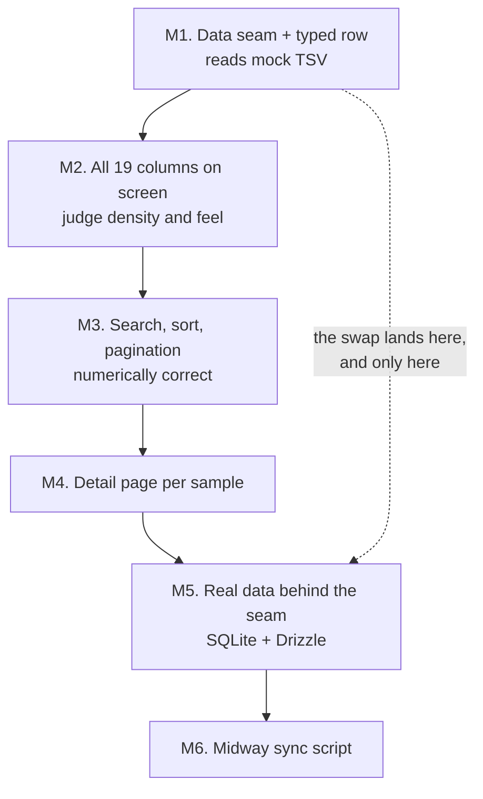
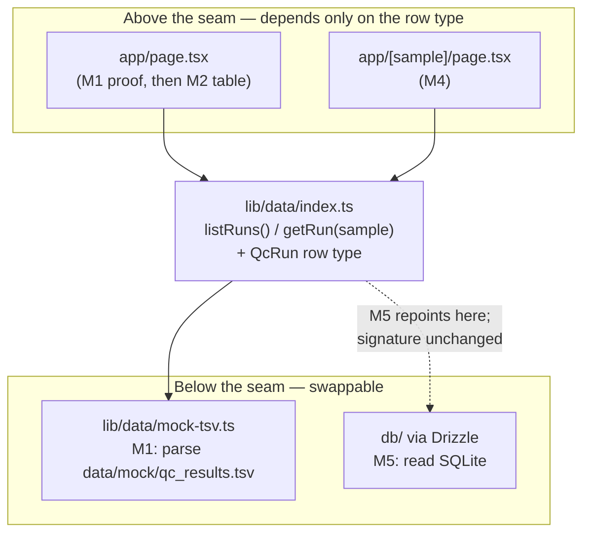
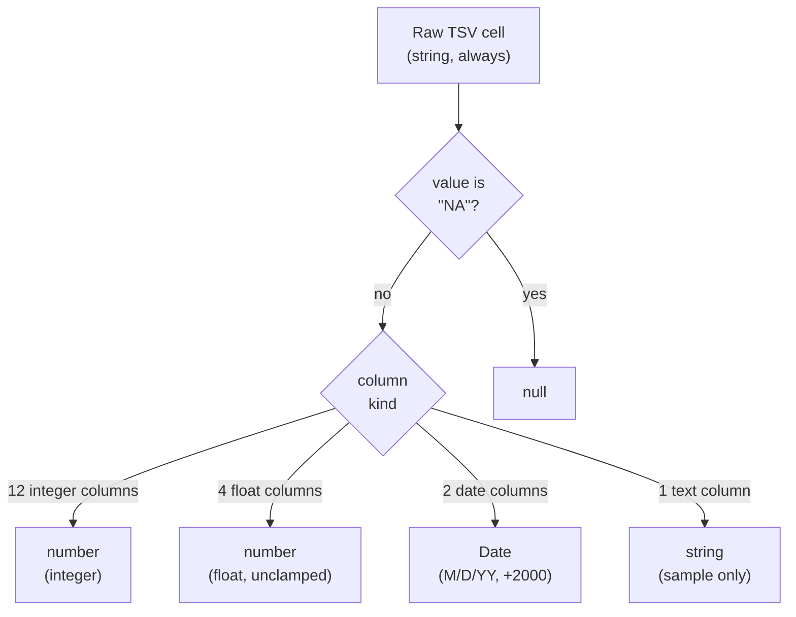

# feat: Build framework and data seam

## Summary

Establish the build framework as two durable documents — an ordered six-milestone
ladder and a register of deliberately deferred decisions — and then build the
first rung: a single data-access seam that returns typed, coerced rows from the
109-row mock export, proven by a deliberately throwaway page.

---

## Problem Frame

The repo is a bare `create-next-app` scaffold on Next.js 16.2.12. `app/` holds
the untouched starter page; `lib/`, `db/`, and `scripts/` do not exist. No data
or table dependencies are installed.

The normal build order is wrong here for two reasons the origin document
establishes: the real source database is out of date, so a schema designed
against it today would be designed against data that will change; and the only
data available is a flat 109-row tab-separated export whose purpose is narrow —
seeing how the browse table renders and feels with realistic values. So the data
source has to be the *last* thing pinned down rather than the first.

That inversion needs to be deliberate and legible, or it decays into a pile of
undocumented bets. Two artifacts make it legible: a ladder that says what comes
next, and a register that says what was consciously postponed. One seam at the
data-access boundary makes the eventual swap cheap. This plan creates all three
and stops.

---

## Requirements

Requirement IDs are the origin document's, carried verbatim so traceability back
to the brainstorm is direct.

**Framework artifacts**

- R1. The framework defines exactly six ordered milestones: the data seam, the
  full-column table, the working browse controls, the detail page, real data
  behind the seam, and the sync script.
- R8. Milestones are worked in order. Reordering is allowed, but is recorded in
  the register as a decision rather than done silently.
- R9. A milestone is done only when the app has been started, opened in a
  browser, and visually confirmed. Passing code is necessary but not sufficient.
- R10. Before writing code against a Next.js API, the relevant page under
  `node_modules/next/dist/docs/` is read first.
- R11. Each milestone produces at least one commit, so the ladder's progress is
  legible in history.

**The deferred-decision register**

- R12. The repo carries a register of consciously deferred decisions. Each entry
  names the decision, why it is deferred, and what would force it.
- R13. The register opens with at least these entries: which columns to display,
  how `frip` is formatted, how the two all-empty columns are handled, how the
  export's shape reconciles with CLAUDE.md §6, and the Midway access method.
- R14. A decision leaves the register only by being made and recorded, never by
  being forgotten.

**The data seam (M1)**

- R2. M1 establishes a single module that returns typed rows, reading from the
  mock export. Nothing above it references the file format or its location.

**Data handling**

- R15. All pipeline data lives under `data/`, which is gitignored wholesale. No
  research data is committed, ever.
- R16. `drizzle-kit migrate` and `drizzle-kit push` are never run against the
  database. The pipeline owns the schema; this app reads it. CLAUDE.md §8
  currently lists both commands and contradicts §6 on this point — §6 governs.
- R17. The app never writes to the database and never contacts Midway. Only the
  sync script touches the source.

**Defined by this plan, built later**

R3 (all 19 columns via shadcn on TanStack Table), R5 (per-`sample` detail page),
R6 (SQLite reads through Drizzle), and R7 (the idempotent Midway sync) are
milestone completion criteria that U1 writes into the ladder. This plan does not
implement them. R4 (numerically and chronologically correct ordering with a
defined `"NA"` position) belongs to M3, but U3 here makes it achievable by
resolving `"NA"` and type coercion once at the seam.

**Origin flows and acceptance examples**

Origin flow F1 (working a milestone) becomes U1's gates section; F2 (swapping
mock for real) is recorded as M5's definition in the ladder. Of the six
acceptance examples, AE2 and AE3 are enforced directly by U3's test scenarios,
AE1 is encoded as U1's visual gate, AE4 is made satisfiable by U4's verification
grep, and AE6 already holds in the current `.gitignore`. AE5 concerns the M6 sync
script and is out of scope here.

---

## Key Technical Decisions

- **The framework is two files, not one.** `docs/build-ladder.md` carries the
  ladder, the gates, and the standing data rules; `docs/deferred-decisions.md`
  carries the register. The ladder is stable reference material read before each
  milestone, while the register grows monotonically for the life of the project.
  Merging them would bury the ladder as the register accumulates, breaking the
  origin's success criterion that the framework stay short enough to actually
  read. Resolves the origin's open question about artifact location.

- **The seam returns coerced values; `"NA"` becomes `null`.** Six of the 19
  columns carry `"NA"` — `experiment_date` (8 rows), `gdna_batch` (14),
  `max_peak_score` (4), `motif_peaks` (12), and `subsampled_frags` and
  `num_peaks_rmsk` (109 each). Coercing at the seam gives sentinel handling and
  numeric typing exactly one implementation site; returning raw strings would
  duplicate coerce-and-check logic at every sort, filter, and display callsite.
  This is the same argument that justifies the seam itself. CLAUDE.md §6 says the
  real tables are also all-TEXT with `"NA"`, so the coercion layer survives the
  M5 swap unchanged. Resolves the origin's open question about where coercion
  belongs.

- **Nulls sort last in every direction.** A coerced `null` orders after all real
  values whether the sort is ascending or descending. R4 requires `"NA"` to have
  a defined and consistent position; pinning the rule now means M3 implements it
  rather than re-deciding it.

- **Dates are parsed explicitly as `M/D/YY`, not through `new Date(string)`.**
  All 196 non-`"NA"` values across `experiment_date` and `gdna_batch` match
  `M/D/YY`. Passing those to the `Date` constructor relies on
  implementation-defined two-digit-year and locale handling, which is exactly
  the kind of quiet wrongness a browse table hides. An explicit parse with a
  fixed 2000 offset is deterministic. Note that `gdna_batch` is a date column —
  its name suggests an identifier and the origin's column notes did not flag it.

- **No `cacheComponents` opt-in during the mock phase.** The `use cache`
  directive in Next.js 16.2.12 requires `cacheComponents: true`, which also makes
  Partial Prerendering the App Router default and switches client navigation to
  React `<Activity>` for state preservation. That is a whole-app rendering-model
  change bought to avoid re-parsing a 109-row file. The seam memoizes internally
  instead; because the memo sits behind the seam, M5 can revisit caching without
  touching a single caller.

- **The seam lives at `lib/data/`; `db/` stays reserved for M5.** CLAUDE.md §4
  assigns `db/` to the Drizzle client and schema, which M5 will add *behind* the
  seam. Keeping the seam at `lib/data/` preserves that role and makes the seam's
  source-agnosticism visible in its path — nothing named `db` appears anywhere
  above the boundary.

- **`sample` is the record key and URL slug, unencoded.** All 109 values are
  distinct and every one matches `[A-Za-z0-9_.-]+`, so they are URL-path-safe
  as-is with no encoding layer. This is the origin's knowingly temporary bet; the
  register entry records what would force a change.

- **M1 ships a throwaway proof page.** R9's gate is universal, and a data module
  with no rendering cannot be visually confirmed. The page is explicitly
  disposable — M2 replaces it with the shadcn data table — so it gets no styling
  effort and no test coverage.

- **Tests run on `node:test` with zero new dependencies.** Coercion is the one
  piece of M1 whose correctness is not visible on screen — a lexicographic
  `num_peaks` sort and an off-by-one month parse both render as perfectly
  plausible numbers — and the origin states two of them as acceptance examples,
  which implies something executable. Vitest is the conventional choice and was
  rejected: this machine runs Node v24.14.1, where `node:test` is stable and
  TypeScript type-stripping is on by default, so `node --test lib/data/*.test.ts`
  runs `.ts` test files with no dependency, no config file, and no loader flag.
  Verified working before this plan was finalized. That matters because the
  origin optimizes for speed and minimalism, and a test runner was the only new
  dependency this plan would otherwise have introduced.

  Two constraints come with it. Type-stripping executes types away rather than
  checking them, so type errors surface from `npm run build`, not the test run —
  which is where they already surfaced. And the `@/*` alias from `tsconfig.json`
  does not resolve under plain `node`, so test files import their subjects by
  relative path. Both are acceptable at this scope; if component or
  end-to-end testing is ever wanted, that is the point to revisit Vitest.

- **Every field except `sample` is nullable.** The row type declares `T | null`
  for all 18 non-key fields, not only the six that carry `"NA"` in today's
  export. CLAUDE.md §6 states the real tables are all-TEXT with `"NA"` as the
  missing-value sentinel, so any column can arrive missing. Typing only today's
  six as nullable would bake a property of the 109-row mock export into the
  contract that every caller above the seam then relies on, and M5 would turn
  that into a breaking type change rippling through exactly the layers the seam
  exists to protect. Uniform nullability costs a null check at display sites,
  which M2 needs anyway for the two all-`"NA"` columns.

---

## High-Level Technical Design

### The ladder



This plan delivers M1 and the two documents that define the whole ladder.
M2 through M6 are named with their completion gates but decomposed later.

### The seam boundary



Callers import the row type and the two functions. They never learn that a TSV
exists, where it lives, or that `"NA"` was ever a value — which is what makes the
M5 swap a one-module change.

### Coercion pipeline



The 19 columns partition into exactly four kinds. `frip` values above 1 pass
through unclamped — the export stores a percentage of `mapped_reads`, not a 0–1
fraction, with 26 rows exceeding 1 and a maximum of 14.25. How that gets
*formatted* stays deferred; coercion does not decide it.

---

## Output Structure

```text
docs/
  build-ladder.md          # U1 — the six milestones, the gates, standing rules
  deferred-decisions.md    # U2 — the register
lib/
  data/
    types.ts               # U3 — QcRun row type, column kind map
    coerce.ts              # U3 — "NA" → null, numeric and date parsing
    coerce.test.ts         # U3
    mock-tsv.ts            # U4 — the M1 implementation, replaced at M5
    mock-tsv.test.ts       # U4
    index.ts               # U4 — the seam's public surface
```

No test-runner config file: `node --test` needs none.

The per-unit file lists remain authoritative; the implementer may adjust this
layout if implementation reveals a better one.

---

## Implementation Units

### U1. The build ladder

**Goal:** A short durable document defining the six milestones, what makes each
one done, and the standing rules that apply to every rung.

**Requirements:** R1, R8, R9, R10, R11, R15, R16, R17. Realizes origin flow F1
(working a milestone) as the gates section, and encodes origin AE1 — code that
type-checks but has not been opened in a browser is not done. Also writes the
completion criteria for R3, R5, R6, R7 without implementing them, and states
origin flow F2 as M5's definition so the swap sequence is recorded before it is
needed.

**Dependencies:** None.

**Files:** `docs/build-ladder.md` (create)

**Approach:** Three sections. First, the ladder — the mermaid diagram from the
High-Level Technical Design plus one short paragraph per milestone naming its
completion criterion, drawn from origin R2 through R7. M2's paragraph should name
`shadcn init` plus one trivial component as that milestone's first step, per the
compatibility risk below. M5's paragraph should carry origin flow F2's step
order, since the whole point of pre-drawing the seam is that the swap sequence is
known before it is needed.

Second, the gates that apply to every milestone: visual confirmation in a browser
before done (R9), read the relevant `node_modules/next/dist/docs/` page before
writing against a Next.js API (R10), at least one commit per milestone (R11), and
worked in order unless a reordering is recorded in the register (R8).

Third, the standing data rules: everything under `data/` is gitignored wholesale
(R15), the app never writes to the database or contacts Midway (R17), and
`drizzle-kit migrate` and `push` are never run because the pipeline owns the
schema (R16).

Keep it short. The origin's own success criterion is that the framework stays
readable before working, and it explicitly counts feeling like paperwork as
failure. Prose over ceremony; no status tracking, no checkboxes — progress lives
in git history per R11.

R16 needs care: CLAUDE.md §8 lists both `drizzle-kit` commands as normal
project commands while §6 forbids them. Record that §6 governs and that §8 is
known to be stale. Do not edit CLAUDE.md — the origin puts that outside scope.

**Patterns to follow:** The origin document's register and requirement voice —
declarative, reasons stated inline. No existing docs in this repo to mirror.

**Test scenarios:** Test expectation: none — documentation artifact with no
executable behavior. Verified by review against R1 and R8 through R11.

**Verification:** A reader who has never seen the brainstorm can name the next
milestone and its completion criterion after one read. All six milestones from
R1 are present and ordered. All four gates are stated. The three standing data
rules are stated, with the §6-governs ruling explicit.

---

### U2. The deferred-decision register

**Goal:** A living register of consciously postponed decisions, seeded with
everything currently known to be deferred.

**Requirements:** R12, R13, R14.

**Dependencies:** None.

**Files:** `docs/deferred-decisions.md` (create)

**Approach:** Each entry names the decision, why it is deferred, and what would
force it — the three fields R12 requires. Seed with the five entries R13
mandates plus two more this plan surfaced:

- Which of the 19 columns to display, hide, or reformat — deferred until the
  full table has been seen on screen at M2.
- How `frip` is formatted, given it is a percentage of `mapped_reads` rather
  than a 0–1 fraction, with 26 of 109 rows above 1 and a maximum of 14.25.
- How `subsampled_frags` and `num_peaks_rmsk` are handled, both `"NA"` in all
  109 rows — render as empty, or omit from the table entirely.
- How the export's 19 columns reconcile with the two tables in CLAUDE.md §6,
  which describe roughly thirty columns plus file paths and no `output_dir` in
  the export at all — deferred to M5, when current data exists to reconcile
  against.
- The Midway access method (SFTP pull, mounted path, scheduled export) —
  deferred to M6 and still undecided.
- `sample` as the record key and detail-page slug, valid because all 109 values
  are distinct and URL-safe. Forced open again if real data breaks uniqueness,
  or if the composite `(output_dir, sample)` key from CLAUDE.md §6 turns out to
  be required.
- Whether M3's in-memory pagination and sorting survive the real dataset, whose
  size is unknown. Forced by M5 revealing a row count that does not fit
  comfortably in memory.

Satisfy R14 with a structural convention rather than a promise: resolved entries
move to a `## Resolved` section recording the decision and the date it was made.
Entries are never deleted. That way a decision cannot leave the register by
being quietly dropped, and the history of what was postponed and why stays
readable.

**Patterns to follow:** The origin document's Scope Boundaries and Dependencies
sections, which already state most of these with their reasoning.

**Test scenarios:** Test expectation: none — documentation artifact with no
executable behavior. Verified by review against R13's five mandated entries.

**Verification:** All five R13 entries present, each with all three fields
populated. The `## Resolved` convention is documented in the file itself, not
just here. No entry says only "TBD" without naming what would force it.

---

### U3. Typed row shape and coercion

**Goal:** The `QcRun` row type every layer above the seam depends on, and the
coercion that turns raw TSV strings into it — `"NA"` to `null`, numbers to
numbers, dates to dates.

**Requirements:** R2 (the typed row half). Makes R4 achievable at M3.

**Dependencies:** None.

**Files:**
- `lib/data/types.ts` (create)
- `lib/data/coerce.ts` (create)
- `lib/data/coerce.test.ts` (create)
- `package.json` (modify — add a `test` script running `node --test`)

**Approach:** `types.ts` declares `QcRun` with all 19 fields and a map from
column name to column kind. The partition is settled by profiling: `sample` is
text; `experiment_date` and `gdna_batch` are `M/D/YY` dates;
`mapping_pct`, `frip`, `frip_filt`, and `max_peak_score` are floats; the
remaining twelve are integers. All 18 non-`sample` fields are `T | null` per the
uniform-nullability decision, not just the six carrying `"NA"` today.

`coerce.ts` implements the four-kind pipeline from the High-Level Technical
Design. Two behaviors need deliberate choices rather than defaults. First, `"0"`
must coerce to `0`, not `null` — `num_peaks_filt` and `num_peaks_bl` both
contain genuine zeros, and collapsing them into the `"NA"` case would silently
misreport samples that produced no filtered peaks. Second, a value that is
neither `"NA"` nor parseable for its column kind must fail loudly rather than
becoming `null`. No such value exists in the mock export; the guard exists for
the M5 swap, where a silent `null` would look like legitimately missing data.

Export a null-last comparator alongside the coercion so M3 has one place to get
ordering from rather than inventing it per column.

**Execution note:** Write the coercion tests before the coercion. The origin
states two of them as acceptance examples, and the failure mode here is
plausible-looking wrong output rather than a crash.

**Patterns to follow:** No existing patterns in the repo. Follow the `@/*` path
alias already configured in `tsconfig.json`, and the repo's existing strict-mode
TypeScript settings.

**Test scenarios:**
- Covers AE2. Integer coercion of `"5"`, `"101"`, `"10132"` then ascending sort
  yields 5, 101, 10132 — not the lexicographic 101, 10132, 5.
- `"NA"` in an integer column yields `null`, and `"0"` in the same column
  yields `0`. The two are not conflated in either direction.
- `"5/7/25"` yields 2025-05-07 and `"12/18/25"` yields 2025-12-18 — correct
  month and day, not transposed as D/M/Y, and not off by one.
- Covers AE3. A date list mixing real dates with `"NA"` sorts with all nulls in
  one terminal position ascending, and in that same terminal position
  descending — never scattered through the ordering.
- `gdna_batch` coerces as a date on the same path as `experiment_date`, not as
  text or a number.
- Float coercion of `"14.25"` yields 14.25 unclamped, and `"88.1"` yields 88.1
  rather than truncating to 88.
- A column whose value is `"NA"` in all 109 rows coerces to `null` throughout
  without throwing, and the resulting field is still present on every row.
- A non-numeric, non-`"NA"` string in a numeric column raises an error naming
  the column and the offending value.
- An empty-string cell is treated as the defined case chosen above — not
  silently coerced to `0` or to a valid date.

**Verification:** The full test file passes. `QcRun` has exactly 19 fields.
Coercing all 109 rows of the real mock export produces no thrown errors, and
`null` appears in exactly the six columns profiling identified.

---

### U4. The seam module

**Goal:** One module the app calls to get rows, reading the mock TSV, with
nothing above it aware that a file is involved.

**Requirements:** R2, R17.

**Dependencies:** U3.

**Files:**
- `lib/data/mock-tsv.ts` (create)
- `lib/data/index.ts` (create)
- `lib/data/mock-tsv.test.ts` (create)

**Approach:** `mock-tsv.ts` reads and parses `data/mock/qc_results.tsv`, applies
U3's coercion, and memoizes the parsed result at module scope. `index.ts` is the
public surface: the `QcRun` type re-exported plus two async functions — list all
runs, and get one run by `sample`. Both are async even though the M1
implementation is synchronous, because M5's implementation will not be, and
changing the signature later would ripple into every caller and defeat the
seam's whole purpose.

The mock file path is read from one constant inside `mock-tsv.ts` and appears
nowhere else. Tab-splitting a 19-column file with no quoted fields or embedded
tabs needs no CSV dependency; the profiling confirmed the format is uniform.

Missing-file behavior matters more than it looks. If the export is absent the
seam must throw an error naming the expected path, because returning an empty
list would render as a legitimately empty table and send the reader hunting for
a data problem that is really a setup problem.

`getRun` returning `null` for an unknown sample is the right shape — M4 will map
that onto a 404, and throwing would force every caller into a try block.

**Execution note:** Read `node_modules/next/dist/docs/01-app/01-getting-started/06-fetching-data.md`
before writing this — it is the authority on database and filesystem access from
Server Components in this version, and R10 requires it.

**Patterns to follow:** The ORM-and-database example in the fetching-data doc
above, which is the shape this seam mirrors — an async function in a `lib/`
module, awaited from a Server Component.

**Test scenarios:**
- Listing runs returns exactly 109 rows.
- Every returned row has all 19 fields present, none `undefined`.
- Getting `"TGIF2_NWaug"` returns exactly that row, with `total_reads` equal to
  87395092 and `experiment_date` equal to 2025-05-07.
- Getting a sample that does not exist returns `null` rather than throwing or
  returning an empty object.
- All 109 returned `sample` values are distinct — this is the guard on the
  record-key bet, and it should fail loudly if real data ever breaks it.
- Two consecutive list calls return equal data, and the second does not re-read
  the file.
- Pointing the seam at a nonexistent path throws an error whose message contains
  the expected path, rather than returning an empty list.
- Nothing in `index.ts`'s exported surface names a file, a path, or a TSV — this
  is R2's actual content and is checked by review, not assertion.

**Verification:** The test file passes. Grepping the repo for `qc_results`,
`.tsv`, and `readFile` outside `lib/data/mock-tsv.ts` returns nothing — this
grep returning clean is what makes origin AE4 satisfiable at M5, since it is the
same check that proves no file above the seam needs modification when the
implementation is replaced. The exported surface is the row type and two
functions.

---

### U5. Throwaway proof page

**Goal:** Render all 109 rows from the seam in the browser so M1 can pass R9's
visual gate.

**Requirements:** R9 for M1.

**Dependencies:** U4.

**Files:**
- `app/page.tsx` (modify — replace the scaffold)
- `app/layout.tsx` (modify — page title and description)

**Approach:** An async Server Component that awaits the seam's list function and
renders a plain HTML table of all 19 columns. No shadcn, no TanStack, no styling
beyond whatever keeps 19 columns legible enough to read — M2 does the real
table, and effort spent here is thrown away. Deleting the `next/image` scaffold
content and the `Create Next App` metadata is part of the unit.

What this page is actually for is confirming three things by eye that no test
asserts well: that 109 rows arrive, that `null` renders as visibly absent rather
than as `0` or `NaN` or the string `"NA"`, and that dates render as dates. The
two all-`"NA"` columns should read as conspicuously empty — that visual is what
makes the register's entry about them a real decision at M2 rather than an
abstract one.

**Execution note:** Read `node_modules/next/dist/docs/01-app/01-getting-started/05-server-and-client-components.md`
before writing this, per R10. This page needs no interactivity and must stay a
Server Component — no `"use client"`.

**Patterns to follow:** The async Server Component shape in the fetching-data
doc. The existing `app/layout.tsx` already sets up fonts and the flex column
body; leave that structure alone and change only the metadata.

**Test scenarios:** Test expectation: none — throwaway surface replaced by the
shadcn data table at M2. Correctness is established by U3 and U4's tests, and
this unit's whole purpose is the R9 visual check that no test substitutes for.

**Verification:** `npm run dev` serves the page. All 109 rows and 19 columns
are on screen. `null` values are visibly blank, not `0`, `NaN`, `undefined`, or
`"NA"`. `subsampled_frags` and `num_peaks_rmsk` read as entirely empty columns.
Dates read as dates. `npm run build` succeeds and `npm run lint` is clean. The
scaffold's Next.js logo and starter copy are gone.

---

## Scope Boundaries

### Deferred to follow-up work

- Decomposing M2 through M6 into implementation units. Each earns its own
  planning pass when reached, because the origin's core argument is that
  specifying interfaces before seeing the table render means guessing at shapes
  the UI has not yet justified.
- Installing shadcn/ui and TanStack Table. M2's first task, not M1's.

### Deferred by the origin document

- Which columns to display, how `frip` is formatted, and what to do with the two
  all-`"NA"` columns — until the full table has been seen at M2.
- Reconciling the export's 19 columns with the two tables in CLAUDE.md §6 —
  deferred to M5, when current data exists to reconcile against.
- The Midway access method — deferred to M6 and still undecided.
- Full layer contracts beyond the single data seam.
- Authentication, deployment, and multi-user concerns.
- Correcting CLAUDE.md's internal inconsistencies. U1 records that §6 governs
  over §8; editing CLAUDE.md is separate work.

---

## Risks & Dependencies

- **shadcn/ui on this stack is unverified.** M2 depends on shadcn's data-table
  pattern working against Tailwind CSS 4, React 19.2, and Next.js 16.2 — a
  combination this repo has never exercised, and shadcn's setup has historically
  been sensitive to Tailwind major versions. Nothing in this plan is blocked by
  it. Mitigation: U1's ladder should name `shadcn init` plus adding one trivial
  component as M2's first step, before any table work, so an incompatibility
  presents as a five-minute setup failure rather than a debugging session
  entangled with 19 columns of new code. If it does fail, TanStack Table is
  headless and has no Tailwind coupling, so a hand-rolled table using it with
  plain Tailwind classes remains open and keeps M3's sorting work intact.

- **The mock export is an untracked local prerequisite.** `data/` is gitignored
  wholesale by design (R15), so `data/mock/qc_results.tsv` exists only on this
  machine. U4 and U5 cannot be verified anywhere the file is absent — notably in
  a fresh clone or an isolated git worktree, where `data/` will not be carried
  over. U4's loud missing-file error is what makes that present as an obvious
  setup problem instead of an empty table, but the file has to be copied in
  before those units can be checked. This is a consequence of R15, not a conflict
  with it; nothing should be committed to fix it.

- **The test setup depends on the local Node major version.** `node:test` with
  native TypeScript stripping needs Node 22.18 or newer; this machine runs
  v24.14.1. On an older Node the test files will not execute at all, which
  surfaces immediately and loudly rather than silently passing. The fallback is
  adding Vitest at that point, at the cost of the one dependency this plan
  currently avoids.

- **The `M/D/YY` parse assumes the format holds.** Every non-`"NA"` date value in
  the export is `M/D/YY` and every year is `25`. A real export using ISO dates,
  four-digit years, or spanning a century boundary breaks the fixed 2000 offset.
  U3's loud-failure guard on unparseable values is what surfaces this at M5
  rather than silently producing wrong dates.

- **The real dataset's size is unknown.** Mock data fits in memory trivially, so
  M1's memoize-everything approach and M3's in-memory sorting are free. If the
  real dataset is large, both need revisiting at M5. Registered in U2.

- **The mock export is representative of layout, not of schema.** It has 19
  columns; CLAUDE.md §6 describes two tables with roughly thirty columns plus
  every input and output file path, and no `output_dir` at all. M4's detail page
  will be thin for exactly this reason, and M5 does the reconciliation.

- **`sample` as the record key is a knowingly temporary bet.** Valid across all
  109 mock rows. CLAUDE.md §6 documents the real join key as the composite
  `(output_dir, sample)`, so the slug and possibly the seam's `getRun` signature
  may change at M5.

---

## Sources / Research

- `docs/brainstorms/2026-07-29-build-planning-framework-requirements.md` — the
  origin document. All R-IDs, the ladder diagram, and the three planning
  questions this plan resolves.
- `CLAUDE.md` §3 (read-only app, sync as a separate concern), §4 (directory
  layout, which assigns `db/` its role), §6 (the two pipeline-owned tables,
  all-TEXT columns, the `"NA"` sentinel, the numeric-sort warning), §8 (commands,
  stale on `drizzle-kit`), §9 (guardrails).
- `AGENTS.md` — this Next.js version differs from older releases; the bundled
  docs are authoritative over recollection.
- Next.js 16.2.12 bundled docs, all under
  `node_modules/next/dist/docs/01-app/`:
  `01-getting-started/06-fetching-data.md` (async Server Components, the ORM
  and database access pattern the seam mirrors),
  `01-getting-started/05-server-and-client-components.md` (why the proof page
  stays a Server Component),
  `01-getting-started/08-caching.md` and
  `03-api-reference/01-directives/use-cache.md` (`use cache` requires
  `cacheComponents: true`, which also makes Partial Prerendering the default and
  switches navigation to React `<Activity>` — the basis for skipping it),
  `01-getting-started/03-layouts-and-pages.md` (`params` and `searchParams` are
  both Promises and must be awaited — M3 and M4 will need this).
- `data/mock/qc_results.tsv` (gitignored) — profiled directly for this plan.
  109 rows, 19 columns, tab-delimited, no quoting. `sample` is 109/109 distinct
  and every value matches `[A-Za-z0-9_.-]+`. Six columns carry `"NA"`:
  `subsampled_frags` and `num_peaks_rmsk` in all 109 rows, `gdna_batch` in 14,
  `motif_peaks` in 12, `experiment_date` in 8, `max_peak_score` in 4. Both
  `experiment_date` and `gdna_batch` are `M/D/YY` dates with zero malformed
  values across 196 non-`"NA"` cells — `gdna_batch` being a date is not obvious
  from its name. All numeric columns parse cleanly aside from `"NA"`.
  `num_peaks_filt` and `num_peaks_bl` contain genuine `0` values distinct from
  `"NA"`. `frip` exceeds 1 in 26 rows with a maximum of 14.25. The peak funnel
  `num_peaks` ≥ `num_peaks_filt` ≥ `num_peaks_bl` holds with zero violations.
  Ten rows are `HALO_*` negative controls.
- Local toolchain, probed directly: Node v24.14.1, where `node:test` is stable
  and TypeScript type-stripping is on by default. A throwaway probe confirmed
  `node --test <file>.ts` executes a TypeScript test file with no dependency, no
  config, and no loader flag — the basis for skipping Vitest. The `@/*`
  `tsconfig.json` alias does not resolve under plain `node`, so test files use
  relative imports.
- `.gitignore` lines 47–56 — already ignores `/data/` wholesale with `*.db` and
  `*.sqlite` backstops. R15 and origin AE6 are satisfied by the current state;
  `git check-ignore` confirms the mock export is ignored. U1 records the rule; no
  code change is needed.
