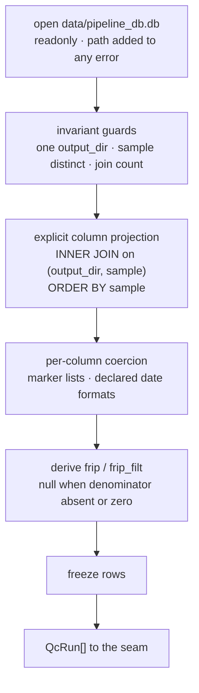
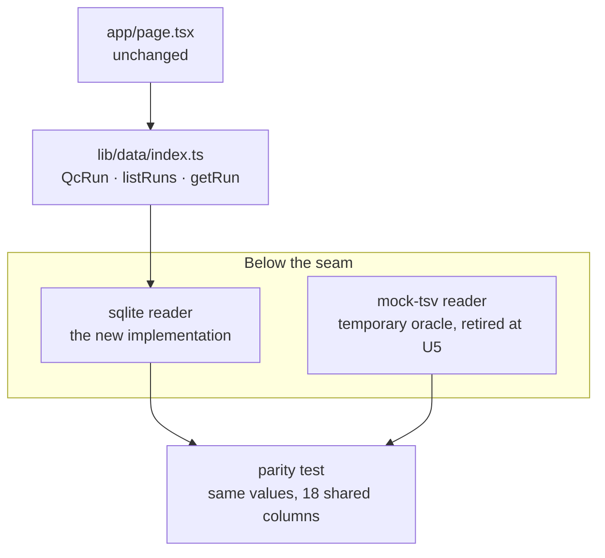

# feat: Real data behind the seam

## Summary

Replace the seam's mock-TSV implementation with reads from the real SQLite
database, keeping `listRuns()` and `getRun()` unchanged. The coercion rules change
first and are proven against both sources; the source swaps second at today's
column parity, with the mock kept briefly as a value oracle; the row type grows
last, and the oracle retires with it. Along the way, the invariants that currently
hold by luck get guards that fail loudly.

---

## Problem Frame

M1 built a data seam whose whole purpose was to make this change cheap: one module
knows a file exists, and everything above it depends only on the `QcRun` row type
and two functions. The database is now on disk at `data/pipeline_db.db` and has
been inspected column by column, so the reconciliation the framework deliberately
deferred can happen.

What inspection found is that the swap is not mechanical. The mock export was
derived from this database but is not a faithful projection of it, and the two
disagree in ways that matter:

- Four of the mock's 19 columns have no direct database source. Two are computed,
  one is conditional on a pipeline flag, one does not exist at all.
- The two sources use **different missing-value markers for the same absent cells**
  — the mock writes `"NA"` where the database writes `""`, for the same 8
  `experiment_date` rows and 14 `gdna_batch` rows.
- Two of the 19 live only in the second table, so the browse query must join
  rather than select.
- Two date formats coexist where the parser accepts one.

And several facts the app currently relies on — `sample` uniqueness, a clean 1:1
join, exactly one run directory — are properties of this one file rather than
guarantees, with nothing in place to notice when they stop holding.

The failure mode throughout is not a crash. It is a plausible wrong number: a
`SELECT *` that silently keeps the last of seven collided columns, a derived metric
that keeps rendering after its definition moves upstream, a sort that looks ordered.
The existing code already takes the position that a silent `null` is worse than a
thrown error. This milestone extends that position to the database.

---

## Requirements

Requirement IDs are the origin document's, carried verbatim.

**The swap**

- R6. M5 replaces the seam's implementation with SQLite reads, reconciling the real
  schema at that point and not before. Origin wording specifies Drizzle; the ORM
  was dropped on 2026-07-29 with the reasoning recorded in the register, so the
  requirement's intent is preserved and its named tool is not.
- R2. A single module returns typed rows. Nothing above it references the file
  format, its location, a table name, a SQL query, or a missing-value marker.
- R17. The app never writes to the database and never contacts Midway.
- R16. No schema migrations, ever. The pipeline owns the schema.

**Data handling**

- R15. All pipeline data lives under `data/`, gitignored wholesale. No research
  data is committed, and no database file of any kind is committed — the test
  fixture is fabricated and written to the OS temp directory, so the existing
  ignore rules need no exception.
- R4. Numeric columns sort numerically, dates chronologically, and missing values
  hold one defined position in every ordering. M3 implements this; this milestone
  must not regress the coercion and comparator that make it achievable.

**Gates**

- R9. Done only when the app has been started, opened in a browser, and visually
  confirmed.
- R10. Read the relevant page under `node_modules/next/dist/docs/` before writing
  against a Next.js API.
- R11. At least one commit per milestone.

**Origin flows and acceptance examples**

Origin flow F2 (swapping mock data for real data) is the spine of this plan and its
step order is preserved: reconcile the schema, resolve the register's schema entry,
reimplement the seam leaving its signature intact, confirm the page still renders.
Origin AE4 — no file above the seam required modification — is verified by U4's
grep check. AE2 and AE3 (numeric and missing-value ordering) are existing coverage
this plan must keep passing. AE5 concerns the M6 sync script and is out of scope.

---

## Key Technical Decisions

### Data access

- **`better-sqlite3` directly, no ORM.** Decided before planning and recorded in
  the register: every data column is `TEXT`, so an ORM infers `string | null`
  throughout and adds no type information, while `drizzle-kit pull` would write a
  migration journal into a repo whose worst failure mode is exactly that. See
  `CLAUDE.md` §2.

- **`node:sqlite` considered and rejected.** Node 24 ships SQLite built in and it
  reads this database read-only with zero dependencies — genuinely attractive given
  the project's minimalism. Rejected because it still emits an
  `ExperimentalWarning` on every run and its API may change before Node 26.
  Recording it here so that a future reader hitting a native-build failure does not
  have to rediscover the option.

- **`readonly: true` is what prevents file creation; `fileMustExist: true` is
  defense in depth.** The driver computes its open flags as
  `readonly ? SQLITE_OPEN_READONLY : must_exist ? SQLITE_OPEN_READWRITE : (READWRITE | CREATE)`,
  so `readonly` short-circuits and `fileMustExist` is never consulted while it is
  set. Under `readonly` a missing path fails with `SQLITE_CANTOPEN` and no file is
  created. Both flags still get set — `fileMustExist` becomes load-bearing the
  moment anyone drops `readonly` — but the reason to care is not a zero-byte file:
  it is that the driver's error text carries **no path**, so the wrapper must add
  it or the failure is unactionable.

- **Open per call; do not memo rows for the process lifetime.** The current
  implementation caches the parsed array forever, which is right for a file that
  never changes during a run and wrong for a database that a sync will replace. A
  long-lived handle whose file is swapped by `rename` keeps serving the deleted
  inode indefinitely with no error — `PRAGMA data_version` does not fire, because it
  only reports changes to the file the connection still holds. Opening a 300 KB
  read-only database is inexpensive, so the simple thing is also the correct thing.
  Two honest limits: the freshness benefit is only realised under `next dev`, since
  production currently prerenders; and this changes observable behavior, because an
  existing test asserts reference identity across two `listRuns()` calls and that
  assertion becomes wrong rather than merely stale.

- **Enumerate every selected column explicitly; never `SELECT p.*, m.*`.** The two
  tables share seven column names (`id`, `output_dir`, `sample`, `run_date`,
  `genome_ref`, `r1`, `r2`). A star-join selects 60 columns and returns 53 keys —
  last one wins, silently. It is harmless today only because all six shared data
  columns happen to agree on every row, which no index, foreign key, or constraint
  enforces. The tables are written by separate pipeline steps, so divergence is a
  question of when.

- **`INNER JOIN` plus a count reconciliation that branches on direction.** The
  browse query must join: `experiment_date` and `gdna_batch` are already-rendered
  columns that live only in `run_metadata`, so this is a hot-path join and not a
  detail-page concern. An inner join silently yields 108 rows where an orphan
  exists, and a left join yields nulls indistinguishable from genuine missing
  values. So the join is inner and the joined count is compared against the
  `pipeline_runs` count — but a mismatch has two causes and the message must not
  assume one. Fewer joined rows means unmatched `pipeline_runs` samples; more means
  duplicated `(output_dir, sample)` pairs in `run_metadata`. Naming "orphans" in the
  duplicate case would point the reader at the wrong problem with an empty list.

- **Explicit `ORDER BY sample`, and a fixture that can prove it.** SQL without an
  `ORDER BY` guarantees no order at all, and the seam's doc comment currently
  promises "source order" — a phrase that stops meaning anything in a relational
  table. Note the trap: insertion order in this database *already equals*
  `ORDER BY sample` exactly, so a test comparing returned order against sorted
  order cannot tell a query that has the clause from one that lost it. That is
  precisely why the clause gets pinned rather than relied on, and why U2's fixture
  must insert rows in an order that differs from sorted, so the assertion actually
  fails when the clause goes missing.

### Coercion and the row shape

- **Missing markers are declared per column as a list, and the list is the union
  across both sources.** This is not speculative headroom — it is required on day
  one. The database writes `""` for `experiment_date` (8 rows) and `gdna_batch`
  (14 rows); the mock writes `"NA"` for the same rows. Both readers share one
  column spec, so those two columns declare `["NA", ""]` or one reader throws.
  Within the database alone no column uses both markers, and that is the fact that
  makes the union safe rather than lossy. Everything else declares the single
  marker its source uses. This follows the Frictionless Table Schema convention of
  a per-field `missingValues` array, which exists for exactly this problem in
  exactly this domain.

- **Date formats are declared per column, not sniffed.** `experiment_date` and
  `gdna_batch` are `M/D/YY`; `run_date` is an ISO 8601 datetime. Sniffing converts
  a known fact into a runtime guess whose failure mode is a silently wrong date.
  Critically, this *narrows* the existing guards rather than loosening them: the
  current parser rejects ISO input, and after this change `experiment_date` still
  rejects ISO. The two existing tests that assert rejection are therefore edited to
  be column-specific, not deleted. `run_date` is run-scoped and so does not enter
  the row type — its format declaration lives with the run-level columns and is
  exercised only when something surfaces them.

- **`frip` and `frip_filt` are derived, with a defined degenerate case.** Both use
  `mapped_reads` as the denominator — confirmed on all 109 rows; the filtered
  variant does *not* use a filtered denominator, which is the natural misreading.
  When `mapped_reads` is absent or zero the result is `null`, not `NaN`: the
  existing cell formatter renders `NaN` as the literal string "NaN", which is
  precisely the silent-garbage outcome this codebase rejects. The derivation
  reproduces the export **to two decimals, not exactly** — the worst row diverges
  by 0.005 — so every comparison against mock values must round. The formula
  carries a comment pointing at the register's upstream entry, because it is a
  stopgap for a pipeline logging gap.

- **`num_peaks_bl` stays in the row type; only `num_peaks_rmsk` is removed.** These
  look alike and are not. `num_peaks_rmsk` exists in neither table and is `"NA"` in
  all 109 mock rows, so removing it costs nothing. `num_peaks_bl` carries 84
  distinct real values in the mock and is absent from the database only because the
  blacklist was disabled for this run — a per-run setting. Removing it would make
  the column churn in and out of the row type on every toggle, each toggle a
  breaking type change in the direction this plan identifies as breaking. So it
  stays, declared with a missing marker, and the SQLite reader returns it as `null`
  until a run populates it. The register's all-empty-columns entry already frames
  this class of column as varying per run.

- **Coercion rejects non-string input loudly.** No column in either table is
  declared `NOT NULL`, so a real SQL `NULL` is one pipeline change away. The
  coercion signature says `string`, and a `null` reaching the text branch would
  pass the marker checks and return `null` while the type claims `string` — the
  exact class of lie the layer exists to prevent. The TSV could not represent NULL;
  SQLite can.

- **The row type carries the per-sample columns; run-scoped ones stay out.** The
  criterion is semantic, not mechanical, and getting this wrong drops a column that
  must survive. Twenty data columns hold one identical value across every row, but
  only **18** are genuinely run-scoped — the 15 pipeline parameters plus `author`,
  `gene_annotation`, and `report_csv`. The other two, `alignment_rate` and
  `subsampled_frags`, are constant only because the features that populate them were
  switched off; they are per-sample columns that stay in the row type, and
  `subsampled_frags` is already in it. Applying "one distinct value" as the literal
  test would silently drop it. Excluding the run-scoped 18 also postpones a parsing
  gap rather than solving it: `fimo_thresh` is `1.0e-05` and
  `macs3_foldch_levels` is `[2, 5, 15]`, neither of which the current numeric
  regexes accept.

- **Do not encode "blank `control` implies a control sample."** Ten rows have a
  blank `control`; nine have `is_treatment = '0'`. `HALOb_b2` is HALO-named, is a
  treatment sample, and has no control recorded — confirmed intentional. Encoding
  the biconditional as a validated invariant would throw on a legitimate row.
  `is_treatment` is the authoritative signal.

### Verification

- **A fabricated fixture database, built from a committed schema snapshot.** The
  real database is invisible to CI and absent on a clone, so without a fixture the
  new reader has no automated coverage at all. The fixture is a temporary **file**,
  not in-memory: the driver rejects `readonly` on `:memory:`, and a second
  connection to `:memory:` sees none of the first's tables — so a reader that opens
  a path read-only can never observe an in-memory fixture. It is written under the
  OS temp directory, which keeps it outside the repo entirely and leaves the
  `*.db` ignore rules untouched.

  The snapshot must be generated from `sqlite_master` filtered to exclude
  `sqlite_%`, **not** from `.schema` — because both tables use `AUTOINCREMENT`, the
  live database contains `sqlite_sequence`, and `.schema` emits a
  `CREATE TABLE sqlite_sequence` line that SQLite refuses to replay as a reserved
  name.

- **Machine-local tests skip visibly.** Tests needing the real database use an
  explicit skip when it is absent rather than passing silently. A test that quietly
  passes because its fixture vanished is the failure this is guarding against. This
  is one annotation per test, not a restructuring of the suite.

- **The mock reader is a temporary value oracle, and retires at U5.** Keeping it
  through the swap lets one test assert the SQLite reader reproduces known-good
  values for every sample — a value-level regression check on the reconciliation,
  which is the only independent check available. Be precise about what it does not
  prove: the test imports both readers directly, so it establishes value parity
  between two below-the-seam modules, not that consumers above the seam are
  insulated. It does **not** recover what the ladder reorder cost; that
  demonstration still waits for M2 through M4 being built without learning SQLite
  exists, exactly as the register records. Once the row type grows past what the
  mock can express, the oracle has done its job and is deleted rather than
  maintained.

- **Guard the three invariants that currently hold by accident.** Single queries,
  run at read time: exactly one distinct `output_dir`; `sample` distinct within
  `pipeline_runs`; and the join count reconciliation above. The third does not
  imply the second — a duplicated `(output_dir, sample)` in one table alone passes
  a count check while making `getRun` return an arbitrary one of two records, which
  is the silent corruption the guards exist to prevent. The first is the specific
  event the register says to watch for, and after M2 through M4 build a table and
  routing on `sample`, its arrival would corrupt silently instead of announcing
  itself.

---

## High-Level Technical Design

### The read path



Coercion stays where it already is and keeps its current contract — it is the
column spec that grows, not the boundary. The derivation step is new and exists
only because the pipeline does not log these two metrics.

### The seam during this milestone



The oracle is deliberately not a fallback. If the database is unavailable the seam
fails; it does not quietly serve mock data, which would be the worst possible
outcome for a data browser. Note that the parity test sits beside both readers
rather than above the seam — it compares values, and claims nothing about consumer
insulation.

### Database state to behavior

Every row was verified empirically against this database.

**These are build-time behaviors today.** The page prerenders statically, so in a
production build these throws happen during `next build` and are unreachable at
request time. They become request-time behaviors only when the register's entry on
picking up new data after a sync is resolved. That same deferral owns the dominant
production staleness path: a rename after build leaves baked HTML serving old rows
with no error, which the per-call-open decision does not address.

| State | Driver default under `readonly` | Required behavior |
|---|---|---|
| File absent | `SQLITE_CANTOPEN`, no file created, **no path in the message** | Throw with the path and the gitignore consequence |
| Zero-byte file from a prior mistake | Opens, then `no such table` | Throw with the path |
| Not a database | Opens, first query throws `file is not a database` | Throw with the path |
| Truncated or corrupt | Opens, first query throws `disk image is malformed` | Throw with the path |
| Table or column renamed upstream | `no such table` / `no such column` | Throw; the message already names the missing object |
| Replaced by `rename` under a live handle | Serves stale rows forever, no error | Not reachable — the connection does not outlive the call |
| Being rewritten in place | `database is locked` (`journal_mode=delete`, no reader concurrency) | Throw; retrying is the caller's business, not the seam's |
| Second `output_dir` present | `sample` silently ambiguous | Throw, pointing at the register entry |
| Duplicate `sample` in one table | `getRun` returns an arbitrary one of two | Throw, naming the duplicates |
| Join orphan present | Silently 108 rows | Throw, naming the unmatched samples |

---

## Output Structure

```text
db/
  schema.sql             # U2 — DDL snapshot from sqlite_master, zero rows
  fixture.ts             # U2 — builds a temp-file database from it
  fixture.test.ts        # U2 — proves the snapshot replays and the fixture is usable
lib/
  data/
    types.ts             # U1, U5 — column spec: marker lists, declared formats
    coerce.ts            # U1 — column-aware coercion
    coerce.test.ts       # U1 — existing assertions narrowed per column
    sqlite.ts            # U3 — the new implementation
    sqlite.test.ts       # U3 — against the fixture
    seam.test.ts         # U4 — parity, then seam-level behavior
    index.ts             # U4 — repointed; signature unchanged
    mock-tsv.ts          # deleted at U5
```

`db/` was previously reserved for a Drizzle client that will now never exist. It is
repurposed for artifacts *about* the database that this repo does own — the schema
snapshot and the fixture builder — keeping them out of `lib/data/`, which is the
app's access layer. The per-unit file lists remain authoritative.

---

## Implementation Units

### U1. Column-aware coercion

**Goal:** Resolve both blocking register decisions in code — per-column marker
lists and per-column date formats — proven against the mock export before any
database code exists.

**Requirements:** R4 (keeps the ordering guarantees intact). Resolves the register
entries "What counts as a missing value" and "Which date format a column uses."

**Dependencies:** None.

**Files:**
- `lib/data/types.ts` (modify — column spec gains per-column `missing` list and date `format`)
- `lib/data/coerce.ts` (modify — coercion becomes column-aware)
- `lib/data/coerce.test.ts` (modify)

**Approach:** The column spec stops being a bare name-to-kind map and becomes a
per-column descriptor carrying the kind, the list of strings that mean absent, and
for date columns the expected format. `QcRun` continues to derive from that spec,
so the derivation stays the single source of truth.

Declare `["NA", ""]` for `experiment_date` and `gdna_batch`. This is the reason the
marker is a list rather than a value: the mock and the database disagree on the
marker for exactly these two columns, and one shared spec has to satisfy both
readers until the oracle retires. Every other column declares the single marker its
source uses.

Coercion consults the descriptor rather than a module-level sentinel constant.
Three outcomes replace today's two: a declared marker yields `null`, a parseable
value yields the value, and anything else throws. That third case should now be
genuinely rare, which is what makes throwing informative rather than obstructive.

Two existing tests assert that empty strings throw and that ISO dates are rejected.
Both were deliberate guards with recorded reasoning, and this unit overturns them
only partially — the distinction matters. After this change a column whose declared
markers are `["NA"]` still throws on `""`, and `experiment_date` still rejects ISO
input. The guards narrow to per-column; they do not loosen. Edit those tests to be
column-specific rather than deleting them.

Also add a guard for non-string input. It is dead code against the TSV and
necessary against SQLite.

**Execution note:** Land this against the mock export with the existing suite
green, before any SQLite code exists. Doing the coercion change and the source swap
together produces the worst intermediate state available here — a reader that
throws on 141 empty cells and 109 ISO timestamps with no way to tell whether the
query or the coercion is at fault. Note that the mock alone cannot exercise the
empty-string half of the change: every sentinel in the TSV is `"NA"`. Only the U2
fixture covers that direction.

**Patterns to follow:** The existing spec-derives-the-type mechanism in
`lib/data/types.ts`, and `coerce.ts`'s error style — name the column and the
offending value, never substitute a plausible default.

**Test scenarios:**
- A column declaring `["NA"]` yields `null` for `"NA"` and still throws for `""`;
  a column declaring `[""]` does the inverse; a column declaring both accepts both.
- `"0"` still coerces to `0` for a numeric column, distinct from any marker.
- Covers AE2. Integer coercion of `"5"`, `"101"`, `"10132"` still sorts to
  5, 101, 10132.
- Covers AE3. A date list mixing values with markers still sorts nulls into one
  terminal position in both directions.
- `experiment_date` accepts `"5/7/25"` and **throws** on `"2026-07-29T12:53:34"`.
- A column declared ISO accepts `"2026-07-29T12:53:34"` and **throws** on `"5/7/25"`.
- A date that parses but is not a real calendar date (`"13/40/25"`, `"2/31/25"`)
  still throws rather than rolling forward.
- `null` and `undefined` passed as a cell value throw, naming the column — they do
  not return `null`.
- A value that is neither a declared marker nor parseable throws, naming the column
  and the value.
- Coercing all 109 mock rows produces no errors and the same null distribution as
  before this change.

**Verification:** The full suite passes against the mock export with no behavioral
change visible to the seam. `QcRun` still derives from the spec. Every date column
accepts exactly one format and rejects the other.

---

### U2. Fixture foundation

**Goal:** Make the new reader testable without the real database, so its claims
mean something on a clone.

**Requirements:** R15 (satisfied without changing any ignore rule).

**Dependencies:** None.

**Files:**
- `db/schema.sql` (create — DDL only, zero rows)
- `db/fixture.ts` (create — builds a temp-file database and inserts fabricated rows)
- `db/fixture.test.ts` (create)
- `package.json` (modify — add `better-sqlite3` and `@types/better-sqlite3`; extend
  the test glob to cover `db/*.test.ts`)

**Approach:** The dependency lands here rather than in U3, because the fixture
builder needs a driver to open a database and U3 depends on this unit. The test
script currently globs `lib/data/*.test.ts` only, so a test under `db/` would
silently never run — extend the glob in the same change.

Generate the snapshot from `SELECT sql FROM sqlite_master WHERE type='table' AND
name NOT LIKE 'sqlite_%'`. Do not use `.schema`: `AUTOINCREMENT` means the live
database carries `sqlite_sequence`, and replaying its `CREATE TABLE` fails on a
reserved name. The snapshot is structure only. It leaks nothing beyond what
`CLAUDE.md` §6 already publishes in prose, and it does double duty — the fixture
reads it, so a pipeline column addition means refreshing one file rather than
editing fixture code.

The fixture writes a temporary file under the OS temp directory and returns its
path. A file rather than `:memory:` is forced by the reader's shape: the driver
rejects `readonly` on in-memory databases, and separate connections to `:memory:`
do not share tables, so a path-opening read-only reader could never see it.
Nothing lands inside the repo, so the `*.db` ignore rules stay exactly as they are
— and if a future change finds itself wanting to commit a `.db`, that is a signal
to stop rather than to add an exception.

Insert a handful of fabricated rows — invented sample names, invented paths. Their
value is that the awkward cases are present *deliberately* rather than by luck:
both markers, both date formats, a blank-`control` treatment row, a genuine `0`
distinct from a marker, a row pair exercising the join, and — specifically — rows
inserted in an order that differs from sorted-by-`sample`, so U3's ordering
assertion can actually fail when the `ORDER BY` goes missing.

**Patterns to follow:** The existing tests' style — flat `node:test` calls,
declarative sentence names, assertions that state the invariant. Resolve
`db/schema.sql` relative to the module rather than the working directory, since
these helpers are imported from tests in another folder.

**Test scenarios:**
- The committed snapshot replays into a fresh database without error — the
  regression guard against a `sqlite_sequence` line creeping back in.
- The fixture reports the same table and column names the snapshot declares,
  excluding `sqlite_%` internals.
- A fixture row round-trips through coercion: both markers become `null`, both date
  formats parse, the genuine `0` stays `0`.
- The fixture contains at least one blank-`control` treatment row, so code assuming
  the biconditional fails here rather than in production.
- The fixture's insertion order differs from sorted-by-`sample`.
- Two fixtures are independent — inserting into one does not affect the other.
- The tree-wide backstop still ignores a `.db` placed anywhere, and no file matching
  `*.db` or `*.sqlite` is tracked.

**Verification:** The fixture-backed tests pass with `data/` renamed away entirely.
`npm test` executes them (the glob covers `db/`). No `.db` file is tracked, and the
snapshot matches the live database's structure.

---

### U3. The SQLite reader

**Goal:** A module that reads the database and returns rows in today's shape, with
connection flags, projection, join policy, ordering, and invariant guards explicit.

**Requirements:** R6, R16, R17.

**Dependencies:** U1, U2.

**Files:**
- `lib/data/sqlite.ts` (create)
- `lib/data/sqlite.test.ts` (create)

**Approach:** A private constant holds the database path, mirroring how the mock
module confines that knowledge — and, like the mock module, the unit also exports a
loader that takes an explicit path so tests can point it at the fixture. Without
that seam the fixture is unreachable.

The connection opens `readonly`, and every failure to open is wrapped in an error
naming the path and the fact that `data/` is gitignored. The wrapping is not
decoration: the driver's own `SQLITE_CANTOPEN` message contains no path.

The query enumerates every column explicitly with aliases. This is more verbose
than a star-join and that verbosity is the point — seven column names collide
across the two tables and a star-join drops the collisions silently. `ORDER BY
sample` is explicit.

Three guards run before rows are returned: one distinct `output_dir`; `sample`
distinct within `pipeline_runs`; and joined count against `pipeline_runs` count,
with the message branching on which direction the mismatch runs. All three are
single queries against 109 rows.

Rows come back in today's 19-column shape, with `frip` and `frip_filt` derived,
`num_peaks_bl` returned as `null` (no source this run), and `num_peaks_rmsk` still
present until U5 removes it. Parity with the mock is what makes the swap in U4
verifiable on its own.

No connection is held across calls. See the decision above.

**Execution note:** Read `node_modules/next/dist/docs/01-app/01-getting-started/06-fetching-data.md`
and `03-api-reference/04-functions/connection.md` before writing this, per R10. The
second matters specifically: synchronous database drivers complete during
prerendering, and `connection()` is the documented way to exclude a query from it.
That interacts with the register's open question about picking up data after a sync.

**Patterns to follow:** `lib/data/mock-tsv.ts` for the shape of a below-the-seam
module — a private path constant, an explicit-path loader beside it, a loud
missing-source error carrying `cause`, and frozen output. The ORM-and-database
example in the fetching-data doc for the async server-side read.

**Test scenarios:**

*Happy path, against the fixture*
- Returns one row per fixture sample, each with all declared fields present.
- A known fixture row's numeric, date, and text values match what was inserted.
- Rows come back sorted by `sample` even though the fixture inserted them in a
  different order — the assertion that fails if `ORDER BY` is dropped.
- Derived `frip` equals `reads_in_peaks / mapped_reads × 100` for a row with known
  inputs.
- `num_peaks_bl` is `null` for every row.

*Error and failure paths*
- A nonexistent path throws an error **containing that path**, and no file is
  created — assert the path still does not exist afterward.
- A zero-byte file throws rather than returning an empty list.
- A non-database file (arbitrary text) throws.
- A fixture with two distinct `output_dir` values throws, pointing at the
  record-key decision.
- A fixture with a duplicated `sample` in `pipeline_runs` throws, naming it — and
  this fixture keeps one `output_dir` and a matching join count, so it passes the
  other two guards and only the uniqueness guard catches it.
- A fixture with a `pipeline_runs` row lacking a `run_metadata` match throws,
  naming that sample as unmatched.
- A fixture with a duplicated `(output_dir, sample)` in `run_metadata` throws with a
  message describing duplication, not orphans.
- A row with a real SQL `NULL` in a text column throws rather than returning `null`
  typed as `string`.
- A row whose `mapped_reads` is `0` or a marker yields `null` for `frip` — not
  `NaN`, not `Infinity`.

*Integration*
- Each of the seven collided column names carries the value from the intended
  table, verified with a fixture where the two tables deliberately disagree on
  `run_date`.
- A write attempt through the open handle fails, proving `readonly` is in force
  rather than merely intended.

*Machine-local, visibly skipped when the database is absent*
- The real database returns exactly 109 rows with no coercion errors.
- Nulls land in exactly seven columns — the six inspection found plus
  `num_peaks_bl`, which has no source this run.

**Verification:** Fixture-backed tests pass with `data/` renamed away. Machine-local
tests pass with it present and skip visibly without it. A write through the handle
fails. No zero-byte file is ever left behind.

---

### U4. Swap the seam

**Goal:** Point the seam at the SQLite reader, with a parity test proving it
reproduces known-good values and a grep proving nothing above the seam changed.

**Requirements:** R2, R6. Verifies origin AE4.

**Dependencies:** U3.

**Files:**
- `lib/data/index.ts` (modify — repoint; signature unchanged)
- `lib/data/seam.test.ts` (create)
- `lib/data/mock-tsv.test.ts` (modify — the memo assertion no longer holds)

**Approach:** `index.ts` swaps which module it calls. `listRuns` and `getRun` keep
their signatures exactly; the only edits to their bodies are dropping the row memo,
and the only edit to their docs is replacing "in source order" with the ordering the
query now guarantees.

The parity test is the unit's real content: for every sample the mock carries, both
readers must produce equal values, with derived floats compared at two decimals.
Two columns are excluded and the test should say why in its name or a comment —
`num_peaks_bl`, where the mock has real values the database cannot source, and the
derived pair, which is compared rounded. Everything else compares exactly.

What this proves is that the reconciliation reproduces known-good values. It does
not prove consumers are insulated — the test imports both readers directly, below
the seam. Do not describe it as recovering the ladder reorder's cost; that
demonstration still belongs to M2 through M4.

One existing test asserts reference identity across two `listRuns()` calls, which
was true of the memo and is now false by design. It becomes an assertion that two
calls return *equal* data, with a comment recording that identity was deliberately
given up to avoid serving a stale file after a sync.

**Patterns to follow:** The existing seam-level tests in
`lib/data/mock-tsv.test.ts` for how to exercise `listRuns`/`getRun` without
reaching below the boundary.

**Test scenarios:**
- For every sample in the mock, both readers agree on the 16 directly-sourced
  columns exactly, and on `frip`/`frip_filt` rounded to two decimals.
- Both readers return the same sample set, and the same count.
- `num_peaks_bl` is excluded from comparison, with the reason stated — the SQLite
  reader returns `null` where the mock has a value.
- `getRun` on a known sample returns a row equal to the one `listRuns` contains.
- `getRun` on an unknown sample still returns `null`, not a throw.
- Two `listRuns()` calls return equal data; the test asserts equality, not identity.
- Rows are frozen, so a caller cannot mutate what the seam returns.
- Grepping above the seam finds no file path, table name, SQL fragment, marker
  literal, or `better-sqlite3` import — this is AE4, checked by review.

**Verification:** The full suite passes. The browse page renders from the database
with no change to `app/page.tsx`. The grep above the seam comes back clean.

---

### U5. Grow the row type and retire the oracle

**Goal:** Extend `QcRun` to the per-sample columns the database carries, remove the
one column that has no source anywhere, and delete the mock reader now that it has
served its purpose.

**Requirements:** R6 (completes the reconciliation).

**Dependencies:** U4.

**Files:**
- `lib/data/types.ts` (modify — the column spec grows to 37 fields)
- `lib/data/sqlite.ts` (modify — projection grows to match)
- `lib/data/sqlite.test.ts` (modify)
- `lib/data/seam.test.ts` (modify — parity comparison removed, seam behavior kept)
- `lib/data/mock-tsv.ts` (delete)
- `lib/data/mock-tsv.test.ts` (delete)
- `package.json` (modify — add a `typecheck` script)

**Approach:** Add the 34 per-sample columns with their kinds, markers, and formats;
the row type follows automatically. With derived `frip` and `frip_filt` and retained
`num_peaks_bl`, `QcRun` lands at **37 fields**. Remove `num_peaks_rmsk`, the only
column with no source anywhere. Fourteen of the newly added columns are file paths
from `run_metadata`; they are Midway absolutes, displayable but not linkable.

Deleting the mock reader is what makes this unit tractable. The spec is shared, and
the mock's `parseRuns` validates its header against the spec in both directions
while `coerceRow` iterates every spec column — so a spec of 37 columns and a
19-column TSV cannot coexist. Retiring the oracle here rather than teaching it a
second column list is both simpler and honest: its job was verifying the swap at
parity, and U4 did that.

`seam.test.ts` keeps its seam-level behavior tests and loses only the
cross-implementation comparison.

The page renders whatever the spec lists, so it needs no edit — but it will get
much wider, and this is the unit where the browse table stops being comfortably
readable. That is expected and is exactly the observation M2 exists to act on.

Add a `typecheck` script, because one test scenario below is otherwise unrunnable:
`npm test` strips types without checking them, so a property access on a removed key
yields `undefined` and passes vacuously.

**Test scenarios:**
- The column spec and `QcRun` agree, and the field count is asserted as exactly 37
  so an accidental addition or omission is visible.
- `num_peaks_rmsk` is absent from the row type: the runtime row has no such key,
  and a property access is a type error, asserted with an `@ts-expect-error` line
  that `npm run typecheck` enforces.
- `num_peaks_bl` is still present and still `null` for every row.
- `alignment_rate` and `subsampled_frags` are present and `null` — they survived
  the run-scoped exclusion despite holding one value across all rows.
- Each newly added column coerces to its declared kind on a fixture row: file paths
  as text, `experiment_date` as a date, `is_treatment` as its declared kind.
- The machine-local test coerces all 109 real rows with no errors at 37 fields.
- No test imports the deleted mock reader.

**Verification:** Suite green, `npm run typecheck` clean, build passes. The page
renders every new column with no edit to `app/page.tsx`. The mock reader and its
tests are gone and nothing references them.

---

### U6. Milestone verification and record-keeping

**Goal:** Satisfy the milestone gate honestly, and leave the register, ladder, and
CLAUDE.md matching what was actually built.

**Requirements:** R9, R10, R11. Updates the register per R12 and R14.

**Dependencies:** U5.

**Files:**
- `docs/deferred-decisions.md` (modify)
- `docs/build-ladder.md` (modify — M5's completion note)
- `CLAUDE.md` (modify — §4's structure gains `db/`)

**Approach:** The visual gate needs care, because the obvious way to satisfy it
exercises nothing. The production build prerenders the page, so `npm run start`
serves baked HTML and never opens the database — the gate could pass without a
single runtime read. Use `next dev` for the eyeball check, and additionally rename
the database away and confirm the failure is legible rather than a blank table.

Register work, specifically:

- Resolve the two entries this milestone answers — missing values and date formats —
  moving them to the resolved section with their decisions.
- Correct the upstream FRiP entry, which says the derivation "reproduces the export
  exactly on all 109 rows." It reproduces it to two decimals; the worst row diverges
  by 0.005. A later reader trusting "exactly" would write a failing equality test.
- Leave the ladder-reorder entry standing. Its statement that the seam's
  demonstration defers to M2 through M4 is still correct, and the parity test does
  not change that.
- Add what the work surfaced: that `sample` ordering is now pinned by the query
  rather than inherited from a file; that a production error page is still missing,
  so "fail loudly" degrades to a scrubbed message outside dev; that `num_peaks_bl`
  is a per-run-availability column; and that whether a schema-drift check should run
  against the committed snapshot is deferred rather than built.

`CLAUDE.md` §4 needs `db/` back in the structure with its new purpose — the rewrite
removed it when the ORM was dropped.

**Test scenarios:** Test expectation: none — this unit is verification and
documentation. Its content is the gate itself, and the register's accuracy is
checked by review against what the preceding units actually did.

**Verification:** The page renders all rows from the database in a browser under
`next dev`. With the database renamed away, the failure names the path rather than
showing an empty table. `npm test`, `npm run typecheck`, `npm run lint`, and
`npm run build` all pass. Both resolved register entries carry their decision and
date; the FRiP entry no longer claims exactness; no open entry describes something
this milestone settled.

---

## Alternative Approaches Considered

**Grow the row type in the same change as the source swap.** Rejected on
diagnosability. One column disappears and 19 appear, so a failure after a combined
change could be the query, the projection, the coercion, or the type. Parity-first
means the swap is checkable against known-good values, which stops being available
the moment the shapes diverge.

**Keep the mock reader as a runtime fallback when the database is absent.**
Rejected outright. A data browser that silently serves stale mock data when its
source is missing is worse than one that fails — the reader has no way to tell. The
mock survives only as a test oracle, and only until U5.

**Teach the mock reader its own column list so the oracle survives past U5.**
Rejected as maintenance for no gain. It would mean a second column list to keep in
sync and a parity test that shrinks with every column added, in exchange for
re-proving something U4 already proved. Deleting the oracle is the honest end of
its lifecycle.

**Hold one connection open for the process lifetime.** The conventional choice, and
wrong here. A sync that replaces the file by rename leaves the handle serving a
deleted inode indefinitely with no error. Reopening a 300 KB read-only file costs
little enough that the safe option is also the simple one.

**Validate the schema against the committed snapshot at startup.** Deferred rather
than rejected, and partly adopted already — a machine-local column-set comparison is
registered as follow-up work. What is deferred is only running that check at boot.
The reason is not the stale-but-working guardrail, which is about sync failures
leaving old data intact rather than about validation: it is that structural drift
already fails loudly at query time with the missing object named, while the drift
that actually threatens this app is semantic — a metric's definition moving upstream
while its column name stays put. A column-set diff cannot see that, and the FRiP
invariant is the only thing that could.

---

## Scope Boundaries

### Deferred to follow-up work

- The 18 run-scoped columns, how run-level metadata is surfaced, and the numeric
  parsing gap that surfacing them exposes (`1.0e-05`, `[2, 5, 15]`).
- A schema-drift check comparing the live database against the committed snapshot.
  Registered, not built here.
- A production `error.tsx`. Its absence means "fail loudly" degrades to a scrubbed
  message outside dev, which is recorded rather than fixed.
- Whether the page should read per request instead of prerendering. The register's
  entry on picking up new data after a sync owns this, and `connection()` is the
  documented lever.

### Deferred by the origin document

- Which columns to display, and `frip` presentation — M2, once the full table is
  visible.
- The Midway access method — M6, still undecided.
- Whether sorting and pagination stay in memory. The row count is 109, so the
  in-memory approach is confirmed free for now.
- The record key. `sample` holds, and this milestone adds detectors for the events
  that would break it rather than resolving it.

---

## Risks & Dependencies

- **`better-sqlite3` is a native module and the first real dependency this project
  has added.** Node 24 prebuilds exist, so no compile is expected, but a future
  Node major without a matching prebuild would need a working toolchain. It is
  already on Next's auto-externalized list, verified in the shipped
  `server-external-packages.jsonc`, so no `next.config.ts` change is needed.
  Mitigation if it ever bites: `node:sqlite` is a near-identical synchronous API
  with zero install risk, at the cost of an experimental warning.

- **The fixture can drift from the real schema.** It is built from a committed
  snapshot, so a pipeline column addition makes it stale until the snapshot is
  refreshed, and nothing forces that refresh — on a clone the suite can be fully
  green against a schema that no longer exists. The drift check that would close
  this is registered as follow-up rather than built here, which is a deliberate
  scope choice and a real exposure.

- **The derived FRiP is a stopgap that cannot fail loudly.** If the pipeline changes
  the metric's definition, the app keeps computing its own and nothing breaks. The
  real fix is the pipeline logging both columns; the register's upstream section
  owns it.

- **Every invariant guard encodes a fact about one run.** One `output_dir`, unique
  `sample`, a clean 1:1 join. They are guards precisely because they are not
  guarantees, and a second run directory will trip the first by design — that is the
  intent, not a defect, but it means the app stops working rather than degrades when
  the dataset legitimately grows. Worth deciding before then whether a hard stop is
  the outcome you want, since a rebuild-from-scratch sync leaves no prior data to
  fall back to.

- **`id` is `INTEGER`, not `TEXT`** — the only non-text column, and one of the seven
  collided names. Nothing should depend on it: `AUTOINCREMENT` means a
  rebuild-from-scratch sync renumbers every row.

- **Per-call open means every read pays for three guard queries, a join, and full
  coercion.** Free at 109 rows and one page. It is the first thing to revisit if the
  dataset grows, alongside the deferred in-memory sorting question, and M4's
  per-sample pages are where the cost would first show.

---

## Sources / Research

- `docs/brainstorms/2026-07-29-build-planning-framework-requirements.md` — origin;
  R6, R2, R15–R17, flow F2, AE4.
- `docs/build-ladder.md` (M5's definition and the gates) and
  `docs/deferred-decisions.md` (the two blocking entries, the resolved schema
  reconciliation and ladder reorder, and the upstream FRiP gap).
- `CLAUDE.md` §2 (why no ORM), §4 (the seam's role), §6 (the schema and its
  sentinels), §9 (loud failure, stale-but-working).
- `data/pipeline_db.db`, inspected directly and repeatedly. 52 data columns across
  two tables; 109 rows each; 1:1 join on `(output_dir, sample)` with zero orphans;
  one distinct `output_dir`; no indexes, no foreign keys, no `NOT NULL`;
  `journal_mode=delete`; `id` is INTEGER; `sqlite_sequence` present from
  `AUTOINCREMENT`. Twenty columns hold a single value, of which 18 are run-scoped
  and two (`alignment_rate`, `subsampled_frags`) are all-`"NA"`. Insertion order
  already equals `ORDER BY sample` on all 109 rows. Sentinels within the database:
  `"NA"` in `alignment_rate` (109), `subsampled_frags` (109), `motif_peaks` (12),
  `max_peak_score` (4); empty string in `max_frags` (109), `gdna_batch` (14),
  `control` (10), `experiment_date` (8). Ten blank `control` rows against nine
  `is_treatment='0'`.
- `data/mock/qc_results.tsv` — every sentinel in the mock is `"NA"`; it never uses
  the empty string. So `experiment_date` and `gdna_batch` carry `"NA"` here and
  `""` in the database for the same rows, which is what forces the marker list.
  `num_peaks_bl` holds 84 distinct real values across 109 rows and has no database
  source.
- Next.js 16.2.12 bundled docs: `01-getting-started/06-fetching-data.md` (the
  server-side database read), `03-api-reference/04-functions/connection.md`
  (synchronous drivers complete during prerendering; `connection()` opts out),
  `03-api-reference/05-config/01-next-config-js/serverExternalPackages.md` and
  `dist/lib/server-external-packages.jsonc` line 33 (`better-sqlite3` already
  auto-externalized).
- `better-sqlite3` open-flag behavior: the driver computes
  `readonly ? SQLITE_OPEN_READONLY : must_exist ? SQLITE_OPEN_READWRITE : (READWRITE | CREATE)`,
  so `readonly` short-circuits `fileMustExist`, never creates a file, and reports
  `SQLITE_CANTOPEN` without the path. It also rejects `readonly` on `:memory:`, and
  separate `:memory:` connections do not share tables — which is why the fixture is
  a temp file.
- Frictionless Table Schema's per-field `missingValues` array — the precedent for
  declaring markers per column, from the same scientific-data world this data comes
  from.
- FHIR's `dataAbsentReason` extension — the precedent for keeping absence plain in
  the value and deriving the *reason* alongside it, rather than encoding the reason
  in every column's type. Why `QcRun` stays `T | null`.
