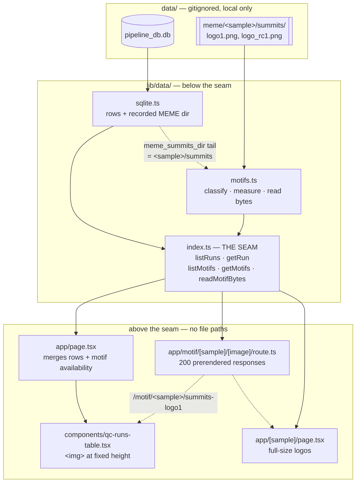
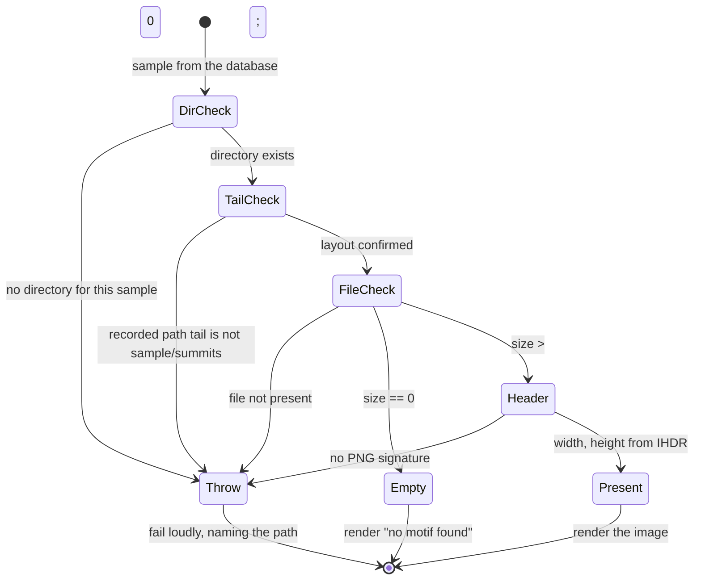

# feat: Motif logos on the browse table

## Summary

Show each sample's summits motif logo and its reverse complement as two columns on
the browse table, and full-size on the detail page. The images come from the local
MEME output tree that now sits at `data/meme/`, which means the app gains a
**second data source** — a filesystem tree alongside the SQLite file — and has to
serve bytes out of a gitignored directory for the first time.

Three facts found while inspecting the tree shape the whole plan. Nine of the 109
`logo1.png` files are **zero bytes** rather than absent, so handing them straight
to an `` renders a broken-image icon. The database **cannot** predict which
nine: `motif_peaks = "NA"` covers twelve rows, and three of those have real logos,
so only the filesystem knows. And every logo is a constant 358px tall but **404 to
1664px wide**, so the obvious "fit the column width" treatment would render an 8bp
motif and a 32bp motif at different letter scales and quietly destroy the
comparison the column exists to support.

The seam absorbs all of that. Availability, intrinsic dimensions, and the bytes
themselves are reported by a new module below `lib/data/index.ts`; nothing above it
learns that `data/meme/` exists.

---

## Problem Frame

The browse table shows 18 QC numbers per sample. For DAP-seq, the question those
numbers circle around — *did this transcription factor bind a recognisable motif,
and what does it look like* — is answered by a picture the pipeline already
produced and that the app currently does not show at all. `motif_peaks` is the
closest proxy and it is a FIMO hit count, not the motif.

The pipeline's MEME output is now available locally at `data/meme/`, mirroring the
`meme/` directory the database already records a Midway path for. So the images
exist on the machine; the app has no way to reach them.

Two things make this more than "add an ``":

1. **`/data/` is gitignored wholesale and sits outside `public/`.** Next.js serves
   static files from `public/` only. The app has never served a byte out of
   `data/`, and the project's standing data rule says pipeline data lives under
   `data/` and *nowhere else* — so mirroring into `public/` would break a written
   invariant.
2. **The seam forbids file paths above `lib/data/index.ts`.** "Does this sample
   have a motif logo" is a filesystem question, so either the seam answers it or
   the rule breaks.

---

## Requirements

Traced from the user's request and the scope confirmed before research.

| ID | Requirement |
|----|-------------|
| R1 | The browse table shows two new columns for every sample: the summits motif logo and its reverse complement, visible by default. |
| R2 | A sample with no motif reads as an explicit, labelled absence — never a broken image, a blank cell, or a plausible-looking substitute. |
| R3 | Logo availability is derived from the filesystem, never inferred from `motif_peaks` or `is_treatment`. |
| R4 | Every logo renders at the same letter scale as every other, so motifs are visually comparable down a column. |
| R5 | Nothing above `lib/data/index.ts` references `data/meme`, a file path, or a filename. |
| R6 | A missing file, an unreadable file, or a layout that no longer matches what the database records fails loudly and names what was wrong. |
| R7 | The new code has automated coverage on a machine with no research data. |
| R8 | The detail page shows both logos at full size, grouped with the other motif evidence. |

**Non-goals** (see Scope Boundaries for the full split): the `peaks/` logos, motif
2, the `.eps`/`meme.html`/`meme.txt`/`meme.xml` artifacts, and teaching the M6 sync
script about this tree.

---

## Key Technical Decisions

### KTD1. The bytes are served by a prerendered route handler, not a `public/` mirror

`app/motif/[sample]/[image]/route.ts` asks the seam for bytes and returns them.
`generateStaticParams` enumerates the 200 (sample, image) pairs that actually have
bytes, and `dynamicParams = false` means **only those paths exist** — anything else
404s before a line of handler code runs.

Chosen over mirroring ~8MB into a gitignored subfolder of `public/` because:

- The standing data rule in `docs/build-ladder.md` is explicit that pipeline data
  lives under `data/` and nowhere else. A gitignore exception *inside* a committed
  directory is how 8MB of research data eventually lands in a commit.
- A mirror is a second copy that drifts, and keeping it fresh is a sync concern
  that does not exist yet.
- Path traversal is not *defended against*, it is **structurally impossible**: the
  sample list comes from the seam and the image name comes from a two-element
  closed set, so no user-supplied string is ever joined into a path.

The cost, stated plainly: the images are baked at build time, so new logos need a
rebuild to appear. That is the same constraint the rows already have, and it
strengthens the existing *how the app picks up new data after a sync* register
entry rather than opening a new question.

Verified against `node_modules/next/dist/docs/01-app/03-api-reference/04-functions/generate-static-params.md`
(§"With Route Handlers", §"Disable rendering for unspecified paths") and
`01-app/03-api-reference/03-file-conventions/route.md` (§"Static Generation with
`generateStaticParams`").

### KTD2. A plain `` with explicit intrinsic dimensions, not `next/image`

`next/image`'s value is resizing, format conversion, and `srcset`. Against a route
handler that requires either `images.localPatterns` plus request-time optimization
— which would make the one image-bearing surface dynamic while every other route in
the app is static — or `unoptimized`, which reduces it to an `` wrapper. The
part that actually matters here is explicit `width`/`height` to prevent layout
shift across 100 images on a page, and the seam reports those.

`loading="lazy"` covers the page-weight concern: at ~40KB average, a 50-row page
touches ~4MB only if the reader scrolls through all of it.

If page weight does become a problem, the lever is generating thumbnails at sync
time rather than optimizing at request time — recorded as a deferred decision, not
built.

### KTD3. Motif data is a second function pair on the same seam, not new `QcRun` fields

`QcRun` is derived from `QC_COLUMNS`, a spec of all-TEXT database columns with
missing markers and coercion rules. A filesystem-derived object with pixel
dimensions has none of those properties, and forcing it into that spec would
corrupt a clean abstraction — and would also break `groupColumns`, which throws on
any spec column no detail-page group claims.

So `lib/data/index.ts` grows a second pair alongside `listRuns`/`getRun`:

- `listMotifs()` / `getMotifs(sample)` — per-sample availability and dimensions
- `readMotifBytes(sample, image)` — the bytes, for the route handler

The seam is the *module boundary*, not the row type. R5 is satisfied because the
route handler asks the seam for bytes instead of reading a file.

### KTD4. The local path is derived from what the database records, not hardcoded

All 109 `meme_summits_dir` values end in `<sample>/summits`. The reader takes the
last two segments of the recorded path and joins them under the local MEME root,
then asserts the second-to-last segment equals `sample`.

This is the property that makes the folder layout safe to grow: the app follows the
pipeline's own directory shape instead of duplicating a convention that can drift.
A pipeline reorganisation surfaces as a loud assertion failure naming the sample
and the recorded path, not as 109 broken images.

### KTD5. Zero bytes means "no motif"; absent means "broken"

An empty file is the pipeline's own record that MEME produced no motif — all nine
correlate with `motif_peaks = "NA"`, and seven are HALO controls, which have no
motif by construction. It is a **declared sentinel**, and this codebase already
distinguishes structurally-empty from unknown (`control` is blank *because*
`is_treatment` is `"0"`).

The fail-loudly rule exists to stop *plausible substitutes* from hiding bugs. A
labelled "no motif found" is the opposite of a plausible substitute, so the rule is
honoured, not bent. It still applies with full force to the cases that really are
bugs:

| Filesystem state | Meaning | Behaviour |
|---|---|---|
| Non-empty, valid PNG header | A motif was found | Render it |
| Zero bytes | MEME found no motif | Render a labelled absence |
| File not present | A sync dropped it | **Throw**, naming the path |
| Non-empty, no PNG signature | Corrupt or wrong file | **Throw**, naming the path |
| No directory for a database sample | Tree and database disagree | **Throw**, naming the sample |
| Recorded path tail ≠ `<sample>/summits` | Layout changed upstream | **Throw**, naming both |

### KTD6. Fix the height, let the width fall where it lands

Logo height is constant (358/359px); width varies 4.1× with motif width. Fixing
the **height** in the table means every logo renders at an identical letter scale,
which is what R4 asks for. A 1664px logo at 32px tall is ~149px wide — comparable
to the existing text columns, so no cap is needed.

Fixing the width instead would tidy the column and render an 8bp and a 32bp motif
at different scales, making the column actively misleading.

The exact height lands in a 28–40px band, chosen at the browser gate. The y-axis
`bits` chrome (~90px of each image) is left in place at this rung; cropping it would
make the letters bigger but depends on MEME's axis width staying fixed. Recorded as
a deferred decision.

### KTD7. Image columns sort by availability only and are excluded from search

Sorting an image is meaningless; **partitioning** samples into "has a motif" and
"no motif" is genuinely useful. So the sort comparator compares availability only
and returns 0 among equals, which makes it a stable partition rather than a fake
ordering.

Search is excluded because the cell has no text a reader could be looking at — and
because the alternative, matching against the URL, would make `summits` match all
100 rows. This is the same reasoning that removed the file-path columns from the
default search: a query that matches everything is worse than one that matches
nothing.

---

## High-Level Technical Design

Directional guidance for review — the prose above is authoritative where they differ.

### Two paths out of one reader



The dotted line from `sqlite.ts` to `motifs.ts` is KTD4: the reader learns the
layout from the database rather than hardcoding it.

### Classifying one logo file



Only two of the six outcomes reach the reader. The other four are bugs, and each
names what was wrong.

---

## Implementation Units

### U1. A fabricated MEME tree for tests

**Goal.** Give the motif reader coverage on a machine with no research data, the
way `buildFixture()` already does for the database.

**Requirements.** R7.

**Dependencies.** None.

**Files.**
- `db/fixture.ts` — modify
- `db/fixture.test.ts` — modify

**Approach.** Add `buildMemeFixture()` writing a temp directory shaped like
`<root>/<sample>/summits/{logo1.png,logo_rc1.png}`, and `missingRealMeme()`
mirroring `missingRealDatabase()` for the tests that can only run where the real
tree is.

The fabricated PNGs are an 8-byte PNG signature plus an IHDR chunk carrying chosen
dimensions. That is exactly what the dimension reader parses and what the route
handler streams without interpreting — so it is sufficient, and the code comment
must say plainly that these are parseable headers rather than renderable images so
nobody later mistakes the fixture for a rendering test.

Cover the four cases the real tree contains, keyed to the existing fixture samples:

- `SYN_beta` — both logos present, deliberately **different** widths so a reader
  that returns one dimension for both fails here
- `SYN_delta` — both logos zero bytes, mirroring the nine real ones (it already
  carries `motif_peaks: "NA"`)
- `SYN_alpha` — both present, narrow
- `SYN_gamma` — directory exists, `logo_rc1.png` deliberately **absent**, to
  exercise the loud failure

The existing `meme_summits_dir` default is `/fixture/meme/placeholder/summits`,
which is per-sample-templated by neither helper — it must become
`/fixture/meme/<sample>/summits` so the KTD4 tail assertion has something correct
to assert against.

**Patterns to follow.** `buildFixture()` and `missingRealDatabase()` in
`db/fixture.ts` — temp directory per call, nothing written inside the repo, every
value invented.

**Test scenarios.**
- `buildMemeFixture()` returns a root containing a directory per fixture sample.
- `SYN_beta`'s two files are non-empty and their IHDR widths differ from each other.
- `SYN_delta`'s two files are exactly 0 bytes.
- `SYN_gamma/summits/logo_rc1.png` does not exist while `logo1.png` does.
- Two calls return different roots and do not interfere.
- The root is outside the repository tree, so no ignore rule is relied on.
- `missingRealMeme()` returns a string naming `data/meme` when it is absent and
  `false` when it is present.
- Every fixture metadata row's `meme_summits_dir` ends in `<sample>/summits`.

**Verification.** `npm test` passes with the new assertions on a tree that has no
`data/` directory at all.

---

### U2. The motif reader, below the seam

**Goal.** One module that knows where the MEME tree is, classifies each logo, and
hands out dimensions and bytes. The only place in the codebase aware that
`data/meme/` exists.

**Requirements.** R2, R3, R5, R6, R7.

**Dependencies.** U1.

**Files.**
- `lib/data/motifs.ts` — create
- `lib/data/motifs.test.ts` — create
- `lib/data/index.ts` — modify (re-export the new surface)

**Approach.** Mirror `resolveDbPath()`: resolve the root per call from
`GENOME_BROWSER_MEME_ROOT ?? path.join(process.cwd(), "data", "meme")`, never at
module load, so the location is not a property of whatever launched the process and
tests can point it elsewhere.

The exported surface, as sketched — shapes are directional, names are not final:

```
type MotifImage = "summits-logo1" | "summits-logo-rc1"   // closed set, drives the route
type MotifLogo  = { present: true; width: number; height: number }
                | { present: false; reason: "no-motif" }
type SampleMotifs = { sample: string } & Record<MotifImage, MotifLogo>

listMotifs(): Promise<readonly SampleMotifs[]>
getMotifs(sample): Promise<SampleMotifs | null>
readMotifBytes(sample, image): Promise<Uint8Array>   // throws unless present
```

Dimensions come from the PNG header: the 8-byte signature, then a length and the
literal `IHDR`, then big-endian width and height at byte offsets 16 and 20. Reading
24 bytes per file is enough — no image library, no new dependency.

Per-sample directories are located per KTD4, from the last two segments of
`meme_summits_dir`. The six outcomes and which throw are in the KTD5 table; every
thrown message names the sample and the resolved path, matching how the SQLite
reader already reports a missing database.

Return frozen objects, consistent with what `listRuns` hands out.

**Execution note.** Write the failure cases first. Four of the six outcomes are
throws, they are the requirement (R6), and they are the ones that will never be
exercised by hand on a machine where the tree happens to be complete.

**Patterns to follow.** `resolveDbPath()` and the guard style in
`lib/data/sqlite.ts` — loud, specific, naming the offending value. `lib/data/index.ts`
for the async-signature-even-though-it-need-not-be convention.

**Test scenarios.**
- *Present:* a non-empty logo reports `present: true` with the width and height
  written into the fixture's IHDR, and the two images of one sample report their
  own differing widths rather than a shared value.
- *No motif:* a zero-byte logo reports `present: false, reason: "no-motif"` and
  does **not** throw.
- *Absent file:* `SYN_gamma`'s missing `logo_rc1.png` throws, and the message
  contains both the sample and the resolved path.
- *Corrupt:* a non-empty file whose first bytes are not the PNG signature throws.
- *No directory:* a database sample with no directory under the root throws,
  naming the sample.
- *Layout drift:* a metadata row whose `meme_summits_dir` does not end in
  `<sample>/summits` throws, naming the sample and the recorded path.
- *Independence from the database:* a sample with `motif_peaks: "NA"` and a
  non-empty logo reports `present: true` — the real tree's `TP53_amp` case, and
  the specific inference this requirement forbids.
- *Bytes:* `readMotifBytes` returns the file's exact bytes for a present logo, and
  throws for a zero-byte one rather than returning an empty buffer.
- *Root override:* unsetting `GENOME_BROWSER_MEME_ROOT` resolves under
  `data/meme` relative to the working directory.
- *Per-call resolution:* changing the env var between calls changes which tree is
  read, proving the path is not captured at import.
- *Seam surface:* `lib/data/index.ts` exports the motif functions and the `QcRun`
  pair, and nothing else.
- *Real tree, skipped when absent:* against `data/meme`, exactly 9 of 109 samples
  report `no-motif` and all 109 have a directory.

**Verification.** `npm test` green with no `data/` directory; the real-tree test
skips visibly rather than passing quietly.

---

### U3. The image route

**Goal.** A URL per logo that serves its bytes, prerendered at build time like
every other route in the app.

**Requirements.** R1, R5.

**Dependencies.** U2.

**Files.**
- `app/motif/[sample]/[image]/route.ts` — create
- `lib/display/motif.ts` — create (URL construction, above the seam)
- `lib/display/motif.test.ts` — create

**Approach.** Read `node_modules/next/dist/docs/01-app/01-getting-started/15-route-handlers.md`
and `01-app/03-api-reference/04-functions/generate-static-params.md` before writing —
project gate.

`generateStaticParams` calls `listMotifs()` and emits one entry per **present**
logo, so the ~200 that have bytes are baked and the 18 that do not are never
routed. With `dynamicParams = false` those 18, and every other path, 404. Set
`dynamic = "force-static"`; `params` is a Promise in this version.

`GET` awaits `params`, calls `readMotifBytes`, and returns the bytes with
`Content-Type: image/png`. It never touches a path — that is what keeps R5 true
for a route whose entire purpose is serving a file.

`lib/display/motif.ts` holds `motifImageUrl(sample, image)` and the
`MOTIF_COLUMNS` ordering. URLs are the app's own public surface, not filesystem
knowledge, so they belong above the seam and stay unit-testable.

**Segment-shadowing guard.** `app/motif/` is a static segment sitting beside the
existing `app/[sample]/` dynamic one, so a sample literally named `motif` would
become unreachable. No such sample exists; assert it rather than assume it.

**Test scenarios.**
- `motifImageUrl` builds `/motif/<sample>/summits-logo1` and the `-rc1` variant.
- The image identifiers are a closed set of exactly two, and an unknown identifier
  is a type error rather than a string joined into a URL.
- No sample name collides with the reserved `motif` first segment (skipped when
  the real database is absent).
- A sample name needing URL encoding would be caught — reuses the existing
  `[A-Za-z0-9_.-]+` assertion rather than restating it.

**Verification.** `npm run build` reports ~200 additional prerendered route
entries; requesting a present logo in `npm run dev` returns a PNG that renders in
the browser; requesting one of the nine no-motif samples returns 404; a fabricated
path such as `/motif/../../etc/passwd` 404s.

---

### U4. Two image columns on the browse table

**Goal.** Both logos visible by default for every sample, at one letter scale, with
a labelled absence for the nine that have none.

**Requirements.** R1, R2, R4, R5, R7.

**Dependencies.** U2, U3.

**Files.**
- `app/page.tsx` — modify
- `components/qc-runs-table.tsx` — modify
- `lib/table/column-defs.ts` — modify
- `lib/table/column-defs.test.ts` — modify
- `lib/display/column-groups.ts` — modify (table column ordering)
- `lib/display/column-groups.test.ts` — modify

**Approach.** `app/page.tsx` reads `listMotifs()` alongside `listRuns()` and passes
motif data to the table.

**Motif data travels beside the rows, not inside them.** `QcTableRow` is
`Record<string, CellValue>` where `CellValue` is `string | number | null`, and a
motif cell needs presence plus two pixel dimensions. Widening `CellValue` to carry
an object would ripple into `formatValue` (which ends in `String(value)`) and
`rowMatches`, putting the shared formatter — the one thing that keeps display,
search, and the detail page agreeing — at risk for a single column type.

So the table takes a second prop keyed by sample, and each motif column's
`accessorFn` returns only what sorting needs: a marker when a logo is present,
`null` when it is not. Absence then flows through the existing
`sortUndefined: "last"` machinery, so AE1 is satisfied by the mechanism already
proven at M3 rather than by a new comparator. The cell renderer looks the
dimensions up by sample.

Column order places the two logos immediately after `motif_peaks` — they are the
evidence that metric summarises. That makes the table's column list an explicit
ordering rather than `QC_COLUMN_NAMES` as-is, so it becomes a named export in
`lib/display/column-groups.ts` (beside `defaultVisibleColumns`) with a test that
all 39 appear exactly once. The column *identifiers* and URL construction stay in
`lib/display/motif.ts` from U3; only the merged ordering lives with the other
column-layout decisions.

`lib/table/column-defs.ts` **stays JSX-free** — that constraint exists because
`node --test` strips types but not JSX, and the properties it guards are the ones
that keep absent values terminal. So it gains only the classification
(`isMotifColumn`) and the availability-only comparator from KTD7; the `` is
rendered in `components/qc-runs-table.tsx`, which is already `.tsx`.

The cell renders at a fixed height with the intrinsic width scaled to match, plus
`loading="lazy"`, `decoding="async"`, and an `alt` naming the sample and which
strand it is. A no-motif cell renders `no motif found` in the muted-italic
treatment the detail page already uses for `not recorded` — the two absences are
different and must not look identical, so the wording carries the difference.

Search excludes both columns per KTD7. The search input currently says "Search
visible columns…", which stops being strictly true; adjust the wording if the
browser gate shows it misleads.

**Patterns to follow.** `buildColumnDefs` for `sortUndefined: "last"` and the
accessor's `null → undefined` mapping; the `stickyColumn` helper for how
presentation concerns are commented; `TABLE_HIDDEN_BY_DEFAULT` for how default
visibility is declared.

**Test scenarios.**
- The table column ordering contains all 37 spec columns plus the 2 motif columns,
  exactly once each, with the logos immediately after `motif_peaks`.
- Both motif columns are visible by default — they are absent from
  `TABLE_HIDDEN_BY_DEFAULT`, and `defaultVisibleColumns` returns 20.
- `isMotifColumn` is true for exactly the two and false for all 37 spec columns.
- The 9 no-motif samples sit in the **terminal** positions ascending *and*
  descending — absences never migrate to the top when direction flips. *(This is
  the failure mode that inverted the M3 sort while every comparator unit test
  passed, because TanStack negates the comparator for descending. Assert both
  directions explicitly.)*
- The comparator returns 0 for two present logos and for two absences, so the sort
  is a stable partition and does not reorder rows arbitrarily.
- `rowMatches` with the motif columns excluded does not match a query that appears
  only in a logo URL.
- A row whose logo is absent still matches queries against its other columns.
- The motif accessor returns `null` for a no-motif sample and a non-null marker for
  a present one, so `sortUndefined: "last"` is what places absences — no motif
  branch inside the comparator.
- `CellValue` is unchanged, and `formatValue` is never called with a motif column —
  a guard against the shared formatter growing a special case.

**Verification.** Open `npm run dev`: both columns appear by default; letters are
the same size on an 8bp and a 32bp motif; the nine no-motif samples read as
`no motif found`; no broken-image icons anywhere; sorting either column partitions
present from absent in both directions; the pinned `sample` column still occludes
correctly as the table scrolls past the images.

---

### U5. Motif logos on the detail page

**Goal.** Both logos at full size where there is room to actually read them.

**Requirements.** R2, R8.

**Dependencies.** U2, U3.

**Files.**
- `app/[sample]/page.tsx` — modify
- `lib/display/column-groups.ts` — modify (a note on the Peaks group, if warranted)

**Approach.** A `Motif` section after `Peaks`, showing both logos at intrinsic size
with the strand labelled. `groupColumns` is untouched: the motif columns are not in
`QC_COLUMNS`, so its unclaimed-column guard has nothing new to check.

For the nine with no motif, state the reason rather than showing an empty box —
and distinguish the two populations, because they are different facts: a HALO
control has no motif *by construction*, while `MTHFD2_aug1` and `PWP1_dap_b2` are
treatments where MEME simply found nothing. `is_treatment` is authoritative for
telling them apart and must not be inferred from the `HALO` name prefix, since
`HALOb_b2` is a treatment.

**Test scenarios.** `Test expectation: none — presentation-only, and the grouping
logic it reuses (`groupColumns`) already has coverage.` The claims here are visual
and are verified at the browser gate.

**Verification.** Open a sample with a motif, a HALO control, and `MTHFD2_aug1`:
the first shows two readable logos, the second says the control has no motif by
construction, the third says no motif was found. `npm run build` still prerenders
109 detail pages.

---

### U6. Record the rung and the decisions

**Goal.** Leave the ladder, the register, and `CLAUDE.md` describing what the app
now is, so the next session does not rediscover the zero-byte files.

**Requirements.** Project gates — *work in order* requires a reorder to be recorded
as a decision, and the register's contract is that entries leave only by being made
and recorded.

**Dependencies.** U1–U5.

**Files.**
- `docs/build-ladder.md` — modify
- `docs/deferred-decisions.md` — modify
- `CLAUDE.md` — modify

**Approach.**

*Ladder.* Add **M7. Motif logos** as a new rung worked **before** M6, and record
that insertion — a new rung ahead of a pending one is exactly the reorder the gate
means. Note what the rung produced, in the style of the M2–M5 entries: nine
zero-byte files, the three samples that disprove inferring availability from
`motif_peaks`, and the 4.1× width spread.

*Register — resolve:*
- How motif-logo availability is determined (filesystem, not `motif_peaks`)
- How a motif-less sample is represented (labelled absence, with the empty-file
  sentinel distinguished from a dropped file)
- Where the image bytes are served from (prerendered route handler over a `public/`
  mirror)
- How a variable-width logo sits in a fixed-width column (fixed height)

*Register — strengthen an existing entry:* *how the app picks up new data after a
sync* now has a second reason — images are baked at build time too — which raises
its stakes without changing the question.

*Register — open:*
- Whether the sync copies the whole MEME tree or a declared subset, and whether the
  tree gets a snapshot the way the schema does. Feeds *the Midway access method*.
- Whether to generate thumbnails at sync time if page weight becomes a problem
  (KTD2's escape hatch).
- Whether to crop the y-axis chrome to enlarge the letters at table scale (KTD6).
- Whether the `peaks/` logos and motif 2 are ever shown.

*`CLAUDE.md`.* §4 gains `data/meme/` and the new modules in the directory tree and
records that the seam now has two sources. §6 gains a short subsection on the MEME
tree: the layout mirrors the pipeline and is derived from `meme_summits_dir`; nine
logos are zero bytes; `motif_peaks` does not predict them. §8 gains
`GENOME_BROWSER_MEME_ROOT` beside `GENOME_BROWSER_DB`.

**Test scenarios.** `Test expectation: none — documentation.`

**Verification.** Section numbers §1–§9 unchanged (they are cited by the ladder,
the register, and both prior plans — fix content in place, never renumber). Every
decision the plan made appears in the register as either resolved or open. `npm
test`, `npm run typecheck`, `npm run lint`, and `npm run build` all clean.

---

## Scope Boundaries

### In scope
The summits `logo1.png` and `logo_rc1.png` for all 109 samples, on the browse table
and the detail page; the seam extension that makes them available; the route that
serves them; loud failures for a tree that disagrees with the database.

### Deferred to follow-up work
- The `peaks/` logos — same 109 coverage, same shape. The image identifier is a
  closed set precisely so adding them is one entry plus a column, not a rewrite.
- Motif 2 (`logo2.png`, `logo_rc2.png`) — present for the 100 samples that got a
  motif, since `meme_nmotifs` is `2`.
- Teaching the M6 sync script about the tree. Until then, refreshing logos is a
  manual copy, exactly as the database is today.
- Thumbnail generation, axis cropping, and a declared tree manifest — all in the
  register.

### Non-goals
- Serving the `.eps`, `meme.html`, `meme.txt`, or `meme.xml` artifacts. They are
  worth keeping in the tree as provenance and are not app surface.
- Parsing `meme.xml` for motif consensus strings, E-values, or site counts. That is
  a different feature — reading the motif rather than seeing it.
- Any write path. The app still only reads.

---

## Risks & Dependencies

| Risk | Mitigation |
|---|---|
| A page with 100 images feels slow even lazily loaded. | `loading="lazy"` plus explicit dimensions; assessed at the browser gate with the page-size control at 100. The thumbnail lever is registered if it is not enough. |
| At 32px tall the letters may be too small to be useful, making the columns decoration. | This is the one claim unit tests cannot make. It is an explicit browser-gate check, with axis cropping registered as the response if it fails. |
| ~8MB of prerendered binary responses slows `npm run build` or bloats `.next`. | Measure build time before and after; ~200 responses at ~40KB is small next to 113 existing prerendered pages, but measure rather than assume. |
| `data/meme` is absent on a clone, a worktree, or CI — as `data/` always is — and now the *build* needs it. | `generateStaticParams` already fails loudly without the database; the motif reader must fail the same way and name `data/meme`. Tests use the fabricated tree and skip visibly. |
| The nine zero-byte files are a coincidence of this run, and a future run leaves genuinely corrupt files instead. | KTD5 separates the sentinel from corruption: zero bytes is a stated absence, a non-PNG with content throws. |
| The `motif` URL segment shadows a sample named `motif`. | Asserted against the real sample list in U3, not assumed. |

**Dependencies.** No new packages. PNG header parsing is 24 bytes of arithmetic;
`better-sqlite3`, TanStack Table, and shadcn/ui all stay as they are, and the stack
in `CLAUDE.md` §2 is unchanged.

---

## Acceptance Examples

| ID | Example |
|----|---------|
| AE1 | Sorting the summits-logo column descending puts all 100 present logos above all 9 absent ones — the same direction-negation trap that inverted the M3 sort while every unit test passed. |
| AE2 | `TP53_amp` has `motif_peaks = "NA"` and shows a motif logo. Anything inferring availability from `motif_peaks` fails here. |
| AE3 | `HALO_LHa`'s zero-byte logo renders `no motif found`, not a broken-image icon and not a blank cell. |
| AE4 | Deleting one `logo1.png` from the tree makes the build fail with a message naming that sample and path — not 108 working images and one silent gap. |
| AE5 | An 8bp motif and a 32bp motif in the same column render their letters at the same height, so the two are comparable at a glance. |
| AE6 | `npm test` passes on a checkout with no `data/` directory, and the real-tree tests report as skipped rather than passed. |

---

## Deferred to Implementation

Genuinely not knowable until the code exists:

- The exact table image height inside the 28–40px band, and whether rows need more
  vertical padding to hold it.
- Whether the search input's "Search visible columns…" wording actually misleads
  once two unsearchable columns are on screen.
- Whether `listMotifs()` wants memoizing within a build. `listRuns()` deliberately
  is not, so a replaced file is never served stale — but `generateStaticParams`,
  the browse page, and 109 detail pages will each trigger a tree walk. Measure
  before adding a cache, and if one is added, keep the reason it was declined for
  the database in view.
- The precise wording distinguishing "a control has no motif by construction" from
  "MEME found no motif", which is a copy decision best made against the rendered
  page.

---

## Sources & Research

- `node_modules/next/dist/docs/01-app/03-api-reference/04-functions/generate-static-params.md`
  — §"With Route Handlers" confirms `generateStaticParams` in `route.ts`;
  §"Disable rendering for unspecified paths" confirms `dynamicParams = false`
  restricts serving to enumerated params. Both are load-bearing for KTD1.
- `node_modules/next/dist/docs/01-app/01-getting-started/15-route-handlers.md`
  — `GET` handlers are uncached by default and opt in via `dynamic = 'force-static'`.
- `node_modules/next/dist/docs/01-app/03-api-reference/03-file-conventions/route.md`
  — `params` is a `Promise` in this version; `RouteContext<'/path'>` typing helper.
- `node_modules/next/dist/docs/01-app/03-api-reference/02-components/image.md`
  — `localPatterns` and `unoptimized` semantics, which is what ruled out
  `next/image` in KTD2.
- `node_modules/next/dist/docs/01-app/03-api-reference/03-file-conventions/public-folder.md`
  — confirms static serving is `public/`-only, the constraint behind KTD1.
- Direct inspection of `data/meme/` and `data/pipeline_db.db`: 109/109 directory
  match; 9 zero-byte logo pairs; 12 rows with `motif_peaks = "NA"` of which 3 have
  real logos; constant 358px height against 404–1664px widths; all 109
  `meme_summits_dir` values ending in `<sample>/summits`; `meme_nmotifs = "2"`.
- `CLAUDE.md` §4 (the seam rule), §6 (empty-is-not-always-missing, `is_treatment`
  authoritative), §9 (fail loudly); `docs/build-ladder.md` gates and standing data
  rules; `docs/deferred-decisions.md` open entries on post-sync data pickup and
  `sample` as record key.
