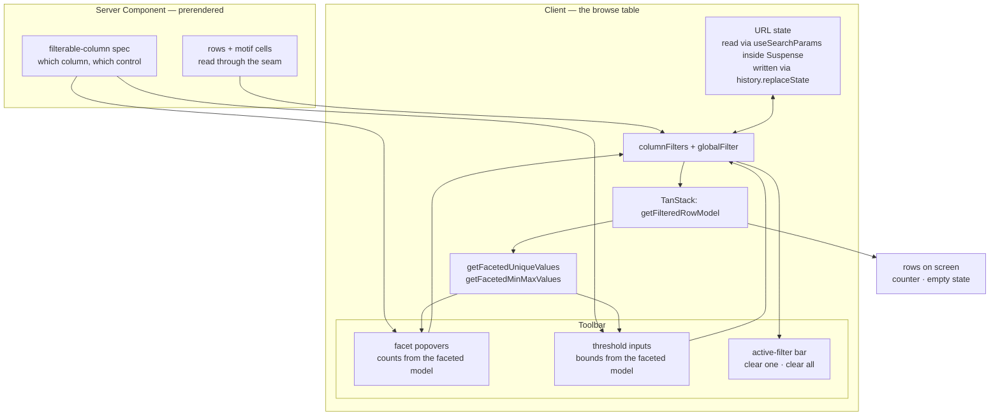

# feat: A filtering experience for QC triage

## Summary

The browse table has one filter: a substring search across every visible text column.
It answers *"find the sample I already know the name of"* and cannot answer *"which
samples are bad"* — which is the question QC data exists to answer.

This adds filtering shaped by what the data actually supports, measured rather than
assumed. Four columns have short enough value lists to pick from; the QC metrics are
near-unique per row and want thresholds; three columns have no values at all and get
no control, because a filter that cannot narrow anything is worse than its absence.

The free-text search stays. It is the right tool for the columns a list cannot serve —
`sample` and the sixteen file paths are unique per row, so any pick-from-a-list
control would offer 109 options.

Everything needed is already installed: TanStack Table ships the faceting engine, and
its faceted value counts respect the *other* active filters, so the numbers beside
each option stay true as a reader narrows.

---

## Problem Frame

109 samples, 20 visible columns, one search box. A reader who wants "treatment samples
from the December batch with more than 1,000 peaks and a motif" has to scan.

**What the columns can support** — measured against the real database, not guessed:

| Column | Distinct values | Not recorded | Natural control |
|---|---:|---:|---|
| Sample Type | 2 | 0 | pick from list |
| gDNA Batch | 3 | 14 | pick from list |
| Experiment Date | 8 | 8 | pick from list |
| Control Sample | 9 | 10 | pick from list |
| Motif found | 2 | 0 | pick from list |
| Peaks with Motif | 28 | 12 | threshold |
| Median Fragment Size | 67 | 0 | threshold |
| Number of Filtered Peaks | 86 | 0 | threshold |
| Mapping Percentage | 99 | 0 | threshold |
| Number of Peaks | 104 | 0 | threshold |
| Maximum Peak Score | 105 | 4 | threshold |
| FRiP / Filtered FRiP | 109 / 106 | 0 | threshold |
| Reads in Peaks (both) | 109 / 106 | 0 | threshold |
| Total / Trimmed / Mapped Reads | 109 each | 0 | threshold |
| `sample`, 16 file paths | 109 each | 0 | **text search only** |
| Alignment Rate, Subsampled Fragments, Peaks after Blacklist | **0** | 109 | **no control** |

Three facts fall out of that table and shape the whole design:

1. **Five columns are facetable and none has more than nine options.** No search-inside-a-facet is needed; a checkbox list fits.
2. **The QC metrics are effectively continuous.** 109 distinct FRiP values across 109 rows means a value list is useless and a threshold is the only sensible control.
3. **A generic "filter any column" UI would ship three dead controls and seventeen useless ones.** The filterable set has to be declared, not derived from "all columns".

**Not recorded is a filterable state.** Five columns carry nulls — 14 samples have no
gDNA batch, 12 have no motif-peak count. "Which samples are missing a batch" is a real
provenance question, and a facet that silently omits the nulls cannot answer it. This
matters more here than in most apps: this codebase already distinguishes *structurally
empty* from *unknown* throughout (`CLAUDE.md` §6), and the filter UI should not be the
first place that distinction collapses.

---

## Requirements

| ID | Requirement |
|----|-------------|
| R1 | A reader can narrow by Sample Type, Control Sample, Experiment Date, and gDNA Batch, selecting any combination of values within a column. |
| R2 | A reader can narrow to samples where MEME did or did not find a motif. |
| R3 | A reader can set a lower and/or upper bound on any QC metric. |
| R4 | Filters combine: narrowing by two columns shows rows satisfying both. |
| R5 | Each facet option shows how many rows it would yield **given the other active filters**, so the count never promises rows that aren't there. |
| R6 | Columns with no values, and columns whose values are unique per row, get no filter control. |
| R7 | "Not recorded" is selectable for every column that has nulls. |
| R8 | Active filters are visible at a glance and clearable individually and all at once. |
| R9 | An empty result says *why* it is empty — which filters are responsible — rather than only echoing the search text. |
| R10 | The free-text search continues to work unchanged, and combines with filters. |
| R11 | A filtered view can be shared as a URL that reproduces it. *(Separable — see U6.)* |

---

## Key Technical Decisions

### KTD1. TanStack's own faceting; no new dependency

The installed TanStack Table 8.21.3 already exports `getFacetedRowModel`,
`getFacetedUniqueValues`, `getFacetedMinMaxValues`, and the filter functions
`arrIncludesSome` (multi-select) and `inNumberRange` (bounds). `columnFilters` state
coexists with the `globalFilter` the search box already uses; `getFilteredRowModel`
applies both.

The reason to use the faceted row models rather than computing option lists from the
raw rows is R5. `getFacetedUniqueValues` for a column is computed against the rows
that pass *every other* filter, so selecting "Treatment" makes the Control Sample
counts drop to what Treatment rows actually contain. Counting from the raw data
instead would show options that yield zero rows once clicked — a filter UI that lies
about its own effect.

### KTD2. The filterable set is declared and measured, not derived

A module names each filterable column and which control it gets. Deriving it from
"every column" would produce three dead controls (the all-null metrics) and seventeen
that cannot narrow (`sample` plus the sixteen paths, each unique per row).

The declaration is checked the way `groupColumns` and `assertLabelled` already are: a
filterable column that is not in the row type throws, and so does a filter kind that
does not match the column's declared `kind` in the spec — a `text` column given a
numeric threshold is a bug, and the spec already knows every column's kind.

**This is a judgment that will age.** The cardinality that justifies a facet today is a
property of *this* run: `gdna_batch` has 3 values because 109 samples came from 3
batches. A future run with 40 batches turns that facet into a scroll. Recorded as a
deferred decision rather than solved now, with the threshold for revisiting stated.

### KTD3. Filters live in the toolbar, not in column headers

TanStack supports per-column filter menus, and this plan does not use them.

The header is already the most crowded surface on the page: 20 columns, two-line
wrapped labels, a 96px minimum width, and a sort control in every cell. Adding a
filter affordance to each would compete with the sort button in a cell that is
sometimes 96px wide. More importantly, active filter state would scatter across twenty
columns, most of them off-screen — the reader could not answer "what am I filtered by"
without scrolling horizontally, which is the same failure the pinned `sample` column
exists to prevent.

A toolbar row of facet controls plus a bar of active filters puts the whole filter
state in one place, next to the Columns control it will sit beside.

### KTD4. "Motif found" reuses the existing column, not a new pseudo-column

The motif logo columns already carry an accessor value of `"motif"` when a logo exists
and `null` when it does not — added so absences sort terminally through
`sortUndefined`. A facet over that same accessor gives R2 for free, with the two
options labelled from the domain (*Found* / *None*) rather than from the marker.

No new column, no second source of truth about which samples have motifs, and the
existing "availability comes from the filesystem, never from `motif_peaks`" guarantee
carries through unchanged.

### KTD5. URL state writes with `history.replaceState`, and reads inside `Suspense`

Verified against the bundled docs, because this one has a trap.

`useSearchParams` in a client component on a **prerendered** route causes the client
tree up to the nearest `Suspense` boundary to be client-rendered — and without that
boundary, `next build` **fails** with *Missing Suspense boundary with
useSearchParams*. The trap is that `next dev` renders routes on demand, so the missing
boundary works perfectly in development and breaks only at build time. This project
has been bitten by exactly this shape before: the sort inversion that passed every
unit test and appeared only in a browser.

Writing goes through `window.history.replaceState`, which Next integrates into its
router and syncs with `useSearchParams` — no server round-trip, no navigation, and no
history entry per keystroke. `router.push` would add one entry per filter change and
make the back button walk through every intermediate state.

The browse route stays static either way; only the toolbar subtree becomes
client-rendered.

### KTD6. Filtering stays in memory

Consistent with the resolved register entry covering pagination and sorting: 109 rows
makes in-memory filtering free, and the row data is already fully in the client. The
same entry records what would push this into SQL, and this plan does not change that
threshold.

Pagination reset needs no work: `autoResetPageIndex` defaults to `!manualPagination`,
which is `true` here, so narrowing while on page 3 returns to page 1 rather than
showing an empty table. Verified in the installed source rather than assumed, and
worth a test precisely because it is inherited behavior nobody wrote.

### KTD8. Hiding a column keeps its filter, and the chip is what makes that safe

Twenty columns are hideable and five of them are filterable, so a reader can filter by
gDNA Batch and then hide gDNA Batch. Two defensible answers: clear the filter when the
column hides, or keep it.

**Keep it** — hiding a column is a display choice about width, not a statement about
which rows matter, and silently widening someone's result set because they tidied the
view is the more surprising behaviour. It is also the reversible one: a kept filter is
visible and removable, a cleared one is gone.

That only holds because U5's chips exist. Without a filter summary this is the exact
failure KTD3 rejects per-column menus for — an active narrowing with no on-screen
cause. **So the chip row is not a nicety; it is the precondition for this decision**,
and a chip for a hidden column must render like any other.

Note the deliberate asymmetry with search. `searchableColumns` *excludes* hidden
columns, because a text match whose reason is off screen is unattributable. A filter is
different: it was chosen explicitly, by name, and is named back in the chip. Search
narrows by a side effect of what happens to be visible; a filter narrows by intent.
Worth stating plainly because the two now treat "hidden" oppositely, and that reads as
an inconsistency until the reason is written down.

### KTD9. "Motif found" and "Peaks with Motif" are different questions

Both filters exist and a reader will assume they agree. They do not, and the data says
so: `motif_peaks` is `"NA"` for twelve samples of which **three have real motifs**,
because it counts FIMO hits rather than recording whether MEME found anything.

So *Motif → Found* plus *Peaks with Motif → Not recorded* is a legitimate combination
returning three rows, not an empty contradiction. Nothing in the UI can prevent the
confusion, but the two controls must not be merged or made to imply each other, and the
three-sample case is worth a test so a future "simplification" that collapses them
fails loudly.

### KTD7. The counter and the empty state must name filters, not just the query

Today the empty state reads `No rows match "{query}"` and the counter reads
`{n} matching of 109`. With filters active and the search box empty, the first is a
lie about the cause and the second is silent about it.

Both need to attribute the narrowing. This is the same principle as the blank-cell
problem the removed page subtitle left behind: a reader looking at a short list must
be able to tell *why* it is short.

---

## High-Level Technical Design

### Where each piece sits

The loop from `TABLE` back into the controls via `FACETS` is R5: option counts are a
function of the filtered row model, so they change as the reader narrows. Anything
that computes them from `ROWS` directly breaks that.

### Which control a column gets

Applied to the spec once, not re-decided per column at render time.

| Condition | Control | Why |
|---|---|---|
| No non-null values at all | **none** | Cannot narrow anything; three columns today |
| Distinct values = row count | **none** (search covers it) | A list of 109 options is not a control; `sample` + 16 paths |
| Numeric kind, distinct > ~15 | **threshold** | A value list stops being scannable well before this |
| Distinct ≤ ~15 | **pick from list** | Fits a checkbox list without its own search |
| Any nulls present | *(above) + a “Not recorded” option* | R7 — absence is a filterable state |

The `~15` boundary is a judgment, not a measurement: today's facetable columns top out
at 9 distinct and the smallest threshold column has 28, so nothing sits near the line.
Recorded as deferred rather than tuned against data that does not test it.

---

## Implementation Units

### U1. Declare which columns are filterable and how

**Goal.** One module that answers "can this column be filtered, and with what
control", checked against the column spec so it cannot drift.

**Requirements.** R1, R2, R3, R6, R7.

**Dependencies.** None.

**Files.**
- `lib/table/filters.ts` — create
- `lib/table/filters.test.ts` — create

**Approach.** A declaration keyed by column id, each entry naming a control kind
(`facet` or `threshold`) — absence means no control. Labels come from `columnLabel`
rather than a second set of strings.

Validation mirrors `assertLabelled` and `groupColumns`: throw when a filterable column
is not in the row type, and throw when a control kind contradicts the column's
declared `kind` in `QC_COLUMNS` — a threshold on a text column is a bug the spec can
already detect. The motif column is the one filterable id that is *not* a spec column,
so it needs an explicit exemption rather than a loosened check.

Also exports the "Not recorded" sentinel used by facet options, since a null cannot be
a checkbox value and the sentinel must be one value both the option list and the
predicate agree on.

**Patterns to follow.** `lib/display/labels.ts` for the declare-then-assert shape and
the throw-rather-than-fall-back stance; `lib/display/column-groups.ts` for
`groupColumns`'s coverage errors.

**Test scenarios.**
- Every declared filterable column is either a spec column or the known motif exemption.
- A `threshold` declared on a `text` column throws, naming the column.
- A `facet` declared on a column the row type does not have throws.
- The three all-null columns are absent from the declaration — asserted against the real database, skipped when absent, so a future run that populates them is what forces the decision rather than a stale list.
- `sample` and the sixteen path columns are absent from the declaration.
- Every filterable column resolves to a label through `columnLabel` without throwing.
- The "Not recorded" sentinel does not collide with any real value in the real data (skipped when the database is absent).

**Verification.** `npm test` green with no `data/` present; the real-data assertions
skip visibly rather than passing.

---

### U2. Wire column filters and faceting into the table

**Goal.** Filter state, predicates, and the faceted row models, with nothing on screen
yet.

**Requirements.** R4, R5, R10.

**Dependencies.** U1.

**Files.**
- `lib/table/filters.ts` — modify (predicates)
- `lib/table/filters.test.ts` — modify
- `lib/table/filter-integration.test.ts` — create
- `components/qc-runs-table.tsx` — modify

**Approach.** Add `columnFilters` to table state alongside the existing `globalFilter`,
and register `getFacetedRowModel` / `getFacetedUniqueValues` /
`getFacetedMinMaxValues`.

Two predicates rather than the built-ins, for one reason each. The facet predicate has
to treat the "Not recorded" sentinel as matching `null` (R7), which
`arrIncludesSome` cannot express. The threshold predicate has to decide what an
out-of-range **null** does — and the answer is *excluded*, because "peaks ≥ 1000"
should not return samples whose peak count is unknown. Both are small and both are the
kind of decision that silently differs between implementations, so they live in the
tested module rather than inline in the component.

**Execution note.** Test the predicates and the combined-filter behaviour through
`@tanstack/table-core` before building any control. The engine, not the UI, is where
R4 and R5 are either true or false — and `lib/table/sorting.test.ts` already
establishes that going through the real engine headlessly is how this project avoids
shipping table bugs that unit tests miss.

**Patterns to follow.** `lib/table/sorting.test.ts` for driving `createTable` headless;
`searchableColumns` for how the component asks a tested module rather than deciding
inline.

**Test scenarios.**
- A facet filter selecting one value returns exactly the rows holding it.
- Selecting two values in one column returns the union.
- Filters on two different columns intersect, not union.
- The "Not recorded" sentinel matches rows whose value is null and no others.
- Selecting a real value **and** "Not recorded" returns both populated and null rows.
- A threshold with only a lower bound, only an upper bound, and both.
- A row whose value is null is excluded by any threshold, including one whose bounds would otherwise admit everything.
- A threshold whose lower bound exceeds its upper bound yields zero rows rather than throwing.
- Faceted option counts for column B change when a filter is applied to column A (R5) — the assertion that fails if counts are computed from raw rows.
- Faceted min/max for a numeric column reflect the filtered subset, not the whole table.
- A column filter and the text search combine: each alone returns more rows than both together.
- Narrowing while on a later page returns to page 1 rather than an empty table (KTD6's inherited `autoResetPageIndex`).
- Clearing all filters restores every row.
- A filter on a column that is **hidden** still narrows the rows (KTD8) — the assertion that fails if filters are made to follow visibility the way search does.
- A facet whose faceted values are empty after other filters applied yields an empty option list rather than throwing.
- Against the real data (skipped when absent): *Motif → Found* combined with *Peaks with Motif → Not recorded* returns exactly `TGIF2_amp`, `TP53_LH`, `TP53_amp` — the three samples that prove the two controls answer different questions (KTD9).

**Verification.** Filter behaviour is provable headlessly; the table renders unchanged
because no control exists yet.

---

### U3. Facet controls in the toolbar

**Goal.** A control per facetable column: the value list, live counts, multi-select.

**Requirements.** R1, R2, R5, R7.

**Dependencies.** U2.

**Files.**
- `components/qc-runs-table.tsx` — modify
- `components/filter-facet.tsx` — create
- `components/ui/popover.tsx` — add via shadcn
- `components/ui/checkbox.tsx` — add via shadcn

**Approach.** One popover per facetable column, sitting in the toolbar beside the
Columns control it should visually match. Options come from the column's faceted
unique values, each with its count; values render through `formatValue` so a facet
option reads identically to the cell it filters — the same single-formatter rule that
already keeps search and display from diverging.

Sort options by count descending, so the useful ones surface first in a list that may
hold a "Not recorded" entry among nine real values.

Five facets in a row is a lot of toolbar; whether they collapse behind a single
"Filters" button is a layout question for the browser gate, not a decision to make
blind.

**Patterns to follow.** The Columns `DropdownMenu` for trigger shape, count badge, and
`onSelect` preventDefault so the menu survives a click; `formatValue` for option text.

**Test scenarios.**
- Option lists and counts are derived in a tested helper, not inline: given a faceted value map, it returns options sorted by count with the null sentinel included when nulls exist.
- A column with no nulls produces no "Not recorded" option.
- Option text matches `formatValue` for that column — Sample Type reads *Control* / *Treatment*, not `0` / `1`.
- Counts sum to the filtered row total when no other filter is active.

**Verification.** In a browser: each facet lists the measured value counts (Sample Type
2, gDNA Batch 3, Experiment Date 8, Control Sample 9, Motif 2); selecting Treatment
drops the Control Sample counts; selecting two values widens rather than narrows.

---

### U4. Threshold controls for the QC metrics

**Goal.** A lower and/or upper bound per numeric metric.

**Requirements.** R3.

**Dependencies.** U2.

**Files.**
- `components/qc-runs-table.tsx` — modify
- `components/filter-threshold.tsx` — create
- `lib/table/filters.test.ts` — modify

**Approach.** Two numeric inputs per metric, seeded with the faceted min/max as
placeholders so a reader can see the range before choosing a bound. Plain `<input>`
with Tailwind classes rather than a shadcn Input — the existing search box is
hand-rolled the same way, and matching it is cheaper than introducing a component for
one use.

Eleven numeric metrics is too many to show at once; they belong behind one control
that picks a metric and then its bounds, rather than eleven always-visible pairs.

Parsing is the real work: an empty input means *no bound* and not zero, and a
partially-typed value (`-`, `1e`, `.`) must not be committed as a filter. Both live in
a tested parse step rather than in an `onChange`.

**Patterns to follow.** The search input's hand-rolled styling; `formatValue` for
showing FRiP bounds with a `%`.

**Test scenarios.**
- An empty input is no bound, not zero — a lower bound of `""` does not exclude a row whose value is 0.
- A genuine `0` lower bound is a real bound and is not treated as empty.
- Partial input (`-`, `.`, `1e`) leaves the previous filter untouched rather than committing NaN.
- A negative bound is accepted (no metric is negative today, but rejecting it silently would be a guess about the data).
- A bound on FRiP is compared against the raw float, not the two-decimal display string — the display rounds and the filter must not.
- Faceted min/max round-trip into the placeholders for a metric with nulls (`Maximum Peak Score`, 4 nulls) without NaN.

**Verification.** In a browser: bounding Number of Peaks at 1,000 narrows to the
expected subset; a FRiP bound of `1` behaves as 1%, matching what the column displays.

---

### U5. Active filters, clear-all, and an honest empty state

**Goal.** Make the filter state visible and reversible, and stop the empty state
blaming the search box for a filter.

**Requirements.** R8, R9.

**Dependencies.** U3, U4.

**Files.**
- `components/qc-runs-table.tsx` — modify
- `components/filter-summary.tsx` — create
- `lib/table/filters.test.ts` — modify

**Approach.** A row of removable chips below the toolbar, one per active filter,
labelled with the column and its selected values or bounds — plus a clear-all when any
are active. The row occupies no space when nothing is filtered.

**This unit is what makes KTD8 safe**, not a polish pass on top of it. Filters survive
hiding their column, so for a hidden column the chip is the *only* thing on screen
explaining why the result set is short. A chip that renders differently — or not at all
— for a hidden column reintroduces exactly the invisible-narrowing failure that KTD3
rejects per-column filter menus for.

The counter grows a clause naming how many filters are narrowing the view, and the
empty state distinguishes three cases that currently collapse into one: filters only,
search only, both. Each phrasing points at what to relax.

**Patterns to follow.** The existing counter's `aria-live="polite"`; the muted-italic
treatment used for absence elsewhere.

**Test scenarios.**
- Summarising zero filters yields nothing to render.
- A facet with three selected values summarises as the column label plus all three, formatted.
- A threshold with only a lower bound reads as a lower bound, not a range with a blank end.
- A threshold with both bounds reads as a range.
- The empty-state message differs across filters-only, search-only, and both.
- Clearing one filter leaves the others intact; clear-all leaves none.
- The summary uses `columnLabel`, so a column renamed there is renamed here too.
- A filter on a **hidden** column produces a chip indistinguishable from one on a visible column (KTD8) — if this fails, the narrowing has no on-screen cause.
- Hiding a filtered column does not remove its chip.

**Verification.** In a browser: apply a facet and a threshold, confirm two chips; clear
one; filter to zero rows and confirm the message names filters rather than the empty
search box.

---

### U6. Shareable filter state in the URL

**Goal.** A filtered view reproduces from its URL. **Separable** — droppable without
touching U1–U5.

**Requirements.** R11.

**Dependencies.** U3, U4, U5.

**Files.**
- `components/qc-runs-table.tsx` — modify
- `lib/table/filter-url.ts` — create
- `lib/table/filter-url.test.ts` — create
- `app/page.tsx` — modify (Suspense boundary)

**Approach.** Read `node_modules/next/dist/docs/01-app/03-api-reference/04-functions/use-search-params.md`
and `01-app/01-getting-started/04-linking-and-navigating.md` §Native History API before
writing — project gate, and both carry the specifics this unit turns on.

Serialisation is a pure function pair in its own module, so the encoding is testable
without a browser. Reading uses `useSearchParams`; writing uses
`window.history.replaceState`, per KTD5.

**The build trap, restated because it is the whole risk of this unit:** the toolbar
subtree must sit inside a `<Suspense>` boundary or `next build` fails, while
`next dev` works fine without one. Adding the boundary is the first move, not a
response to a failing build.

Unknown or malformed parameters are ignored rather than throwing — a URL is
user-editable input and a stale shared link should degrade to a wider view, not a
crashed page. This is the one place in this codebase where swallowing bad input is
right, and it is worth a comment saying why, given how loudly everything else fails.

**Test scenarios.**
- A round-trip: encode a state of two facets and a threshold, decode it, get the same state.
- Encoding empty state yields an empty query string, so an unfiltered view has a clean URL.
- Decoding an unknown column name ignores it and keeps the rest.
- Decoding a non-numeric threshold bound ignores that bound and keeps the rest.
- Decoding a facet value for a column that is not facetable ignores it.
- The "Not recorded" sentinel round-trips distinctly from the literal string a user might type.
- Encoding is stable — the same state yields byte-identical output, so no `replaceState` loop fires on re-render.
- A value containing a URL-significant character (`&`, `=`, `+`) round-trips; `HALO_amp` and the date formats are safe today, but the encoder should not depend on that.

**Verification.** `npm run build` succeeds — the assertion that the Suspense boundary
is right, and the one that cannot be made in dev. Then in a browser: apply filters,
copy the URL, open it in a new tab, get the same view; the back button does not walk
through every intermediate filter state.

---

### U7. Record the decisions

**Goal.** Leave the register and `CLAUDE.md` describing what filtering now is, and what
about it is a bet on this run's data.

**Dependencies.** U1–U6.

**Files.**
- `docs/build-ladder.md` — modify
- `docs/deferred-decisions.md` — modify
- `CLAUDE.md` — modify

**Approach.**

*Ladder.* A rung for this work, recorded as an insertion ahead of M6 the way M7 was —
the work-in-order gate treats that as a reorder. Note what the measurement produced,
since the cardinality table is the reason the design looks the way it does.

*Register — resolve:* which columns are filterable and why the set is declared rather
than derived; where filter controls live; how URL state coexists with a prerendered
route; and that hiding a column keeps its filter while hiding it removes it from
search — the asymmetry is deliberate and needs to be findable, since it otherwise
reads as a bug.

*Register — open:*
- The facet/threshold boundary is calibrated against one run. State the event that forces a revisit: a run where a facetable column's distinct count grows past a scannable list.
- Whether the three all-empty columns gain controls when a future run populates them — this now has a second dependant alongside the existing all-empty-columns entry.
- Whether filtering stays in memory. The existing entry covers sorting and pagination; filtering joins it and does not move the threshold.

*`CLAUDE.md`.* §4 gains the new modules. §8 notes that `npm run build` is now the only
place the Suspense requirement is checked, since dev cannot see it — the same shape as
the existing note that `npm run start` reads neither source.

**Test scenarios.** `Test expectation: none — documentation.`

**Verification.** Section numbers §1–§9 unchanged; every decision this plan made
appears in the register as resolved or open.

---

## Scope Boundaries

### In scope
Facets for the five columns that support them, thresholds for the eleven QC metrics,
"Not recorded" as a selectable state, combined filtering with the existing search,
visible and clearable filter state, an empty state that attributes the narrowing, and
URL round-tripping.

### Deferred to follow-up work
- **Saved or named filter sets.** "My QC failures" as a reusable thing is a different feature with storage questions attached; a shareable URL covers most of its value.
- **Filtering the run-level parameters.** The 18 run-scoped constants are still held out of the row type, and every one has a single value across all 109 rows — nothing to narrow until a second run exists.
- **Faceting the file paths.** They are unique per row today. If a second `output_dir` ever arrives, `output_dir` itself becomes the first genuinely useful path facet — and that is the same event the record-key register entry is watching for.
- **Sorting by multiple columns.** Adjacent, frequently requested alongside filtering, and not asked for.

### Non-goals
- Pushing filtering into SQL. 109 rows in memory; the register records what would change that.
- A query language or free-form expression input. The columns are known and typed; a picker is more discoverable and cannot be malformed.
- Changing what the seam returns. This is entirely above the data boundary — no new reads, no new columns.

---

## Risks & Dependencies

| Risk | Mitigation |
|---|---|
| The Suspense boundary is missed and dev passes while `next build` fails. | KTD5 makes adding it the first move of U6, and U6's verification is the build rather than a browser. The failure mode is documented in `CLAUDE.md` §8 so the next person meets it as a note, not a mystery. |
| Five facets plus a threshold control plus search plus Columns plus page size overflows the toolbar. | Explicitly a browser-gate question in U3 and U4, with collapsing behind one "Filters" control named as the likely answer rather than discovered late. |
| Faceted counts are computed from raw rows, so options promise rows that don't exist. | R5 has a dedicated headless test that fails on exactly this: counts for one column must change when another column is filtered. |
| The facet/threshold split is tuned to this run and ages badly. | Stated as a bet in KTD2 with the triggering event recorded in the register, rather than presented as a property of the data. |
| A threshold silently includes or excludes nulls, and the reader cannot tell which. | The choice (exclude) is a KTD with its own test, and "Not recorded" remains separately selectable so the excluded rows are reachable. |
| A reader hides a filtered column and cannot see why their result set is short. | KTD8 keeps the filter deliberately, and U5's chip row is stated as its precondition rather than an enhancement — with two tests asserting a hidden column's chip is indistinguishable from any other. |
| A reader treats *Motif found* and *Peaks with Motif* as the same question and misreads three samples. | KTD9 records why they differ, and a real-data test pins the three-sample case so a future merge of the two controls fails. |
| Filter state and URL state fight, producing a `replaceState` loop. | Encoding is required to be stable for identical state, with a test; the write path is `replaceState` rather than `push` so a loop would not also spam history. |

**Dependencies.** No new runtime dependencies — TanStack ships the faceting engine and
`radix-ui` is already installed. Two shadcn components (`popover`, `checkbox`) get
generated into `components/ui/`, which is the established way this project adds them.

---

## Acceptance Examples

| ID | Example |
|----|---------|
| AE1 | Sample Type → Treatment narrows to 100 rows; the Control Sample facet's counts drop to what those 100 rows contain, rather than still showing all 109 rows' distribution. |
| AE2 | Motif → None narrows to the 9 samples MEME found nothing for — the same nine the filesystem reports, giving the blank logo cells a reachable meaning. |
| AE3 | gDNA Batch → *Not recorded* narrows to the 14 samples with no batch. Without R7 this question has no answer. |
| AE4 | Number of Peaks ≥ 1000 excludes samples whose peak count is null, and those samples remain reachable via *Not recorded*. |
| AE5 | A FRiP lower bound of `1` filters on the raw value, so a row displaying `1.00%` from a stored `0.997` is excluded rather than included by the rounded text. |
| AE6 | With two filters active and the search box empty, an empty result names the filters — not `No rows match ""`. |
| AE7 | Filtering while on page 3 shows page 1 of the narrowed set, never an empty table. |
| AE8 | A copied URL reopens the same filtered view in a new tab; `npm run build` still succeeds, which is the only check that catches a missing Suspense boundary. |

---

## Deferred to Implementation

- Whether the five facets sit inline in the toolbar or collapse behind one "Filters" control, and the same question for eleven thresholds. Both are layout calls that need the real thing on screen.
- The exact chip wording for a two-sided threshold.
- Whether the threshold control offers a metric picker or a scrolling list of all eleven.
- Whether faceted min/max is worth showing as placeholder text or is noise at these magnitudes (`total_reads` spans eight digits).
- The query-parameter names. Short ones keep shared URLs readable; column ids are self-describing. Not worth deciding before seeing a real URL.

---

## Sources & Research

- **Measured against the real database** (109 rows): per-column distinct counts and null counts, reproduced in the Problem Frame table. This is what determined the facet/threshold split and the three no-control columns; nothing here was inferred from column names.
- `@tanstack/table-core` 8.21.3, installed: `getFacetedRowModel`, `getFacetedUniqueValues`, `getFacetedMinMaxValues`, and the `arrIncludesSome` / `inNumberRange` filter functions all confirmed present. `autoResetPageIndex` read in `src/features/RowPagination.ts` — it defaults to `!manualPagination`, so filtering already resets pagination.
- `node_modules/next/dist/docs/01-app/03-api-reference/04-functions/use-search-params.md` §Prerendering — a prerendered route requires a `Suspense` boundary around `useSearchParams` or the production build fails, and dev does not reproduce it. This is KTD5's whole risk.
- `node_modules/next/dist/docs/01-app/01-getting-started/04-linking-and-navigating.md` §Native History API — `history.replaceState` integrates with the Next router and syncs with `useSearchParams`, so filter changes need no server round-trip.
- Existing patterns this plan extends: `lib/table/sorting.test.ts` (headless engine testing), `lib/display/labels.ts` (declare-then-assert), `lib/table/column-defs.ts` (`searchableColumns` — the component asks a tested module), `lib/display/format.ts` (one formatter for display, search, and now facet options).
- Register entries this touches: in-memory pagination and sorting (resolved — filtering joins it), how the all-empty columns are handled (open — gains a second dependant), `sample` as the record key (open — the event that would make a path facet useful is the same one it watches for).
