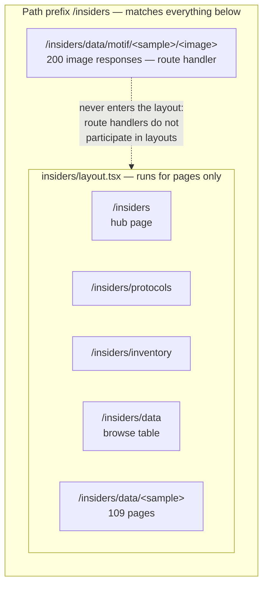

# feat: Lab site structure with a protected insiders area

## Summary

Turn the DAP-seq browser from the whole site into one section of a lab website. Public
pages get a route group and a shared shell; an `/insiders` segment gets its own shell and
holds the data browser, protocols, and inventory. Every page arrives as a placeholder — the
deliverable is a navigable skeleton, not content.

The data browser and its motif image route relocate under `/insiders/data` as a single
change, so no commit exists where the pages sit behind the boundary and the 200 logo images
are still served outside it.

Nothing here chooses an authentication mechanism (see origin: `docs/brainstorms/2026-08-04-lab-site-structure-requirements.md`).
The structure's job is to make that choice cheap when it arrives: one path prefix to
protect, and nothing protected outside it.

---

## Problem Frame

Four route files, all at the root, all public: the browse table is `/`, detail pages are
`/<sample>`, and motif logos are served from `/motif/<sample>/<image>`. There is no
`middleware.ts`. The whole build reads gitignored research data.

The origin document establishes what the pivot needs. Research since then sharpened one
thing and corrected another.

**Sharpened — the enforcement surface is the path, not the layout.** Next's route
documentation is explicit that a route handler "does not participate in layouts or
client-side navigations like `page`." The motif image route is a route handler. Nesting it
under an insiders *layout* therefore gives it nothing: a layout can wrap pages, but it never
runs for `route.ts`. What makes the boundary enforceable for both pages and image bytes is
the shared **path prefix**, which any future middleware can match in one rule. The origin
document's phrase "one layout to attach protection to" is wrong in a way worth correcting
before something is built on it — the layout is navigation and chrome; the prefix is
enforcement.

**Confirmed — nesting choice avoids full page reloads.** Route groups can define *multiple
root layouts*, and navigating between two of them triggers a full page reload. Keeping the
existing `app/layout.tsx` as the single root makes the public and insiders layouts *nested*
instead, so moving between the two sides of the site stays a client-side navigation.

---

## Requirements

Carried from the origin document, grouped by what the work touches. Origin R-IDs are
preserved so the two documents stay traceable.

**The public site**

| ID | Requirement |
|----|-------------|
| R1 | Public pages exist for landing, about, people, publications, and news, each at its own URL and linked from a shared navigation. |
| R2 | Public pages share one layout, so adding a sixth is a file rather than a copy-paste. |
| R3 | The landing page remains at `/`. |
| R4 | Every public page renders as a placeholder naming itself, with no content or styling commitments. |

**The insiders area**

| ID | Requirement |
|----|-------------|
| R5 | All protected pages sit beneath a single `/insiders` parent, and no protected page or asset exists outside it. |
| R6 | `/insiders` is itself a page — a hub linking its sections — not a bare directory. |
| R7 | Protocols and inventory exist as placeholder pages alongside the data browser. |
| R8 | The insiders area has its own layout and navigation, distinct from the public one. |

**Relocating the existing browser**

| ID | Requirement |
|----|-------------|
| R9 | The browse table, detail pages, and motif image route move under `/insiders/data`, keeping current behaviour exactly — filtering, sorting, pagination, logos, detail pages. |
| R10 | No internal link points at an old location. |
| R11 | The motif image route is not reachable from outside the insiders boundary. |
| R12 | The prerendered entry count is unchanged by the move: 109 detail pages and 200 image responses, at new paths. |

**Groundwork**

| ID | Requirement |
|----|-------------|
| R13 | Every route whose build depends on the research database sits within `/insiders/data`. |
| R14 | Adding a new insiders section requires creating a directory, not editing a list of protected paths. |
| R15 | Nothing in the structure presumes a particular authentication mechanism. |

**Actors** (origin A1–A3): the public visitor must never reach a protected page or research
asset (R5, R11); the lab insider moves between insiders sections without passing through the
public site (R8); the site maintainer is **not assumed to hold the research database**, which
is what R13 exists for.

---

## Key Technical Decisions

### KTD1. A route group for the public shell, a real segment for the insiders boundary

`app/(public)/` shares a layout across the public pages without adding a URL segment, so the
landing page stays at `/`. `app/insiders/` is a real segment, so the protected area has a
path prefix.

The asymmetry is deliberate and each half is doing what only it can. A route group cannot
create a URL prefix, and a URL prefix is the only thing a future middleware rule can match —
so the insiders side must be a real segment. Conversely the public pages need shared chrome
and *not* a URL prefix, which is exactly a route group.

The alternative — a `(insiders)` route group — produces the same shared layout with no path
marker, which means protection has to enumerate `/data`, `/protocols`, `/inventory` and keep
that list correct forever. That list is what eventually ships a page unprotected.

Verified against `node_modules/next/dist/docs/01-app/03-api-reference/03-file-conventions/route-groups.md`:
groups are excluded from the URL path, and two groups resolving to the same path is an error
(so exactly one route may own `/`).

### KTD2. Keep the existing root layout; the new layouts are nested

Route groups can define multiple root layouts, and navigating between two of them forces a
full page reload. Retaining `app/layout.tsx` as the single root makes `(public)/layout.tsx`
and `insiders/layout.tsx` nested layouts instead, so crossing between the public site and
the insiders area stays a client-side navigation.

The root layout keeps only what is genuinely global — fonts, `globals.css`, the `<html>`
shell. Navigation belongs to the two nested layouts, because the whole point is that the two
sides look different.

### KTD3. The path prefix is the enforcement surface; the layout is not

Route handlers do not participate in layouts. The motif image route is a route handler, so
an insiders layout would never run for it — meaning a layout-based guard would protect 109
detail pages and leave 200 images open.

Everything protected therefore shares the `/insiders` path prefix, and the plan's
structural guarantee is about that prefix rather than about layout nesting. This does not
choose a mechanism; it makes any path-matching mechanism a single rule.

### KTD4. Navigation lives in a data module, not in the layouts

The two navs go in `lib/site/nav.ts` as plain data, JSX-free, following how `DETAIL_GROUPS`
and `COLUMN_LABELS` already work in this codebase.

The reason is a drift failure this structure invites: someone adds `app/insiders/equipment/`
and forgets the nav, so the page exists and is unreachable. With the nav as data, a test can
compare it against the directories that actually exist and fail when they disagree. A nav
written inline in a layout cannot be checked that way.

### KTD5. The browser and its image route move in one change

They could move separately — relocating the pages first leaves the images working at their
old URLs. That intermediate state is precisely the hole the origin document identified: the
pages behind the boundary, the research images outside it. Even for one commit, that is the
wrong artifact to leave in history.

So `app/insiders/data/` receives the browse page, the detail pages, and the image route
together, along with the two link-construction updates that follow them.

### KTD6. Internal links are constructed, not written inline

The sample link currently interpolates a path in a client component, and the motif URL is
built from a segment constant. After the move, both live beside each other in the display
layer as functions, so a future relocation is a constant change rather than a search across
components — and so the guard tests have something to assert against.

### KTD7. Placeholders are real pages, not stubs behind a flag

Every new page renders a heading naming itself and nothing else. No content, no styling
decisions, no `TODO` comments standing in for markup. A page that responds and names itself
is verifiable — a reader can click every nav link and find no dead ends — and filling it
later touches only that file.

---

## High-Level Technical Design

### What a layout protects, and what it doesn't

The single most consequential shape in this plan, because getting it backwards yields a
boundary that looks complete and leaks the data.



The image route sits inside the prefix and outside the layout. A guard attached to the
layout covers the five page kinds and misses the images entirely; a guard attached to the
prefix covers all six. That is why R11 is phrased about reachability rather than about
nesting, and why KTD3 names the prefix as the enforcement surface.

---

## Output Structure

The expected shape after the work. Per-unit `Files:` lists remain authoritative; this is
the scope declaration.

```
app/
  layout.tsx                          root shell only — fonts, globals, <html>
  (public)/
    layout.tsx                        public nav + footer
    page.tsx                          /
    about/page.tsx                    /about
    people/page.tsx                   /people
    publications/page.tsx             /publications
    news/page.tsx                     /news
  insiders/
    layout.tsx                        insiders nav
    page.tsx                          /insiders — the hub
    protocols/page.tsx                /insiders/protocols
    inventory/page.tsx                /insiders/inventory
    data/
      page.tsx                        /insiders/data — the browse table
      [sample]/page.tsx               /insiders/data/<sample>
      motif/[sample]/[image]/route.ts /insiders/data/motif/<sample>/<image>

lib/site/
  nav.ts                              both navs as data
  nav.test.ts
  boundary.test.ts                    structural guards
```

`app/page.tsx`, `app/[sample]/`, and `app/motif/` are gone — moved, not copied.

---

## Implementation Units

### U1. The public shell

**Goal.** A route group holding five placeholder pages under one layout, with the landing
page still at `/`.

**Requirements.** R1, R2, R3, R4; origin F1.

**Dependencies.** None.

**Files.**
- `app/(public)/layout.tsx` — create
- `app/(public)/page.tsx` — create (the landing page)
- `app/(public)/about/page.tsx`, `people/page.tsx`, `publications/page.tsx`, `news/page.tsx` — create
- `app/page.tsx` — delete (its content moves to `/insiders/data` in U3)
- `app/layout.tsx` — modify (strip to the global shell)
- `lib/site/nav.ts` — create
- `lib/site/nav.test.ts` — create

**Approach.** Read `node_modules/next/dist/docs/01-app/03-api-reference/03-file-conventions/route-groups.md`
before writing — project gate, and it carries the two caveats this unit turns on: groups are
excluded from the URL, and exactly one route may resolve to `/`.

Deleting `app/page.tsx` and creating `app/(public)/page.tsx` in the same unit matters: both
resolve to `/`, and having them coexist is a build error rather than a precedence question.

The public nav goes in `lib/site/nav.ts` as an ordered list of `{ href, label }`. The footer
carries a single unobtrusive link to `/insiders` — resolving an origin open question in favour
of members finding the area over hiding it, since the URL is guessable anyway and obscurity
is not the protection.

**Patterns to follow.** `lib/display/column-groups.ts` for nav-as-data with a validating
function; `lib/display/labels.ts` for the throw-rather-than-fall-back stance.

**Test scenarios.**
- The public nav's hrefs match the page directories that exist under `app/(public)/` — a page added without a nav entry, or a nav entry with no page, fails. This is the drift guard KTD4 exists for.
- Every nav href is root-relative and none carries a trailing slash, so links are uniform.
- Nav labels are non-empty and distinct.
- Covers AE4. Every href in the public nav corresponds to a page file that exists, so clicking every link finds a page rather than a 404.
- The nav contains no `/insiders` entry — the insiders link is a separate footer concern, and mixing it into the public nav would put a protected destination in the main navigation.
- Exactly one route resolves to `/`: no `app/page.tsx` survives alongside `app/(public)/page.tsx`.

**Verification.** `npm run build` succeeds; `/`, `/about`, `/people`, `/publications`, and
`/news` each respond and name themselves; the nav links to all five.

---

### U2. The insiders shell

**Goal.** The `/insiders` segment with its own layout, a hub page, and placeholder protocols
and inventory pages.

**Requirements.** R5, R6, R7, R8, R14; origin F2.

**Dependencies.** U1 (shares `lib/site/nav.ts`).

**Files.**
- `app/insiders/layout.tsx` — create
- `app/insiders/page.tsx` — create (the hub)
- `app/insiders/protocols/page.tsx`, `app/insiders/inventory/page.tsx` — create
- `lib/site/nav.ts` — modify (the insiders nav)
- `lib/site/nav.test.ts` — modify

**Approach.** A nested layout, not a root layout — KTD2. It carries the insiders nav and a
way back to the public site, and looks distinct enough that a reader can tell which side of
the boundary they are on.

The hub at `/insiders` lists its sections rather than redirecting to one of them. A redirect
would make the hub URL a lie and would need revisiting the moment a fourth section exists.

The insiders nav is derived from the same data module, and its guard test is the same shape:
the nav and the directories agree, or the test fails. That is what makes R14 true — a new
section is a directory plus a nav entry, and nothing else, because there is no list of
protected paths to maintain.

**Note the layout is chrome, not a guard.** Whatever eventually enforces the password
matches the path prefix (KTD3). Nothing in this unit should read as protection, and the
layout should carry a comment saying so, or a later reader will assume the area is already
protected.

**Patterns to follow.** U1's layout and nav shape.

**Test scenarios.**
- The insiders nav's hrefs match the directories under `app/insiders/`, including `data`.
- Every insiders nav href begins with `/insiders`, so no entry can point outside the boundary.
- Covers AE3. Adding a directory under `app/insiders/` with a nav entry requires no change to any list of protected paths — asserted by there being no such list to find: no source file enumerates protected routes.
- The hub links every insiders section, so no section is reachable only by typing its URL.
- Covers AE4. Every href in the insiders nav and on the hub corresponds to a page file that exists — the skeleton has no dead ends on either side of the boundary.

**Verification.** `/insiders`, `/insiders/protocols`, and `/insiders/inventory` respond and
name themselves; the insiders nav appears on each and the public nav does not.

---

### U3. Relocate the data browser and its image route

**Goal.** The browse table, detail pages, and motif images move under `/insiders/data` with
behaviour unchanged.

**Requirements.** R9, R10, R11, R12, R13; origin AE1, AE2.

**Dependencies.** U2.

**Files.**
- `app/insiders/data/page.tsx` — create (from `app/page.tsx`)
- `app/insiders/data/[sample]/page.tsx` — create (from `app/[sample]/page.tsx`)
- `app/insiders/data/motif/[sample]/[image]/route.ts` — create (from `app/motif/[sample]/[image]/route.ts`)
- `app/[sample]/`, `app/motif/` — delete
- `lib/display/motif.ts` — modify (the route segment becomes a path prefix; add sample-href construction)
- `lib/display/motif.test.ts` — modify
- `components/qc-runs-table.tsx` — modify (the sample link)

**Approach.** One unit because splitting it leaves a commit where the pages are behind the
boundary and the images are not (KTD5).

**Three link sites change**, and they are the three the scan found — worth naming exactly,
because an earlier draft of this plan miscounted them and lost one:

1. `MOTIF_ROUTE_SEGMENT` in the display layer, which becomes the full prefix rather than a bare segment.
2. The sample link in the browse table, currently interpolating a path inside a client component.
3. **The detail page's "All runs" back link**, currently `/` — which after the move must reach the browse table at its new path, not the site's landing page. Left alone it would silently send a reader from a sample straight out of the insiders area to the public home page.

All three become constructed rather than inline (KTD6): the display layer gains functions for
the browse path, a sample path, and a motif image path, and the three call sites use them.

Everything else moves unchanged. The page bodies, the seam reads, `generateStaticParams`, the
filtering, the motif geometry — none of it knows where it is mounted. The prerendered count
is the check that nothing was lost: 313 entries before, 313 after.

**Execution note.** Move one route at a time and build between moves. A relocation that
breaks three routes at once is far harder to attribute than three that break one each, and
`next build` is what will tell you — dev tolerates stale routing state that a build does not.

**Patterns to follow.** `lib/display/motif.ts` already isolates URL construction above the
seam; extend it rather than introducing a second place paths are built.

**Test scenarios.**
- Covers AE1. `motifImageUrl` returns a path beginning `/insiders/data/motif/`, and no path outside `/insiders` is produced for any sample or image id.
- `sampleHref` returns `/insiders/data/<sample>` and is what the table uses — no component interpolates a sample path itself.
- The two motif image ids still produce distinct URLs, and a URL-unsafe sample name would still round-trip (the existing assertions, re-pointed at the new prefix).
- Covers AE2. The existing filtering, sorting, and motif-geometry suites pass untouched — the move must not need a single test rewritten outside the URL construction ones. Any other test needing a change is a signal the move changed behaviour.
- No source file references `href="/"` as the browse table, or a `/motif/` path outside the insiders prefix. The back link in particular must resolve to the browse table and not the landing page.
- The reserved-segment collision check survives the move with its meaning intact. It currently asserts no sample is named `motif`, because `app/motif/` sat beside `app/[sample]/`; after the move `motif` sits beside `[sample]` under `data/`, so the same collision is still possible and the same assertion still guards it. Re-point it, do not delete it.
- Covers R12 at build time: the build reports 313 prerendered entries, with the detail and image paths under `/insiders/data`.

**Verification.** `npm run build` reports 313 entries at the new paths. In a browser:
`/insiders/data` filters and sorts as before, a sample link reaches
`/insiders/data/<sample>`, the detail page's back link returns to the table, and motif logos
render. `/motif/TP53_b2/summits_logo1` and `/TP53_b2` both 404.

---

### U4. Structural guards

**Goal.** Make the plan's structural claims checkable, so they survive people who never read
this document.

**Requirements.** R13, R14, R15; origin AE3, AE5.

**Dependencies.** U3.

**Files.**
- `lib/site/boundary.test.ts` — create

**Approach.** Source-reading tests, following the precedent this codebase already set with
`lib/display/sticky-column.test.ts` and the client-bundle guard in `lib/display/motif.test.ts`:
when an invariant is structural rather than behavioural, a test that reads the tree is the
cheapest thing that can hold it.

Three claims are worth holding. Every route that reads the research data lives under
`app/insiders/data/` (R13) — the property that keeps the public site's independence from the
database achievable later. Nothing protected exists outside the `/insiders` prefix (R5, R11).
And no file enumerates protected paths (R14), which is the absence that makes adding a
section safe.

**Test scenarios.**
- Covers AE5. No route file outside `app/insiders/data/` imports the data seam, directly or via the display modules that wrap it. Enumerate `app/**/{page,route}.ts?(x)`, read each, and assert the seam import appears only under the data subtree.
- Covers AE3. No source file contains a list of protected route paths — the drift vector R14 exists to remove. Asserted by pattern: no array or union literal enumerating two or more `/insiders/...` paths outside the nav module.
- Every `page.tsx` and `route.ts` under `app/insiders/` resolves to a URL beginning `/insiders`, computed from its path on disk rather than trusted.
- The reverse: no `page.tsx` or `route.ts` outside `app/insiders/` resolves to a URL beginning `/insiders`, so the prefix cannot be reached from two places.
- The guard has teeth: moving the motif route back to `app/motif/` fails the boundary test rather than passing quietly. Assert by construction — the test enumerates the tree, so a file in the wrong place is visible to it.

**Verification.** `npm test` green. Each guard fails when its invariant is deliberately
broken — the check that they are guards rather than decoration.

---

### U5. Record the pivot

**Goal.** Leave the ladder, register, and `CLAUDE.md` describing a lab website rather than a
data browser.

**Requirements.** Project gates — work-in-order requires the reorder recorded; the register's
contract is that decisions leave by being made and recorded.

**Dependencies.** U1–U4.

**Files.**
- `CLAUDE.md` — modify (§1, §4, §8)
- `docs/build-ladder.md` — modify
- `docs/deferred-decisions.md` — modify

**Approach.**

*`CLAUDE.md` §1 is now wrong and needs rewriting, not amending.* It currently says the app is
a searchable table with detail pages and closes with "That's the whole app. Keep it focused —
this is a data browser, not a platform." The pivot contradicts that directly. The replacement
should describe a lab website with a protected insiders area, and keep the *spirit* of the
focus instruction where it still applies: the data browser stays a data browser, and the
surrounding site stays pages rather than becoming a platform. §4 gains the route structure
and `lib/site/`. §8 notes that the browse table now lives at `/insiders/data`. Section
numbers §1–§9 stay as they are — the ladder, the register, and four plans cite them.

*Ladder.* A rung for the pivot, inserted ahead of M6 and recorded as a reorder. Worth stating
plainly that the ladder's own frame widened: it was "how this data browser gets built" and is
now "how this site gets built", with the browser as one section.

*Register — resolve:* the public/insiders split and why the asymmetry between route group and
real segment; that the path prefix rather than the layout is the enforcement surface, with the
route-handler reason; and the three origin open questions this plan settled (the footer link,
the sample path staying short, the data section getting its own heading).

*Register — open:*
- Authentication remains undecided, and now carries a recorded constraint: it must be able to match a path prefix, because a layout cannot cover the image route.
- Static prerendering versus password protection. 313 baked entries served as files need something in front of them to be protected at all. Carried from the origin document as a constraint on the eventual mechanism.
- Making the public site buildable without the research database. R13 confines the coupling; the change itself is still open, and now has a named beneficiary in the site maintainer who does not hold the data.

**Test scenarios.** `Test expectation: none — documentation.`

**Verification.** §1–§9 unchanged in number. Every decision this plan made appears in the
register as resolved or open. No document still describes the app as a single-purpose browser.

---

## Scope Boundaries

### In scope
The route skeleton, both nested layouts and their navs, placeholder pages for all sections,
relocating the browser and its image route with links constructed rather than inline, the
structural guards, and the documentation pivot.

**One item pulled forward from the origin's deferral.** The data section needs a heading now
that the site name lives on the landing page, and writing that heading is the natural moment
to restore the sentence stating how many samples have no motif and why — the cue lost when
the old page subtitle was removed, which currently leaves blank logo cells indistinguishable
from unrecorded values. It is one line inside work that is already in scope, and easy to cut
if unwanted.

### Deferred for later
Carried from the origin document.
- **Authentication itself.** No mechanism, no enforcement, no session handling.
- **Content and styling for every page.** Deliberately — the point of this pass is that the shape exists.
- **Making the public site buildable without the research database.** The coupling is confined; the change is not made.
- **M6, the Midway sync.** Unchanged in priority and explicitly not part of this.

### Outside this product's identity
Carried from the origin document.
- **A public data portal.** The research data is for the lab, behind the password. Designing for outside readers would change every decision the data browser has made.
- **A LIMS.** Protocols and inventory are pages a person reads, not a sample-tracking system with workflows and state machines.
- **A CMS.** Pages are files in the repo, edited by people who can open a pull request.

### Deferred to follow-up work
- **A shared page shell for placeholder pages.** Five near-identical public pages invite one, but extracting it before any page has real content would be abstracting from a sample of placeholders.
- **`error.tsx` and `not-found.tsx`.** Both become more valuable with a public audience, and the register already carries the production-failure entry. Adding them now would mean designing error pages for a site that has no visual design.
- **Redirects from the old paths.** Bookmarks break; it is one person for one week, and a redirect from `/` to `/insiders/data` would defeat the pivot's whole point by making the browse table the site's front door again.

---

## Risks & Dependencies

| Risk | Mitigation |
|---|---|
| A layout-based guard is assumed to protect the image route, and the images ship reachable. | KTD3 and the design diagram make the asymmetry the plan's most prominent structural fact, and the boundary guard asserts reachability from the path on disk rather than from nesting. |
| Two routes resolve to `/` and the build fails confusingly mid-move. | U1 deletes `app/page.tsx` in the same unit that creates `app/(public)/page.tsx`, and the route-groups caveat is read before writing. |
| The move quietly changes browser behaviour. | The existing filtering, sorting, and motif suites must pass **untouched**; a test needing a rewrite outside URL construction is treated as a signal, not a chore. Plus the 313-entry count as an arithmetic check. |
| A future section is added and left out of the nav, so a page exists unreachable. | The nav is data, and a test compares it against the directories that exist. This is the whole reason for KTD4. |
| Someone adds a data-reading route outside the data subtree, quietly recoupling the public site to the database. | The boundary guard enumerates route files and asserts the seam import appears only under `app/insiders/data/`. |
| The pivot's documentation lag leaves `CLAUDE.md` §1 telling the next reader this is not a platform. | U5 rewrites §1 rather than amending it, and its verification is that no document still describes the app as a single-purpose browser. |

**Dependencies.** No new packages. Route groups, nested layouts, and route handlers are all
framework features already in use. No change to the data seam, the row type, or what is read
from `data/`.

---

## System-Wide Impact

**Every URL the browser has ever had changes.** Bookmarks, any link shared during
development, and the session's own test URLs all break. Accepted rather than mitigated (see
Deferred to follow-up work).

**The prerendered surface grows and moves.** 313 entries become 313 entries at new paths plus
nine placeholder pages. The build still requires both `data/` sources; R13 confines that
requirement rather than removing it.

**The register gains a reader.** Several open entries were written for an app with one
audience. Production failure modes, and whether research data is served at all, now have a
public side to consider — noted in U5 rather than resolved here.

**The seam is untouched.** Nothing below `lib/data/index.ts` changes, and no page changes what
it asks for. The pivot is entirely above the data boundary, which is the reason it is a
route-moving exercise rather than a rewrite.

---

## Deferred to Implementation

- Exact placeholder copy for the nine new pages, beyond each naming itself.
- Whether the insiders layout's route back to the public site is a link, a breadcrumb, or both.
- The visual distinction between the two layouts — the requirement is that a reader can tell which side they are on, not how.
- Whether the boundary guard reads the route tree with a glob or a directory walk. Both satisfy the assertions; the choice is legibility.
- Whether the `(public)` group also wants a `template.tsx`. Not needed for placeholders; may be once pages animate or reset state per navigation.

---

## Sources & Research

- `node_modules/next/dist/docs/01-app/03-api-reference/03-file-conventions/route-groups.md` — groups are excluded from the URL path; two groups resolving to the same path is an error; multiple root layouts trigger a full page reload when navigating between them. All three shape KTD1 and KTD2.
- `node_modules/next/dist/docs/01-app/03-api-reference/03-file-conventions/route.md` — a route handler "does not participate in layouts or client-side navigations like `page`." This is KTD3 and it corrects the origin document's framing.
- Current route surface, verified: four files (`app/page.tsx`, `app/[sample]/page.tsx`, `app/motif/[sample]/[image]/route.ts`, `app/layout.tsx`) and no `middleware.ts`.
- Three internal-URL sites, verified by search: the detail page's back link, the sample link in `components/qc-runs-table.tsx`, and `MOTIF_ROUTE_SEGMENT` in `lib/display/motif.ts`.
- Both `generateStaticParams` implementations read through the seam, which is why the whole build fails without `data/` — confirmed earlier by building a fresh clone, which exits naming the missing path.
- Existing structural-test precedent: `lib/display/sticky-column.test.ts` and the client-bundle guard in `lib/display/motif.test.ts` both assert invariants by reading source. U4 follows them.
- `CLAUDE.md` §1 and `docs/build-ladder.md` both describe a single-purpose data browser; §1 closes with "this is a data browser, not a platform." U5 addresses the contradiction directly.
