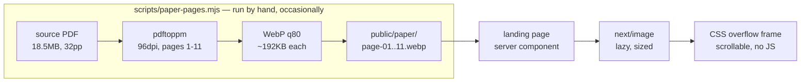

# feat: Scrollable preview of the featured paper

## Summary

Turn the landing page's Recent paper block into a preview you can actually scroll: the article's
real pages, rendered to images at build-preparation time and stacked in a scrollable frame beside
the citation.

The empty column left there deliberately in the previous plan is what this fills.

The paper is *Nature* 2023, **CC BY 4.0**, which is what makes any of this legal — the licence
permits redistribution with attribution, so the pages can be hosted here rather than linked away.
The approach needs **no PDF viewer library and no JavaScript at all**: a CSS overflow container
holding lazily-loaded images is a scrollable document, and it stays a server component like every
other public page.

Eleven pages, not thirty-two. Page 12 begins the Methods, so pages 1–11 are the article proper
with all five main figures, and that is what "preview" should mean. The rest is a link to PMC.

---

## Problem Frame

The Recent paper block is a title, a PMID, an abstract and a link — accurate, and flat. It is the
lab's *Nature* paper and it reads like a bibliography entry. The previous plan deliberately left
the space beside it empty rather than filling it with the source site's generic document glyph,
on the grounds that a better treatment was worth doing properly.

The obvious instinct is to embed the PDF. Measured, that is a bad idea: **18.5MB across 32
pages**, which is more than the entire rest of the site's assets combined, and it would need a
viewer library this project does not have and a client component the public pages currently avoid
entirely.

The paper being CC BY changes what is possible. Its pages, figures and full text can all be
reused with attribution, so the constraint is no longer permission — it is weight, and weight is
solvable by rendering pages once at preparation time instead of shipping a PDF at request time.

---

## Requirements

**R1.** The featured paper's real pages are visible on the landing page and can be scrolled
without leaving it.

**R2.** No PDF viewer library and no new runtime dependency. The prep step may use system tools.

**R3.** The preview adds no client-side JavaScript. The landing page stays a server component and
stays statically prerendered.

**R4.** Page images load lazily, so opening the landing page does not download pages nobody has
scrolled to.

**R5.** CC BY attribution is visible: title, a citation naming the authors, the journal and year,
the licence, and a link to the canonical article.

**R6.** A reader who cannot use a stack of page images — screen reader, or images disabled — is
given a route to the real text rather than a wall of unlabelled graphics.

**R7.** Committed page images are bounded and checked: every page the page declares exists, no
orphans linger in the served directory, and no single page ships at original-render size.

**R8.** The preview degrades sensibly at narrow widths rather than trapping the page scroll inside
a nested container.

**R9.** The prep step is standalone, idempotent, and fails loudly. Running it twice leaves correct
output; a missing or truncated source PDF stops it rather than producing a short preview.

---

## Key Technical Decisions

### Pre-rendered page images, not a PDF viewer

Three approaches were measured before choosing.

| Approach | Weight | Cost |
| --- | --- | --- |
| Embed the 32-page PDF | 18.5MB | Needs a viewer library and a client component |
| Pre-rendered page images, pages 1–11 | ~2.1MB | Text is not selectable; a prep step is needed |
| Scroll-driven figure walkthrough | ~1MB | Editorial work: someone must say what each figure means |

Page images win because the cost they carry is a build-preparation script, which this project
already understands how to reason about, while the other two carry a runtime dependency and an
authorship burden respectively.

**The real cost of this choice, stated plainly: the text in a page image is not selectable,
searchable, or resizable.** That is a genuine regression against a PDF viewer and the reason R5
and R6 exist — the canonical article has to be one click away, always.

### Eleven pages

Page 12 of the PDF opens with "Methods". Pages 1–11 are the article proper and contain all five
main figures; pages 12–32 are Methods, references, and nine Extended Data figures.

Measured at 96dpi, WebP quality 80:

| Scope | Per page | Total |
| --- | --- | --- |
| Pages 1–11 (the article) | ~192KB | **~2.1MB** |
| All 32 pages | ~192KB | ~6.0MB |
| All 32 at 72dpi | ~120KB | ~3.8MB |

2.1MB is roughly twice the site's entire current asset weight, which is a real cost but a
proportionate one for the lab's flagship paper. 6MB for Methods and Extended Data that nobody will
scroll to on a landing page is not. Changing the number later is one constant in the prep script
and a re-run.

### 96dpi, giving 794px-wide pages

The preview frame lands near 420px on a desktop viewport, so 794px is close to the 2× a retina
screen wants. 72dpi (596px) is visibly soft at 2×; 140dpi (1158px) costs 75% more for detail the
frame cannot show. Both were rendered and compared rather than reasoned about.

### Zero JavaScript

`overflow-y: auto` on a fixed-height container, with `` children, is a scrollable document.
No client component, no viewer, no scroll listener.

This is worth stating because the instinct for "live scrollable preview" is a client component,
and it is not needed. It keeps the landing page a server component, keeps the route static, and
means the preview cannot break hydration.

The things JavaScript would buy — a page counter that updates as you scroll, keyboard paging, a
zoom control — are not in this plan. If they turn out to matter, they are additive later.

### Committed, not fetched at build

Page images live in `public/` beside the headshots and the splash photograph, so a fresh clone or
CI builds the page without network access. The alternative — a gitignored directory populated by a
prep script, mirroring how `data/` works — was considered and rejected for this asset: research
data is gitignored because it is large, private, and pipeline-owned, and none of those apply to
eleven pages of a CC BY paper.

### The prep script is a script, not part of the build

It follows the same posture as the planned Midway sync (see `docs/build-ladder.md` M6): standalone,
run occasionally by a human, idempotent, and loud on failure. It is not wired into `npm run build`,
because a build should not depend on poppler being installed or on a 18.5MB download.

`pdftoppm` is a **system** dependency (poppler-utils), not an npm one. That is a deliberate
trade — it keeps `package.json` unchanged — and it means anyone re-running the prep step needs
poppler. The script must say so when it is missing rather than failing obscurely.

---

## High-Level Technical Design

Two shapes matter here: the preparation pipeline, which runs rarely, and the render, which runs at
build time like everything else.



The frame's anatomy, directional rather than prescriptive:

```
┌─ section: Recent paper ──────────────────────────────────────┐
│                                                              │
│  ┌─ scroll frame ─────────┐   Brain-wide correspondence of   │
│  │ ┌────────────────────┐ │   neuronal epigenomics and       │
│  │ │ page-01  (eager)   │ │   distant projections.           │
│  │ │                    │ │                                  │
│  │ └────────────────────┘ │   Zhou et al., Nature, 2023      │
│  │ ┌────────────────────┐ │   PMID 38092919 · CC BY 4.0      │
│  │ │ page-02  (lazy)  ↓ │ │                                  │
│  │ └────────────────────┘ │   [abstract paragraph]           │
│  │      … 11 pages        │                                  │
│  └────────────────────────┘   [ Read on PMC ]  [ Other pubs ] │
│    overflow-y: auto            ↑ R6 lives here: the real text │
└──────────────────────────────────────────────────────────────┘
```

At narrow widths the two columns stack and the frame shortens (R8) — a tall nested scroll region
on a phone is where scroll-trapping bites.

---

## Output Structure

```
scripts/
  paper-pages.mjs              renders the source PDF to page images; standalone, idempotent
public/paper/
  page-01.webp … page-11.webp  the article proper, 96dpi, ~192KB each
lib/site/paper.ts              the featured paper's citation, licence, links, and page count
lib/site/paper.test.ts         guards: pages exist, no orphans, size cap, contiguous numbering
components/site/paper-preview.tsx   the scroll frame; server component, no JS
app/(public)/page.tsx          the Recent paper block gains the preview beside it
```

`scripts/` does not exist yet — the Midway sync is the other planned occupant.

---

## Implementation Units

### U1. The page-render prep script

**Goal:** A standalone script turns the source PDF into the committed page images, repeatably.

**Requirements:** R2, R9

**Dependencies:** none

**Files:**
- Create: `scripts/paper-pages.mjs`
- Create: `public/paper/page-01.webp` … `page-11.webp` (its output, committed)

**Approach:** Take the source PDF path and write `public/paper/page-NN.webp`. Zero-padded names so
lexical order is page order — the same reasoning that makes the fixture files sort correctly.

Render with `pdftoppm` at 96dpi, then encode WebP at quality 80. Clear the output directory first
so a re-run after reducing the page count does not leave stale pages behind, which is also what
makes it idempotent.

Fail loudly and specifically: poppler missing, source PDF absent, or the PDF having fewer pages
than requested. The last one matters most — silently producing a 6-page preview because the source
changed is the failure that looks like success.

The source PDF is **not** committed; it is 18.5MB and only the script needs it. The script should
name where to obtain it (PMC10719087) when it is missing.

**Patterns to follow:** `db/fixture.ts` for a standalone script that builds artefacts and is not
imported by the app. The loud-failure posture in `lib/data/` — name the file or value that is
wrong, never substitute a plausible default.

**Test scenarios:** No unit tests. This is a build-preparation tool whose output is checked by U4,
and mocking `pdftoppm` would test the mock. Verified by running it.

**Verification:** Run it on a clean `public/paper/` and get exactly 11 files, `page-01` through
`page-11`, each 150–250KB, each visibly the right page when opened. Run it a second time and get
byte-identical output and no extra files. Point it at a missing PDF and at a 3-page PDF, and
confirm both stop with a message naming the problem.

### U2. The paper as data

**Goal:** The citation, licence and page count live in one declared place with a test against it.

**Requirements:** R5, R7

**Dependencies:** U1

**Files:**
- Create: `lib/site/paper.ts`
- Create: `lib/site/paper.test.ts`

**Approach:** Follow `lib/site/people.ts` exactly — a declared structure whose claims a test checks
against the directory it describes. Holds the title, the citation string, journal, year, PMID, DOI,
the licence and its URL, the canonical link, and the page count.

The page count is the load-bearing field: it is what the guard compares against `public/paper/`, so
a prep-script re-run that changes the page count and a page that forgets to update cannot silently
disagree.

Author attribution is a citation, not the full list — this paper has enough authors that printing
all of them would dominate the block. "Zhou et al." with the journal and year satisfies CC BY as
normally practised.

**Patterns to follow:** `lib/site/people.ts` and `lib/site/people.test.ts`, including the
both-directions check and the per-file size cap.

**Test scenarios:**
- Every page from 1 to the declared count exists in `public/paper/`.
- No file in `public/paper/` is outside the declared range — the orphan direction, which is what
  catches a page count reduced without deleting the files.
- Numbering is contiguous from 1; a gap fails.
- No page image exceeds 400KB, so a re-render at a much higher dpi cannot land unnoticed.
- The guard is not vacuous: the file count equals the declared page count and the count is at least
  2, so an emptied directory fails rather than passing.
- The licence URL and canonical link use `https://`, and neither is empty.
- Mutation-check each guard by breaking its invariant, per this repo's standing practice.

**Verification:** `npm test` passes, and each new guard has been observed failing when its
invariant is deliberately broken.

### U3. The scroll frame

**Goal:** A scrollable stack of page images, with no JavaScript, that behaves at every width.

**Requirements:** R1, R3, R4, R6, R8

**Dependencies:** U2

**Files:**
- Create: `components/site/paper-preview.tsx`

**Approach:** A server component. A fixed-height container with `overflow-y: auto`, holding one
`next/image` per page at explicit dimensions so the container's scroll height is right before
anything loads.

First page eager, the rest lazy (R4).

**The lazy-loading behaviour inside an overflow container must be verified, not assumed.** Native
`loading="lazy"` is specified against the viewport, and whether a browser also defers images that
are only scrolled out of view *within* a nested container is exactly the sort of thing that differs
between engines. If all eleven load on page open, R4 is unmet and the fallback is an explicit
`IntersectionObserver` — which would cost the zero-JavaScript property, so this is worth measuring
before accepting the design.

R6 lives here: the frame is labelled as a preview of a document, and the canonical link is adjacent
rather than buried. Individual page images are not separately meaningful to a screen reader, so
they should not each announce themselves — one accessible name for the region, with the real text a
link away.

R8: at narrow widths the frame gets shorter, or stops being a scroll region and shows the first
page with the link doing the work. Decide in a browser on a phone-sized viewport.

**Patterns to follow:** `components/site/logo.tsx` and `page-header.tsx` for a small presentational
server component. The people page's `fill` and `sizes` handling for `next/image` inside a sized
box.

**Test scenarios:** No unit tests — a presentational component with no branching beyond eager/lazy.
The claims worth checking are behavioural and belong in the verification below.

**Verification:** In a browser: the frame scrolls through all 11 pages; the network panel shows one
or two images on load, not eleven; scrolling the frame to its end continues scrolling the page
rather than dead-ending; at 390px the layout does not trap the page scroll; the region has an
accessible name and the canonical link is reachable by keyboard. Page count on screen matches the
declared count.

### U4. Wire it into the Recent paper block

**Goal:** The landing page shows the preview beside the citation, with attribution.

**Requirements:** R1, R5

**Dependencies:** U3

**Files:**
- Modify: `app/(public)/page.tsx`

**Approach:** The Recent paper section becomes two columns: the frame on one side, the existing
title, PMID, abstract and links on the other. The abstract stays — it is what a reader skims before
deciding to scroll.

Add the citation line, the licence with its link, and a link to the canonical article. The existing
"Other publications" link stays.

This is the empty column the previous plan left deliberately; the comment there explaining why it
was empty should go with it.

**Test scenarios:** None directly. Covered by U2's guards and U3's browser verification.

**Verification:** Contrast sweep passes across the section at 390, 768 and 1440 — the mint band has
caught a failure on this site before. Route count stays at 323 and `/` stays statically prerendered
(`○`), which is what proves R3 held. Total page weight on first load has not grown by more than the
one eager page.

---

## Scope Boundaries

**Not in this plan:**

- **Any other paper.** One featured paper, hardcoded. Generalising to a PMID-driven component is
  easy once the shape has proven itself, and the Publications page does not exist as real content
  yet to validate it against.
- **The Publications page.** Still a placeholder.
- **Selectable or searchable paper text.** A page image cannot offer it. The canonical link does.
- **Methods, references, and Extended Data.** Pages 12–32 are not shipped.
- **A page counter, keyboard paging, or zoom.** All need JavaScript; all are additive later if they
  turn out to matter.
- **The figure-walkthrough treatment.** Considered and set aside — it needs someone to decide what
  each figure argues, which is authorship rather than engineering.
- **Committing the source PDF.** 18.5MB for a file only the prep script reads.

---

## Risks & Dependencies

**Nested scroll containers are a known mobile hazard.** A tall scroll region inside a scrolling page
means a reader who starts a swipe inside it cannot easily scroll past it. This is the single most
likely thing to make the feature worse than the flat text it replaces, and R8 exists for it. Mitigate
by keeping the frame short at narrow widths, or by not making it a scroll region there at all.

**Lazy loading inside an overflow container may not defer.** If it does not, either R4 or R3 has to
give — eleven eager pages is ~2.1MB on load, and an `IntersectionObserver` costs the
zero-JavaScript property. Measure before committing to the design; this is the plan's main technical
unknown.

**2.1MB is permanent.** Git keeps every byte. The number is defensible for the lab's flagship paper
and it is roughly twice everything else in `public/` combined, so it should be a deliberate choice
rather than a surprise. The per-page size cap in U2 is what stops it growing quietly.

**Page images are not text.** Stated as a decision above and repeated here because it is the honest
cost of the approach: no selection, no search, no reflow, and machine translation cannot touch it.

**poppler is a system dependency.** Present on the machine this was planned on. Anyone re-running the
prep step elsewhere needs it, and the script must say so clearly.

**The source PDF could change.** PMC could re-deposit a corrected version with different pagination,
which would silently move where Methods begins. The page-count guard catches a change in *count*, not
a change in *content*. Low likelihood, and worth knowing the guard's limit.

---

## System-Wide Impact

- **`/` must stay statically prerendered.** The route count should remain 323 and `/` should remain
  `○` in the build output. A client component here would not break the static render, but a
  request-time data fetch would; watching the marker is the cheap check that R3 held.
- **First-load weight of the landing page grows** by one eager page image (~192KB) on top of the
  hero. The hero is already the LCP element at 341KB, so the preview must not compete for priority —
  the first page image should be eager but not `fetchPriority="high"`.
- **`public/` gains a third committed asset class**, after headshots and the splash. The CLAUDE.md
  note explaining why `public/` is committed while `data/` is not should mention it.
- **`scripts/` comes into existence**, which the Midway sync will later share. Nothing about this
  script should assume it is the only occupant.
- **No new npm dependency**, so `package.json` and the lockfile are untouched. That is a deliberate
  property worth preserving through implementation.

---

## Deferred to Implementation

- **Whether lazy loading defers inside the overflow container.** The plan's main unknown; measure it
  in a browser and let the answer pick between native lazy loading and an observer.
- **Frame height, and its narrow-width behaviour.** Both want a real phone-sized viewport, not
  arithmetic.
- **Whether the abstract stays beside the frame or moves below it** at medium widths. Depends on how
  two columns of unequal height actually look.
- **Exact WebP quality.** 80 was measured as reasonable; the encoder may do better at 75 with no
  visible difference across eleven pages of dense figures.
- **Whether the first page gets a subtle affordance** indicating the frame scrolls. It may be
  obvious; it may need a hint. A browser will say.

---

## Sources & Research

**The paper.** Queried Europe PMC on 2026-08-05 for PMID 38092919.

| Field | Value |
| --- | --- |
| Title | Brain-wide correspondence of neuronal epigenomics and distant projections |
| Journal | *Nature*, 2023 (first published 2023-12-13) |
| Identifiers | PMID 38092919 · PMC10719087 · DOI 10.1038/s41586-023-06823-w |
| Licence | **CC BY 4.0**, confirmed from the article's own licence block |
| Open access | Yes, in PMC and Europe PMC, PDF available |
| Authors | Zhou J, **Zhang Z**, Wu M, Liu H, Pang Y, Bartlett A, Peng Z, Ding W, Rivkin A, … |

The licence is the finding that made this plan possible. CC BY 4.0 permits redistribution and
adaptation with attribution, so hosting the pages here is allowed where a paywalled paper's would
not have been.

**The document, measured rather than assumed:**

- 32 pages, 18.5MB, 595×791pt
- Page 12 begins "Methods" — pages 1–11 are the article proper
- 14 figures total: 5 main, 9 Extended Data
- Full-text XML is available at 284KB, which is what a figure-walkthrough treatment would have used

**Render cost, measured on pages 1–2 at WebP q80:**

| dpi | Pixel width | Per page | 11 pages | 32 pages |
| --- | --- | --- | --- | --- |
| 72 | 596px | ~120KB | 1.3MB | 3.8MB |
| **96** | **794px** | **~192KB** | **2.1MB** | 6.0MB |
| 110 | 910px | ~237KB | 2.6MB | 7.4MB |
| 140 | 1158px | ~337KB | 3.7MB | 10.5MB |

**Repo context.** The public pages are all server components; the only client component on the site
is the browse table under `/insiders`. `public/` already holds committed site assets (nine
headshots at 452KB, the splash at 574KB, the icons), with the precedent that images are downscaled
before landing rather than after. `lib/site/people.ts` and its test are the pattern for declaring a
structure and checking it against the directory it describes. `docs/build-ladder.md` M6 sets the
posture for standalone, idempotent, loud-on-failure scripts.

No external best-practice research was run: the technical question here was arithmetic about file
sizes and one licence lookup, both answered directly.
