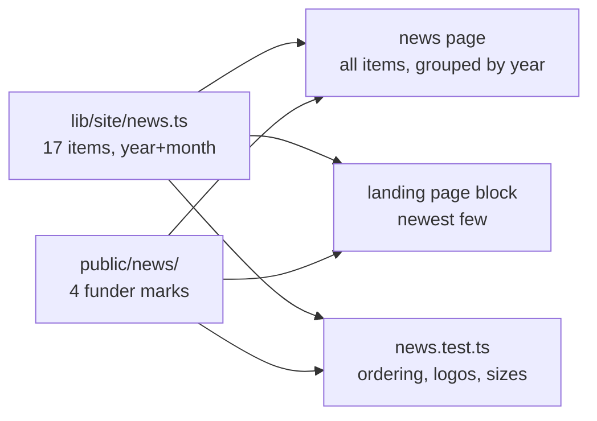

# feat: Redesign the lab news page around a single reading column

## Summary

Carry all 17 news items across from the current site, and drop the timeline they arrive in.

The reference presents them as a centre-line timeline with cards alternating left and right. With
17 items that reads badly for reasons that are structural rather than cosmetic: the eye zigzags
down the page, each date sits on the spine detached from the text it labels, text alignment flips
every row so ragged edges face outward, a generic green icon repeats beside every item carrying no
information, logos appear at three different scales, and "Nick joined our lab, welcome!" gets the
same full card as a grant award.

The replacement is the labelled-row pattern the people page already established: the year in a left
column that pins as you scroll, items in one left-aligned column beside it. One reading path, dates
adjacent to their text, scannable year grouping, no cards.

Dates become structured values rather than free text, which is what lets a test assert the ordering
— and the reference has exactly the bug that invites: one item reads "December, 2024" while sitting
between March 2024 and October 2023.

---

## Problem Frame

The news page is still a placeholder while the current site has 17 real items spanning the lab's
whole existence, from opening its door in July 2023 to an April 2026 scholarship. That is the
richest content the lab has, and the most obviously missing.

It is also the content most likely to grow. Every new member, grant and paper adds a row, so
whatever shape it takes has to stay readable at 17 items and at 50 — which is the specific thing
the reference's timeline fails at, since the zigzag cost compounds with length.

Separately, the landing page states the lab's news too: one hand-written award item from August
2024, now five items out of date. Two places asserting the news is one place too many.

---

## Requirements

**R1.** All 17 items appear, in reverse chronological order, with their text intact.

**R2.** The five items that carry a funder logo keep it, rendered at a consistent size rather than
the three scales the reference uses.

**R3.** Items are grouped by year, with the year label pinned beside its group while that group is
on screen.

**R4.** One reading column. No alternating sides, no centre spine, no decorative icons.

**R5.** No cards. Items are separated by space and hairline rules, as everywhere else on this site.

**R6.** Four transcription errors from the source are corrected, and each correction is recorded
where a reader of the code can see what was changed and why.

**R7.** The landing page's news block derives from the same list as this page, showing the newest
few, so the two cannot disagree or go stale independently.

**R8.** Structural guards: every item has a date and text; the list is provably ordered; every
logo an item references exists on disk; no unreferenced logo sits in the served directory; and no
logo ships oversized.

**R9.** Contrast passes and the layout holds at narrow widths.

---

## Key Technical Decisions

### Dates are structured, not strings

The source stores dates as display text — "April, 2026" — and it has the bug that invites: one item
reads "December, 2024" while positioned between March 2024 and October 2023, describing a paper that
published in December 2023. Free-text dates cannot be ordered, grouped or checked.

So each item carries a numeric year and month, and the display string is derived. Ordering becomes
computable, year grouping falls out for free, and a test can assert the list is sorted — which is the
guard that would have caught the source's error.

Two items share April 2026. Within a month, array order is the tiebreaker and the test allows equal
dates rather than demanding strict descent.

### The people page's labelled-row pattern, reused

This site already solved "a long list that wants grouping and a pinned label": the people page's
168px left column with a sticky heading. Reusing it means the news page and the people page read as
the same site, and it needs no new layout idea.

The alternative considered was a proper vertical timeline done well — a single left rail with items
on one side. Rejected because the rail is decoration once the year labels already provide structure,
and it would be a new pattern in a site that has one that fits.

### Logos are inline at one height, on a plate where the field is opaque

Four distinct marks across five slots. Three of them carry an opaque white field, so on this site's
paper background they would read as pasted white rectangles — the same problem the NIDA mark already
has on the landing page's news block, where it sits on a padded white plate.

Uniform height rather than uniform width: these are wordmarks of very different aspect ratios, and
constraining the height is what makes them look like a set. The same reasoning as the motif logos in
the browse table.

### Corrections, and exactly what they are

Recorded here so the diff is reviewable rather than trusted:

| Source | Corrected to | Why |
| --- | --- | --- |
| "December, 2024" (paper published) | December **2023** | Sits between March 2024 and October 2023, and the paper published 2023-12-13. A year off, and it breaks the page's ordering. |
| "Canadian Institutes of Heath Research" | "Canadian Institutes of **Health** Research" | Misspelling of the agency's name. |
| "Nation Institute on Drug Abuse" | "**National** Institute on Drug Abuse" | Same typo already corrected on the landing page. |
| "SFARI) bridge to independence starts, supporting" | "SFARI) **Bridge to Independence Award**, supporting" | "starts" appears to be a mis-transcription; the programme is named the Bridge to Independence Award. **Flag for confirmation** — this is the one correction that changes wording rather than fixing a clear slip. |

### The landing page block derives from the list

It currently hardcodes one award. With a shared list it takes the newest entries, so it cannot
contradict the news page and cannot go stale by itself. Its current item is from August 2024, five
items behind, which is the failure mode this removes.

How many it shows is a display choice, not a data one — two or three, decided by how the band looks
rather than by argument.

---

## High-Level Technical Design

One list, two surfaces:



The page's shape, directional:

```
┌──────────────────────────────────────────────────────────────┐
│  Lab news                                          (header)  │
├──────────────────────────────────────────────────────────────┤
│           ┌────────────────────────────────────────────────┐ │
│  2026 ←   │ April    [CIHR]  Alexandra was awarded the     │ │
│  pinned   │                  Canada Graduate Research…     │ │
│  while    │ ─────────────────────────────────────────────  │ │
│  its      │ April    [NIDA]  Zhang + Groman labs were      │ │
│  group    │                  awarded a NIDA U01 grant…     │ │
│  is on    │ ─────────────────────────────────────────────  │ │
│  screen   │ January          Jiaqi has been selected to…   │ │
│           └────────────────────────────────────────────────┘ │
│  2025     │ December         Nick joined our lab, welcome!  │ │
│           │ …                                              │ │
└──────────────────────────────────────────────────────────────┘
   ↑ 168px            ↑ one column, left-aligned, hairline-separated
```

Month sits with its item rather than on a spine, so a date and the sentence it dates are read
together.

---

## Output Structure

```
lib/site/news.ts              the 17 items, structured dates, corrections recorded
lib/site/news.test.ts         ordering, completeness, logo presence, orphans, size caps
public/news/
  cihr.webp                   Canadian Institutes of Health Research
  nida.webp                   National Institute on Drug Abuse (two items)
  sfari.webp                  Simons Foundation Autism Research Initiative
  set-center.webp             SET Center for the Science of Early Trajectories
app/(public)/news/page.tsx    the page
app/(public)/page.tsx         its news block reads the shared list
```

`public/nida-avenir-award.webp` already exists for the landing block. It should move under
`public/news/` and be referenced from the list rather than living in two conventions.

---

## Implementation Units

### U1. The news as data

**Goal:** All 17 items in one declared list with structured dates, and guards against it.

**Requirements:** R1, R6, R8

**Dependencies:** none

**Files:**
- Create: `lib/site/news.ts`, `lib/site/news.test.ts`

**Approach:** Follow `lib/site/people.ts` and `lib/site/paper.ts` — a declared structure with a test
that checks it against the directory it describes.

Each item: numeric year, numeric month, the text, and an optional logo key. A helper derives the
display month name, and another groups items by year for the page.

Corrections carry a comment naming the source text and the reason, so a reviewer can check the
reading rather than take it on trust.

**Patterns to follow:** `lib/site/people.ts` for the shape and the both-directions test;
`lib/site/paper.ts` for size ceilings on committed images.

**Test scenarios:**
- All 17 items present, and the count is asserted so a dropped item fails rather than passing quietly.
- The list is ordered newest first. Equal year-and-month is allowed, since two items share April 2026;
  any item strictly newer than its predecessor fails. This is the guard the source's misfiled date
  would have tripped.
- Every item has non-empty text and a month in 1–12 and a plausible year.
- Every logo key an item references resolves to a file in `public/news/`.
- No file in `public/news/` is unreferenced — the orphan direction, which catches a logo left behind
  after an item changes.
- No logo exceeds a per-file ceiling.
- Month-name derivation returns the right name for boundary values (1 and 12) and the display string
  matches the source's "Month, Year" shape.
- Mutation-check each guard by breaking its invariant, per this repo's standing practice.

**Verification:** `npm test` green, and each new guard observed failing when deliberately broken.

### U2. The funder marks

**Goal:** Four logos committed, web-sized, metadata-stripped.

**Requirements:** R2, R8

**Dependencies:** U1 (for the naming the list expects)

**Files:**
- Create: `public/news/cihr.webp`, `public/news/nida.webp`, `public/news/sfari.webp`,
  `public/news/set-center.webp`
- Delete: `public/nida-avenir-award.webp` (moves into `public/news/`)
- Modify: `app/(public)/page.tsx` (its existing NIDA reference follows the move)

**Approach:** Sources are in `~/Downloads` except NIDA, already committed. Convert to WebP, strip
metadata, downscale to a sensible delivery width — these render around 100px tall, so a 1920px
wordmark is far more than needed.

**The Simons/SFARI file in the source site is damaged** — its "O" is missing, verified on both light
and dark backgrounds. A replacement (`sfari.png`, 2896x1614, transparent) has been supplied and is
what should be used. Do not use the reference site's copy.

Note which marks have transparent backgrounds and which are opaque white; that decides which need a
plate in U3.

**Test scenarios:** Covered by U1's guards, which assert presence, absence of orphans, and size.

**Verification:** All four render at the page's logo height without distortion. Check each for
embedded metadata — the group photo carried GPS, so this is now a standing check rather than an
assumption.

### U3. The news page

**Goal:** The page, in the labelled-row pattern, with one reading column.

**Requirements:** R1, R2, R3, R4, R5, R9

**Dependencies:** U1, U2

**Files:**
- Modify: `app/(public)/news/page.tsx`

**Approach:** Header, then one group per year: the year in the left column, pinned from `md` up with
`self-start` and a top offset clearing the site header — the people page's implementation is the
reference, including the detail that a grid item stretches to its row and has nowhere to stick to
without `self-start`.

Within a group, items are rows separated by hairlines: month, then the logo if the item has one, then
the text. Logos at one height; a plate behind the ones whose field is opaque white.

Below `md` the year label stacks above its group, matching how the people page collapses.

**Test scenarios:** None as unit tests — static content with no branching beyond "has a logo". The
claims worth checking are visual and belong in verification.

**Verification:** All 17 items on screen and in order. Year labels pin and release with their groups.
Logos share a height. Contrast sweep clean at 390, 768 and 1440. No horizontal overflow. The route
stays statically prerendered.

### U4. The landing page block reads the list

**Goal:** One source of truth for the lab's news.

**Requirements:** R7

**Dependencies:** U1, U2

**Files:**
- Modify: `app/(public)/page.tsx`

**Approach:** Replace the hardcoded award with the newest few from the shared list, keeping the
existing moss band, its plate treatment for the NIDA mark, and the "More news" link.

How many to show is decided by looking at the band, not by argument. Two or three.

**Test scenarios:** None directly; the data is guarded by U1.

**Verification:** The landing block shows the newest items and agrees with the top of the news page.
Contrast sweep on the moss band, which has already caught one white-on-green failure on this site.

---

## Scope Boundaries

**Not in this plan:**

- **A CMS, or any editing surface.** Items are data in a file, added by editing it.
- **Pagination, filtering, or search.** 17 items do not need it, and year grouping is the structure.
- **Per-item pages or permalinks.** Nothing links to an individual news item.
- **Dates anywhere else.** The publications page stays a placeholder.
- **Pruning items that name former members.** Ben Monahan, Laura, Hang and Lin appear in "joined our
  lab" entries; a news archive is a record of what happened and they stay. Note this is a different
  decision from the roster, where a former member's photo was deliberately excluded — that was about
  a served image, not a historical statement.
- **Reproducing the reference's icons or spine.** Deliberately dropped; see R4.

---

## Risks & Dependencies

**The SFARI correction changes wording, not just spelling.** "bridge to independence starts" reading
as "Bridge to Independence Award" is my inference. It is the one correction in the table that is not a
plain slip, and it should be confirmed rather than assumed.

**Two items share April 2026** and the source gives no finer ordering. Array order decides, and the
test permits equal dates rather than requiring strict descent — which slightly weakens the ordering
guard in exchange for representing the data honestly.

**Sticky positioning at 17 items across four year groups** behaves differently from the people page's
four small groups. A group with one item may pin and release almost instantly, which can read as a
glitch. Worth checking in a browser rather than assuming the pattern transfers.

**A logo may be unreadable at a shared height.** The CIHR mark is two lines of bilingual text under a
graphic; at the height that suits a wordmark it may be illegible. If so, either the height rises for
everything or that mark is shown larger, and the "one set" property weakens.

**The month-name derivation is a place to introduce an off-by-one.** Array-indexed month names with
1-based input is the classic version of this, which is why boundary values are in the test scenarios.

---

## System-Wide Impact

- **`public/nida-avenir-award.webp` moves.** The landing page references it today; both the move and
  the reference must land together or the landing block shows a broken image.
- **`lib/site/` gains a third data module**, after the nav and the roster. All three follow the same
  declare-then-assert shape, which is worth preserving.
- **Route count and static rendering.** `/news` and `/` are both static; the build should stay at 323
  routes with both marked `○`.
- **The landing page's news band gains items**, making that section taller. It sits between the moss
  curve and the hiring block, so the vertical rhythm there wants a look.
- **`CLAUDE.md`'s note on `public/`** lists headshots and the paper pages as its committed asset
  classes. Funder marks are a third and should be mentioned.

---

## Deferred to Implementation

- **How many items the landing block shows.** Two or three; decide by looking at the band.
- **Logo height, and which marks need a plate.** Depends on how the four look side by side.
- **Whether the month sits inline with the text or above it** on narrow viewports.
- **Whether year labels pin usefully** at these group sizes, or whether a single-item year makes the
  behaviour distracting enough to drop the pinning.

---

## Sources & Research

Scraped from https://zhanglab.odoo.com/labnews on 2026-08-05, walking the DOM in order so item
sequence and wording are recorded rather than summarised.

**17 items, July 2023 to April 2026.** Five carry a funder logo. Verbatim text, with the four
corrections from *Key Technical Decisions* applied where marked ⚠:

| # | Date | Logo | Text |
| --- | --- | --- | --- |
| 1 | April 2026 | CIHR | Alexandra was awarded the Canada Graduate Research Scholarship - Doctoral from the Canadian Institutes of Heath⚠ Research. Congrats! |
| 2 | April 2026 | NIDA | Zhang + Groman labs were awarded a NIDA U01 grant for investigating adolescent brain development and addiction vulnerabilities. |
| 3 | January 2026 | — | Jiaqi has been selected to receive the Safadi Pilot Grant Fellowship. Congratulations! |
| 4 | December 2025 | — | Nick joined our lab, welcome! |
| 5 | September 2025 | — | Mark joined our lab, welcome! |
| 6 | June 2025 | SFARI | The Zhang Lab was awarded the Simons Foundation Autism Research Initiative (SFARI) bridge to independence starts⚠, supporting the investigation of epigenetic dysregulation in autism! |
| 7 | February 2025 | — | Ben Monahan and Camilla Meyers have been selected as 2024-2025 Quad Undergraduate Research Scholars and will receive grants for their research with Dr Zhuzhu Zhang. Congratulations to both! |
| 8 | January 2025 | — | Jiaqi joined our lab, welcome! |
| 9 | October 2024 | — | Alexandra has been selected to receive one of the BSD 2024-25 Dean's International Student Fellowships. Congratulations! |
| 10 | August 2024 | NIDA | Zhang Lab received the Avenir Award in Genetics and Epigenetics of Substance Use from Nation⚠ Institute on Drug Abuse. |
| 11 | June 2024 | — | Alexandra joined our lab, welcome! |
| 12 | April 2024 | SET | Zhang Lab received the SET Center's 2024 Pilot Grant. |
| 13 | April 2024 | — | Laura joined our lab, welcome! |
| 14 | March 2024 | — | Hang joined our lab, welcome! |
| 15 | December **2023**⚠ | — | The brain-wide Epi-retro-seq paper was published in Nature. |
| 16 | October 2023 | — | Lin joined our lab, welcome! |
| 17 | July 2023 | — | The Zhang Lab officially opened its door! |

Item 15 is published as "December, 2024" but sits between items 14 and 16 — March 2024 and October
2023 — and the paper published 2023-12-13.

### Assets

| Mark | Source | Size | Field |
| --- | --- | --- | --- |
| CIHR | `~/Downloads/leaf-cihr-colour-en-180711880.jpg` | 1200x772 JPEG | opaque white |
| NIDA | `public/nida-avenir-award.webp`, already committed | 600x400 WebP | opaque white |
| SFARI | `~/Downloads/sfari.png` — **the replacement**, verified intact | 2896x1614 PNG | transparent |
| SET | `~/Downloads/SET-logo_large.png` | 1920x614 PNG | check |

The reference site's Simons file (`image.png`, 1920x644) is **damaged**: its "O" is missing, confirmed
against both a white and a dark background. It is not used.

### The reference's design, and what fails

A centre-line timeline with cards alternating left and right, a date on the spine, and a repeated
green circular icon. At 17 items: the reading path zigzags; each date is separated from the text it
labels; alignment flips every row so ragged edges face outward; the icon carries no information; the
three logos appear at three scales; every item is a card regardless of whether it is a grant award or
six words of welcome; and only one side of the page is occupied at a time, so 17 items span 2,724px.
