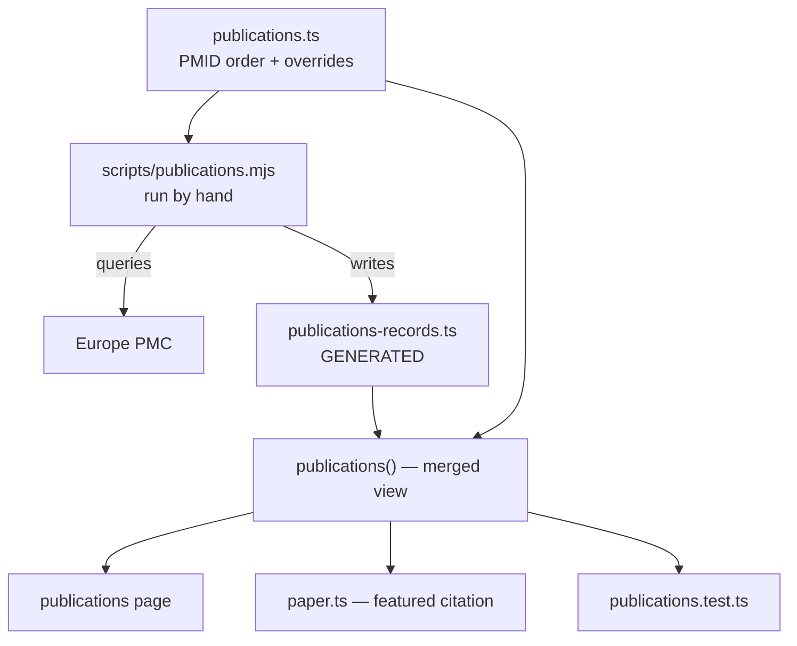

# feat: Publications page generated from canonical metadata

## Summary

Build the publications page from Europe PMC's canonical records rather than transcribing the current
site's list, and collapse that list's duplicates.

The reference shows **19 entries for 15 distinct papers**: preprints are listed as separate entries
from the versions they became, and one paper appears three times. It also carries inconsistent
citation formats, repeats each title inside its own citation line, runs author lists to 62 names, has
one broken internal link, one entry whose "author list" is consortium role labels rather than names,
and one PMID attached to a preprint four years older than the paper that PMID belongs to.

All 15 PMIDs resolve against Europe PMC, so none of that has to be transcribed. Generating from the
API produces correct volumes, issues, pages, DOIs and author lists, and every one of those defects
disappears rather than being fixed by hand.

The design job is making a lab findable in its own papers. Author lists here run to 62 names and
Zhuzhu sits at position 45 in one of them, so entries show the first three authors, then her, then
"et al." — she is first author on one paper and that should be visible too.

---

## Problem Frame

The publications page is a placeholder, and it is the page an academic visitor goes to second after
the people page. The lab has 15 papers spanning 2005 to 2023 including four in *Nature*.

The reference's version is hard to use for structural reasons. Its longest entry is a wall of 62
names; the same work appears up to three times so the list looks padded rather than substantial; and
because nothing bolds the lab's own authors, finding out what *this* lab contributed to a 62-author
consortium paper means reading all 62 names.

There is also a duplication about to appear on our side. `lib/site/paper.ts` holds the featured
paper's citation for the landing page's scrollable preview, and that paper is also publication one of
fifteen. Two places asserting the same citation is the pattern this project has already removed twice
— the news block and the research statement.

---

## Requirements

**R1.** All 15 distinct papers appear, newest first, with correct title, journal, year, volume, issue,
pages, PMID and DOI.

**R2.** One entry per paper. Where the reference lists a preprint separately, the preprint becomes a
secondary link on the published paper's entry.

**R3.** Author lists are truncated, and the lab's author stays visible regardless of position.

**R4.** The lab's author is emphasised so it can be found without reading every name.

**R5.** Where two authors match the lab's name pattern and the metadata cannot say which is hers,
neither is emphasised, and the ambiguity is recorded rather than guessed.

**R6.** Metadata is generated from Europe PMC by a script, not hand-transcribed. Regenerating is a
command; adding a paper is a PMID.

**R7.** No network access at build or request time. The generated records are committed.

**R8.** The featured paper's citation derives from this list rather than being stated separately.

**R9.** Structural guards: the list is ordered; every record has the fields the page renders; the
PMID list and the generated records agree in both directions; author indices are in range.

**R10.** Contrast passes and the layout holds at narrow widths.

---

## Key Technical Decisions

### Generated from Europe PMC, committed, no runtime fetch

All 15 PMIDs resolve. Generating gives correct metadata and removes a class of transcription error
that the reference demonstrates: it lists the Cell Genomics paper's PMID against a 2019 bioRxiv
preprint, four years older than the paper that PMID identifies.

The script runs by hand, like `scripts/paper-pages.mjs` and the planned Midway sync. Nothing fetches
at build or request time, so the site stays static and buildable offline.

### Three files, because generated and hand-maintained data must not share one

| File | Owner | Contents |
| --- | --- | --- |
| `lib/site/publications.ts` | hand | the PMID list in display order, per-paper overrides, accessors |
| `lib/site/publications-records.ts` | **generated** | canonical metadata per PMID, do not edit |
| `scripts/publications.mjs` | — | reads the PMID list, writes the records file |

The overrides are the things Europe PMC cannot know: which "Zhang Z" is Zhuzhu where two match, the
bioRxiv DOI of a preprint the reference linked, and any extra publisher link worth keeping.

Keeping them apart means regenerating never clobbers a human decision, which is the failure mode a
single generated-and-then-edited file always eventually hits.

### Truncation keeps the lab author visible

First three authors, then the lab's author if she falls outside them, then "et al." Measured against
the real data this matters: she is at position 45 of 62 in the 2012 *Nature* chromatin paper and 24 of
29 in the 2021 methylation atlas, so any fixed-length truncation hides her in exactly the papers where
a reader most wants to know the lab was involved.

She is **first author** on *Epigenomic diversity of cortical projection neurons* (Nature 2021), which
is worth being visible rather than buried in a uniform treatment.

### The two ambiguous papers get no emphasis

PMID 22955617 (Nature 2012, 62 authors) has "Zhang Z" at positions 45 and 46. PMID 21750106 (Genome
Res 2011, 26 authors) has one at 2 and one at 20. The metadata cannot say which is Zhuzhu, and
emphasising the wrong one asserts someone else's authorship as hers — wrong in a way no reader can
detect.

So neither is emphasised, and the override map carries an explicit `null` with a comment, so the gap
is visible in the code rather than looking like an oversight. **Both are flagged for confirmation.**

### The consortium paper has no individual authors

PMID 34616075 is authored by "BRAIN Initiative Cell Census Network (BICCN)" — a collective name, no
individuals. The reference tried to render contributors and produced role labels run together as
prose ("ATAC-seq data generation and processing Fang Rongxin Hou Xiaomeng…"). The entry shows the
collective name, which is what the record says.

### The featured paper derives its citation from the list

`lib/site/paper.ts` keeps only what is specific to showing a paper — the licence, the abstract
quotation, the page count. Title, journal, year, PMID and DOI come from the publications list, so the
landing page and the publications page cannot disagree about the same paper.

---

## High-Level Technical Design



One entry's shape, directional:

```
┌────────────────────────────────────────────────────────────────┐
│ 2023 ←  Brain-wide correspondence of neuronal epigenomics      │
│  year   and distant projections                                │
│  label  Zhou J, Zhang Z, Wu M, … et al.                        │
│              ^^^^^^^ emphasised                                │
│         Nature · 624(7991) · 355–365                           │
│         PubMed 38092919 · doi · bioRxiv preprint               │
└────────────────────────────────────────────────────────────────┘
```

Grouping by year with a pinned label reuses the news and people pattern, so a third long list on this
site reads the same way as the other two.

---

## Output Structure

```
scripts/publications.mjs           queries Europe PMC, writes the records file
lib/site/publications.ts           PMID order, overrides, merged accessors
lib/site/publications-records.ts   GENERATED — canonical metadata, do not hand-edit
lib/site/publications.test.ts      ordering, field completeness, both-directions, index ranges
lib/site/paper.ts                  loses its duplicated citation fields
app/(public)/publications/page.tsx the page
```

---

## Implementation Units

### U1. The generator and the records it writes

**Goal:** A command turns a list of PMIDs into committed canonical metadata.

**Requirements:** R1, R6, R7

**Dependencies:** none

**Files:**
- Create: `scripts/publications.mjs`, `lib/site/publications-records.ts` (its output)

**Approach:** Read the PMID list from `lib/site/publications.ts` so there is one place a paper is
added. Query Europe PMC's REST search with `EXT_ID:` terms joined by `OR`, `resultType=core`.

Write a records file keyed by PMID with title, journal abbreviation, year, month, volume, issue,
pages, DOI, and the full author list as an array of names — plus, for each, the index of the author
matching the lab's name pattern, or `null` where more than one matches.

Fail loudly and specifically: a PMID that returns nothing must stop the script naming it, rather than
writing a file with a hole in it.

**Two API details found while planning, worth carrying into the code.** Building the query with a
shell `paste` produced an empty result set silently — the joining needs doing properly and the script
should assert it got as many records as it asked for. And Europe PMC reports the Cell Genomics paper's
pages as `100106` while its own DOI for the same record ends `100107`; the reference site says
`100107` too. Prefer the DOI, and note the discrepancy where the code makes the choice.

**Patterns to follow:** `scripts/paper-pages.mjs` — standalone, idempotent, loud, not wired into the
build. Its `requireTool`-style PATH check is not needed here, but its failure posture is.

**Test scenarios:** None as unit tests. It is a generator whose output U2 checks, and mocking the API
would test the mock. Verified by running it.

**Verification:** Run it and get 15 records. Run it again and get a byte-identical file. Point it at a
list containing one bad PMID and confirm it stops naming that PMID rather than writing 14 records.
Spot-check three records against PubMed by hand — the 2023 *Nature* paper, the consortium paper, and
one of the two ambiguous ones.

### U2. The hand-maintained list, the merge, and the guards

**Goal:** One accessor that yields display-ready publications, with the overrides applied.

**Requirements:** R2, R3, R5, R9

**Dependencies:** U1

**Files:**
- Create: `lib/site/publications.ts`, `lib/site/publications.test.ts`

**Approach:** Hold the PMID list in display order, and an overrides map: the resolved lab-author index
where the generator found the question ambiguous, a preprint DOI where the reference linked one, and
any extra publisher link.

Expose a merged view — records joined to overrides — plus a truncation helper that returns the authors
to show, given the lab author's index, and a year-grouping helper mirroring the news module's.

Two of the three preprint links come from the reference: `10.1101/2023.05.01.538832` for the
brain-wide paper and `10.1101/2020.10.19.343129` for the cell census. The third,
`10.1101/2019.12.11.873398`, is the Cell Genomics paper's preprint.

**Patterns to follow:** `lib/site/news.ts` for a list with numeric dates and grouping; its
`byYear` and ordering test transfer almost directly.

**Test scenarios:**
- Every PMID in the list has a record, and every record has a PMID in the list — both directions, so a
  regenerate that drops a paper and a list entry that was never generated both fail.
- The list is ordered newest first, by year then month. Equal dates permitted, as in the news module.
- Every record has the fields the page renders — non-empty title, journal, year, and a DOI matching
  `10.`.
- A lab-author index, where present, is within the author array's bounds. An index of 45 against a
  26-author list is the failure this catches, and it is exactly what a bad override would look like.
- The two known-ambiguous PMIDs have no emphasised author, asserted by PMID so a later override cannot
  silently guess.
- Truncation: with the lab author inside the first three, the result is the first three plus "et al."
  With the lab author at position 45, the result includes her. With fewer than four authors, nothing is
  truncated and no "et al." appears. With a collective author, the collective name is returned whole.
- Year grouping loses and reorders nothing, and years descend.
- Mutation-check each guard by breaking its invariant.

**Verification:** `npm test` green, and each guard observed failing when broken.

### U3. The page

**Goal:** The publications page, grouped by year, in this site's idiom.

**Requirements:** R1, R2, R3, R4, R10

**Dependencies:** U2

**Files:**
- Modify: `app/(public)/publications/page.tsx`

**Approach:** Header, then year groups with the year pinned beside its group — the news page's
implementation is the reference, `self-start` included.

Each entry: title, the truncated author line with the lab author emphasised, then the citation
(journal, volume, pages), then links — PubMed, DOI, and a preprint where one exists. No cards;
hairline rules between entries.

First authorship is worth marking, since one paper has it. A small label rather than a different
layout.

**Test scenarios:** None as unit tests — static rendering with the branching already covered in U2.

**Verification:** All 15 entries, in order, with 15 distinct titles — no duplicates, which is the
visible difference from the reference. The emphasised name appears in 12 entries and in neither
ambiguous one. Contrast sweep clean at 390, 768 and 1440. No horizontal overflow. Route stays static
and the count stays at 323.

### U4. The featured paper stops repeating itself

**Goal:** One assertion of the featured paper's citation.

**Requirements:** R8

**Dependencies:** U2

**Files:**
- Modify: `lib/site/paper.ts`, `lib/site/paper.test.ts`, `components/site/paper-preview.tsx`

**Approach:** `paper.ts` keeps the PMID it features plus what is specific to previewing it — licence,
licence URL, the abstract quotation, page count, canonical URL. Title, journal and year come from the
publications record for that PMID.

Its existing tests that assert those fields non-empty should follow the fields.

**Test scenarios:**
- The featured PMID resolves to a record in the publications list. A featured paper absent from the
  list is the failure that makes the two disagree.
- The preview's caption still renders a citation, journal and year.

**Verification:** The landing page's paper block and the publications page state the same title,
journal and year for PMID 38092919 — checked by reading both rendered pages, not by inspecting the
data.

---

## Scope Boundaries

**Not in this plan:**

- **A live publication feed.** Metadata is generated by hand-run script and committed.
- **Citation export**, BibTeX, or copy-citation affordances.
- **Filtering, search, or sorting.** 15 entries grouped by year need none.
- **Per-paper pages.** Entries link out to PubMed and the publisher.
- **Preprints as first-class entries.** They are secondary links; see R2.
- **Scrollable previews for other papers.** The featured paper keeps its preview; the rest do not, and
  nothing in this plan generalises that.
- **Resolving who the second "Zhang Z" is** in the two ambiguous papers. Recorded, not guessed.
- **Author pages or per-member publication lists.**

---

## Risks & Dependencies

**The ambiguous author question is unresolved by design.** Two papers show no emphasis, which reads as
inconsistent until someone confirms the positions. That is the intended trade against asserting
authorship wrongly, but it is a visible gap.

**Europe PMC's own fields disagree in one record.** Pages `100106` versus a DOI ending `100107` for the
Cell Genomics paper. Trusting the DOI is a judgement; if other records show the same pattern the rule
should be stated once rather than special-cased.

**Author-name matching is a heuristic.** `Zhang Z` and `Zhang ZZ` both match today. A future paper
with a "Zhang Zi" or similar would match too and would need an override, which is why the override
mechanism exists rather than being avoided.

**A regenerate could silently change a citation.** Europe PMC corrects records over time, which is a
feature, but it means a regenerate can alter what the page says without anyone reading the diff. The
records file being committed is what makes that reviewable, so the diff should actually be read.

**15 entries with long titles and author lines is a dense page.** The news page's rhythm was tuned for
one-sentence items; three lines of citation per entry may want more vertical separation than that
pattern gives.

**Dependency:** none beyond network access when the generator is run, which is not needed to build.

---

## System-Wide Impact

- **`lib/site/` gains two modules and a generated file**, after nav, people, paper and news. All follow
  the declare-then-assert shape; the generated one is the first that must not be hand-edited, and its
  header should say so unmistakably.
- **`scripts/` gains a second occupant.** Nothing there should assume it is alone.
- **`paper.ts` narrows.** Its consumers are the landing page's paper block and the preview component;
  both must follow the field moves in the same change or the block renders blanks.
- **Route count and static rendering** stay at 323 with `/publications` marked `○`.
- **`CLAUDE.md` §4's `lib/site` listing** gains the two modules.

---

## Deferred to Implementation

- **How many authors to show before the ellipsis.** Three is the plan's assumption; four may read
  better against these particular author lines.
- **Whether the citation line wraps or truncates** on narrow viewports.
- **How first authorship is marked.** A label, a marker on the name, or nothing.
- **Vertical rhythm between entries**, given they are denser than news items.
- **Whether the generated records file is prettier-formatted** by the script or left as it writes it.

---

## Sources & Research

**The reference**, scraped from https://zhanglab.odoo.com/publications on 2026-08-05: 19 entries, 15
distinct papers.

Duplicate clusters — the same work listed more than once:

| Work | Entries in the reference |
| --- | --- |
| Brain-wide correspondence | *Nature* 2023 and bioRxiv 2023 |
| Single nucleus multi-omics | *Cell Genom* 2022 twice, plus bioRxiv 2019 — all three carrying PMID 35419551 |
| Multimodal cell census | *Nature* 2021 and bioRxiv 2020, both carrying PMID 34616075 |

Other defects: each title repeated inside its own citation line; author lists to 62 names; one entry
whose author list is consortium role labels as prose; one internal link pointing at an escaped anchor
on its own page; PMID 35419551 shown against a 2019 preprint.

**Canonical metadata**, Europe PMC REST `search` with `resultType=core`, 2026-08-05. All 15 PMIDs
resolved.

| PMID | Year | Journal | Vol(Iss) | Pages | Authors | Lab author at |
| --- | --- | --- | --- | --- | --- | --- |
| 38092919 | 2023 | Nature | 624(7991) | 355–365 | 51 | 2 |
| 35419551 | 2022 | Cell Genom | 2(3) | 100106 / 100107 ⚠ | 33 | 13 |
| 34616061 | 2021 | Nature | 598(7879) | 120–128 | 29 | 24 |
| 34616075 | 2021 | Nature | 598(7879) | 86–102 | collective | — |
| 34616065 | 2021 | Nature | 598(7879) | 167–173 | 32 | **1 — first author** |
| 32396852 | 2020 | Neuron | 107(2) | 274–282.e6 | 11 | 2 |
| 31418686 | 2019 | Elife | 8 | e47835 | 19 | 13 |
| 28650476 | 2017 | Nat Methods | 14(8) | 819–825 | 13 | 11 |
| 27840020 | 2017 | Cell Stem Cell | 20(1) | 112–119 | 26 | 5 |
| 27424783 | 2016 | Cell Stem Cell | 19(4) | 502–515 | 22 | 15 |
| 26104467 | 2015 | Genes Dev | 29(13) | 1393–1402 | 5 | 2 |
| 25945737 | 2015 | Nature | 521(7552) | 316–321 | 27 | 14 |
| 22955617 | 2012 | Nature | 489(7414) | 75–82 | 62 | **ambiguous — 45 and 46** |
| 21750106 | 2011 | Genome Res | 21(10) | 1757–1767 | 26 | **ambiguous — 2 and 20** |
| 15961080 | 2005 | FEBS Lett | 579(17) | 3619–3624 | 6 | 2 |

⚠ Europe PMC's `pageInfo` and its own DOI disagree for this record.

**Preprint DOIs** to carry as secondary links: `10.1101/2023.05.01.538832`,
`10.1101/2020.10.19.343129`, `10.1101/2019.12.11.873398`.

**Repo context.** `lib/site/news.ts` is the closest existing shape — a list with numeric dates, year
grouping, and a both-directions test against its assets. `scripts/paper-pages.mjs` sets the posture
for a hand-run generator. `lib/site/paper.ts` currently duplicates the featured paper's citation, which
U4 removes.
