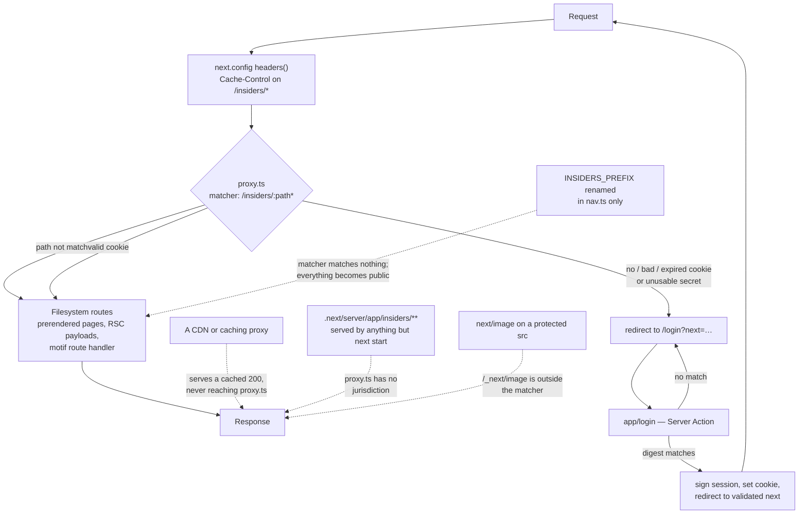

# feat: Password-gate the insiders area

## Summary

Put a single shared password in front of `/insiders`, so the DAP-seq browser, its 109 detail pages
and its ~200 motif images stop being public.

The structure work in M9 built the boundary and deliberately stopped: it committed to one real path
segment because *a path prefix is the only thing a path-matching guard can use*, then recorded that
filling it is separate work. This is that work. Nothing about the boundary's shape changes — the
prefix stays the enforcement surface, and no protected page moves.

**The mechanism is `proxy.ts`.** Next.js 16 renamed Middleware to Proxy, and Next's own
authentication guide names it the correct tool for exactly this case: *"for static routes that share
data between users, data will be fetched at build time and not at request time. Use Proxy to protect
static routes."* That matches this site precisely — 313 prerendered entries under the prefix, shared rather than
per-user data, one password.

**The risks worth planning around are not the crypto.** Four of them bypass the gate completely and
silently, and none is caught by anything that exists today:

1. Every prerendered page under `/insiders` currently ships `Cache-Control: s-maxage=31536000` — one
   year, publicly cacheable — because Next assumes a static page is safe to cache. Any CDN or caching
   proxy in front can then serve a protected page to an anonymous visitor without the request ever
   reaching the gate. Next's CDN guide states the constraint directly: proxy *"should run before the
   CDN cache so it remains the source of truth for auth."*
2. The matcher must be a literal, so the prefix gets hardcoded a second time. If the two copies ever
   disagree, the matcher matches nothing and the whole area is public — with no error and no failing
   test.
3. The protected bytes exist as ordinary files on disk under `.next/server/app/insiders/`. `proxy.ts`
   has jurisdiction only over traffic the Next server actually handles.
4. `next/image` on a protected source serves from `/_next/image`, a path outside the prefix that the
   matcher cannot cover — an ungated public mirror of any image it is used on.

Each is addressed below. The gate itself is about forty lines.

---

## Problem Frame

`/insiders` is a naming convention. Every page beneath it is public today, and `CLAUDE.md` §1 says so
plainly so nobody assumes otherwise. Anyone who guesses `/insiders/data` reads the lab's unpublished
DAP-seq results; anyone who guesses a sample name pulls its motif images.

The register deferred this for a good reason — *"choosing a mechanism against an unknown hosting
target would be guessing"* — and that blocker is now resolved: the site will be deployed to a host
that runs Next. That makes `proxy.ts` available, which is the one mechanism that satisfies both
constraints the structure work recorded:

1. **It must attach to a single route subtree.** Proxy's `matcher` is a path-prefix match, so
   `/insiders/:path*` covers the whole subtree and a new section is a directory, not a list entry.
2. **It must sit in front of static files.** Proxy runs *before* filesystem routes in the documented
   execution order, so it intercepts prerendered pages and route handlers alike. This is what a
   layout could never do, and it closes the hole the register named: a layout-based guard "would
   cover the pages and serve 200 research images to anyone."

What makes this more than wiring a password box is that almost nothing here is request-time. The
protected surface is 313 files baked at build time. There is no per-request render to hook into, no
session to check inside a page, and no data-access layer to defend — the entire authorization
decision happens in one file, before the filesystem is consulted. That concentrates the risk: one
matcher line is the difference between a protected site and a public one, and it fails silently.

---

## Requirements

Traced to the origin document's actors and requirements where they constrain this work.

**Enforcement**

R1. A request to any path under `/insiders` without a valid session is redirected to the login page
and receives no protected bytes — pages, RSC payloads, or motif images alike. *(origin A1, R11)*

R2. A request with a valid session reaches the protected route unchanged. The browser's behaviour —
filtering, sorting, pagination, motif logos, detail pages — is untouched. *(origin A2, and the
origin's "existing browser's behaviour is a fixed point")*

R3. Enforcement attaches to the path prefix, not to a layout, a page, or an enumerated route list.
Adding a section under `insiders/` is protected by existing. *(origin R5, R14)*

R4. The gate fails **closed**, verified against the built server and not merely asserted: a missing,
too-short, or malformed signing secret denies access rather than allowing it.

**The session**

R5. A correct password establishes a session that survives browser restarts and lasts long enough
that lab members are not re-entering it daily.

R6. A session cookie cannot be forged by anyone who does not hold the signing secret, and cannot be
read by client-side JavaScript. A signing secret too weak to make that true is rejected at load.

R7. Rotating the signing secret invalidates every existing session.

**Not weakening what exists**

R8. The prefix continues to live in as few places as possible, and any second copy is held equal to
the first by a test rather than by memory. *(origin R14; register "the prefix lives in exactly one
place")*

R9. The public site is unaffected in markup and in build: no public page requires a session, and the
public build gains no dependency on the gate. *(origin A1, A3)*

R10. Protected responses are not publicly cacheable, in every representation Next can serve for the
path — HTML and RSC payload alike.

R11. `lib/auth/` never imports the data seam, and that is held by a test rather than by intention.

---

## Key Technical Decisions

**KTD1. `proxy.ts` at the repo root, with `matcher: '/insiders/:path*'`.**
Next 16's Proxy is the only mechanism inside the app that runs before filesystem routes, which is
what protecting 313 prerendered files requires. It also defaults to the **Node.js runtime** in v16
(the `runtime` option is not available and setting it throws), which removes the historical reason
teams reached for `jose` over `node:crypto` — full `node:crypto` is available here. Note that most
material online predates the v16 rename and describes an Edge-only Middleware; the bundled
`self-hosting.md` is itself stale on this point, while the file-conventions reference is explicit.

**KTD2. The matcher must be a literal, which forces a second copy of the prefix — held by a test.**
This is the decision with the worst failure mode, so it gets the most guard. Next's docs state
*"matcher values need to be constants so they can be statically analyzed at build-time. Dynamic
values such as variables will be ignored."* So `proxy.ts` **cannot** import `INSIDERS_PREFIX` and
interpolate it — the matcher must read `/insiders/:path*` literally. That is a second hardcoded copy
of a constant the register deliberately keeps in one place, and if the two ever disagree the matcher
silently matches nothing and the entire protected area becomes public with no error, no failed build
and no test failure. `lib/site/boundary.test.ts` cannot catch it today because it walks only `app`,
`lib` and `components`. The resolution is to keep the literal (Next requires it) and assert equality
in a **narrow, additive** check — see U4, which is specific about scope because the obvious
generalization is actively dangerous.

**KTD3. An HMAC-signed cookie, hand-rolled on `node:crypto`. No session library.**
There is no identity to store — the payload is an expiry and nothing else — so there is nothing
confidential to encrypt and the requirement is forgery-resistance, which a MAC provides.
`iron-session` encrypts data this design does not have; `jose` earns its keep on Edge/JWT interop,
neither of which applies now that Proxy is Node; `next-auth` is multi-user identity machinery for a
site with no users. Roughly forty lines of `createHmac` / `timingSafeEqual` is a strict subset of what
those do, with less surface area, and it matches a project that dropped an ORM for adjacent reasons
and whose failures name the offending value.

**KTD4. Two separate secrets, both environment variables, following the existing `GENOME_BROWSER_*`
convention.** `GENOME_BROWSER_INSIDERS_PASSWORD_HASH` gates the login form;
`GENOME_BROWSER_SESSION_SECRET` is a random 32-byte value used only for signing. They are separate
because one is derived from a human-shared passphrase while the other must never leak, and because
rotating one should not force rotating the other. The signing secret is validated at load, not just
for presence — see KTD6. `.env*` is already gitignored, and the repo has no `.env` file of any kind
today, so U5 adds the example one.

**KTD5. The password is stored as a SHA-256 digest, not in plaintext. *(reversed during deepening)***
The first draft stored the plaintext and argued hashing was near-theoretical for a single shared
secret with no user table. That framing was a false binary. The comparison is already specified to
digest both sides to a fixed length before `timingSafeEqual` — that is required anyway, because
`timingSafeEqual` throws on unequal-length buffers — so storing the digest instead of the passphrase
costs one extra step *once*, when the password is set, and nothing at all at request time.

What it buys is narrow but real: reading the env var no longer reveals the passphrase. Someone with
dashboard access, a screenshot in a support thread, or a stray log line learns a digest rather than a
string a lab member has probably reused elsewhere, and cannot replay it against the form (the server
digests what is submitted, so submitting the digest hashes it again and fails). It does **not** defend
against full environment compromise — anyone holding `GENOME_BROWSER_SESSION_SECRET` can forge a
cookie regardless. This is the unsalted, single-round case only; the salted slow-KDF machinery that
protects a table of many users' passwords is still the wrong tool for one shared secret.

**KTD6. Cookie: `__Host-` prefixed, `httpOnly`, `secure`, `sameSite: 'lax'`, 14 days. Signing secret
validated for length.** `__Host-` forbids a `Domain` attribute and pins `Path=/`, preventing a sibling
host on a shared parent domain from tossing a shadowing cookie — a live concern whether this lands on
`*.uchicago.edu` or `*.vercel.app`. The cost is that the cookie rides along on public requests too,
harmless given `httpOnly` and the fact that the matcher, not the cookie's path, decides where it is
consulted. `lax` rather than `strict` so a bookmarked or emailed `/insiders/data` link works on first
click; it also means a cross-site `` or `<iframe>` embed of a protected resource carries no
cookie, since Lax is excluded from cross-site subrequests. Fourteen days suits a tool used in bursts
over weeks. The whole unforgeability guarantee rests on the signing secret, so a secret under 32 bytes
is rejected at load with a message naming the variable — a `changeme` set during testing must not be
able to ship quietly.

**KTD7. The login page lives at `/login`, outside the protected prefix.**
The classic failure here is a redirect loop: with `matcher: '/insiders/:path*'`, a login page at
`/insiders/login` is itself intercepted, finds no session, and redirects to itself forever. Putting it
outside the prefix means the matcher never matches it and the loop cannot exist by construction rather
than by an exclusion someone must remember. Two existing tests also constrain this: `nav.test.ts`
compares directories under `app/(public)/` against `PUBLIC_NAV` and directories under `app/insiders/`
against `INSIDERS_NAV`, so a login page in either location would fail a test or force "Login" into a
nav where it does not belong. `app/login/page.tsx` sits in neither, needs no exemption, and renders on
the bare root layout — which is the right chrome for a gate. It does not violate origin R5: R5 governs
*protected* pages, and the login page is deliberately public.

**KTD8. Nothing under `/insiders` re-checks the session in-route. The proxy is the only check, and
that is a property of all 313 protected entries, not a quirk of one route.**
Reconsidered and reversed during planning, then generalized during deepening. The motif route declares
`dynamic = "force-static"` and `dynamicParams = false`, so it is baked into ~200 static responses and
cannot read a cookie at request time. Making it dynamic to enable a check would cost more than it
buys: the route's own reasoning is that *"traversal is impossible rather than defended against"*
because `generateStaticParams` enumerates only the pairs that have bytes, so going dynamic
reintroduces traversal as something to defend, and it would make the production server require the
MEME tree on disk, which `CLAUDE.md` §8 notes it currently does not.

The generalization matters more than the specific case: **every** protected surface here has the same
exposure for the same reason. The browse table and all 109 detail pages are equally prerendered and
equally unable to host a request-time check. Singling out the motif route for an extra guard would be
an inconsistent, illusory improvement — it would read as though the other pages had a protection the
images lacked, when in fact all of them rest on the proxy alone. Defence in depth is the right
instinct and the wrong trade here; the reasoning is recorded instead of the guard.

---

## High-Level Technical Design

Where the gate sits, and why the dashed paths are the ones that matter.



The solid path is unremarkable. The four dashed edges are why this plan is Standard rather than
Lightweight: each bypasses the gate completely, each is silent, and none is caught by any test that
exists today. U3 addresses the cache edge, U4 the rename edge; the disk and image edges are deployment
and convention rules recorded under Risks, because no code change can enforce them.

The session token's shape, as direction rather than specification:

```
base64url({ exp }) + "." + HMAC-SHA256(that, GENOME_BROWSER_SESSION_SECRET)
```

No identity, no roles, no claims — there is one password and one kind of insider. Verification is a
recomputed HMAC compared with `timingSafeEqual`, then an expiry check.

---

## Implementation Units

Sequenced so the site is never broken between units: the login surface and the cache headers land
before the gate turns on, and the gate is the unit that changes behaviour.

### U1. The session module

**Goal:** Sign and verify a session token, as pure functions with no framework coupling.

**Requirements:** R4, R6, R7

**Dependencies:** none

**Files:**
- `lib/auth/session.ts` (create)
- `lib/auth/session.test.ts` (create)

**Approach:** Two exports — sign a token carrying only an expiry, and verify one, returning a
discriminated result rather than a bare boolean so the caller can distinguish *expired* from
*tampered* from *malformed*. Read `GENOME_BROWSER_SESSION_SECRET` per call rather than at import, the
same posture `lib/data/sqlite.ts` takes with its path env vars, so tests can point it at a fixture
secret. A missing **or under-length** secret throws and names the variable, per the fail-loudly rule
in §9 — and because the proxy treats a throw as a denial, that failure is closed rather than open.

**Patterns to follow:** `lib/data/coerce.ts` for pure, heavily-tested helpers with named failures;
`lib/data/sqlite.ts` for per-call env resolution. Imports inside `lib/` are relative with explicit
`.ts` extensions, since `npm test` runs under plain `node` with no path alias.

**Test scenarios:**
- A freshly signed token verifies as valid.
- A token whose payload is edited fails verification, and reports tampering rather than expiry.
- A token whose signature is edited fails verification.
- A token signed with a different secret fails verification — this is what makes R7 true.
- A token whose expiry is in the past reports expired, not valid.
- Malformed input returns a failure rather than throwing: empty string, no separator, more than one
  separator, non-base64 payload, signature of the wrong length.
- Comparison does not throw on inputs of differing length (the buffer-length trap in `timingSafeEqual`).
- A missing `GENOME_BROWSER_SESSION_SECRET` throws, and the message names the variable.
- A secret shorter than 32 bytes throws, and the message names the variable and the minimum. A
  `changeme` value must not be able to ship silently.

**Verification:** `npm test` covers the module; `npm run typecheck` is clean.

### U2. The login surface

**Goal:** A password form that establishes a session and returns the member to where they were going.

**Requirements:** R5, R9, and the open-redirect guard described in Approach below

**Dependencies:** U1

**Files:**
- `lib/auth/redirect.ts` (create) — the `next` parameter validator, extracted so it is testable
- `lib/auth/redirect.test.ts` (create)
- `app/login/page.tsx` (create) — the page and its colocated Server Action

**Approach:** A Server Action rather than a Route Handler: it is colocated with the form, works before
hydration, and inherits the same-origin checks Server Actions already apply. The page reads `next`
from `searchParams` as a Server Component prop and renders it as a hidden field, since the action
receives `FormData` rather than the URL. Digest the submitted password and compare it against
`GENOME_BROWSER_INSIDERS_PASSWORD_HASH` with `timingSafeEqual`, then sign a session and set the cookie
per KTD6. Add a small fixed delay to every attempt regardless of outcome — it needs no store, costs
nothing at ten users, and is the one cheap brake available while a real rate limiter is deferred.

`safeNextPath` is the security-bearing part and is why it is a separate module: an unvalidated `next`
turns this page into an open redirect that sends someone off-site immediately after they type the lab
password. It accepts only a same-origin relative path under the insiders prefix and returns the prefix
itself for anything else. It imports `INSIDERS_PREFIX` from `lib/site/nav.ts` — relative, with the
explicit `.ts` extension — rather than writing the literal, which the boundary test requires.

**The page itself, which the first draft left almost entirely unspecified.** The enforcement side of
this plan was fully argued while the one surface a human actually looks at was reduced to "a password
form" — an imbalance worth correcting here, because the defaults an implementer would reach for are
wrong in specific ways.

*Chrome.* "Outside both nav directories" is a routing constraint, not a visual one. The first draft
slid from one to the other and asserted a bare page as settled; it isn't. This page is one click from
the public header's Insiders pill, and the insiders layout already argues that crossing that boundary
should land "somewhere continuous rather than in what looks like a different product" — the login page
is a step further along the same path and deserves the same treatment. Minimum: the `Logo` (it takes
`currentColor`, so it works on any field) and a forest band echoing `PageHeader`, on `lab-paper`. Set
the page's own `<title>`, per the root layout's "each section sets its own" convention.

*Copy, and what it must not say.* The page is publicly reachable by construction, so it must orient a
member without advertising what sits behind it. Name the lab; do not name the DAP-seq data, the
browser, or unpublished research. "Zhang Lab — lab members only" orients without disclosing; "Enter
the password to access the DAP-seq data browser" hands an anonymous visitor the fact this gate exists
to protect.

*States.* Four beyond the happy path, three of them currently unaddressed:
- **Pending.** This plan *mandates* a fixed delay on every attempt, so every submit visibly hangs.
  Without a disabled control and a "Checking…" affordance, the deliberate brake reads as a broken
  form and invites double-submits. This one is caused by a decision made above; it is not optional.
- **Empty submit.** Handled by the field being `required`, so it never reaches the delayed action.
- **Expired session.** A member returning after 14 days lands here identically to a stranger who
  mistyped a URL. The proxy should distinguish the redirect it issues for an expired cookie from the
  one it issues for no cookie, so the page can say "your session expired, sign in again."
- **Already signed in.** Nothing re-checks the cookie on `/login`, because KTD7 deliberately keeps it
  outside the matcher. A member who bookmarks it or presses back sees the form again with no
  acknowledgement. The page should check the cookie itself and redirect to the hub if it is valid.

*Accessibility.* A real `<label>` bound with `htmlFor`, not a placeholder standing in for one. The
error is rendered server-side after a full-page Server Action submit, so it is silent to a screen
reader unless it lives in an `aria-live` region and is associated with the field via
`aria-describedby`; move focus to it on failure. This codebase already holds this standard — the
table announces its row count politely, the insiders nav pairs `aria-current` with a visible
underline rather than relying on colour, and three surfaces carry recorded contrast corrections.

*What not to build.* The default output here is a centred white card with a rounded border, a drop
shadow and a `lucide-react` lock icon. This site has no such component anywhere, and adding one for
its least-visited page would make the gate the one screen that looks like generic SaaS. The
established vocabulary — forest field, Poppins heading, mint and sage accents, generous whitespace,
no card — is the brief.

**Execution note:** Write `safeNextPath` test-first. It is a small pure function whose failure modes
are adversarial inputs, which is exactly the shape that rewards enumerating cases before implementing.

**Patterns to follow:** `components/site/page-header.tsx` for the forest band and heading treatment;
`components/site/logo.tsx` for a mark that inherits its colour; `components/site/insiders-nav.tsx` for
the focus-ring and `aria-current` idiom; `lib/site/nav.ts` for importing the prefix rather than
restating it.

**Test scenarios:**
- `safeNextPath` returns a relative path under the prefix unchanged.
- It rejects an absolute URL (`https://evil.example/`) and falls back to the prefix.
- It rejects a protocol-relative URL (`//evil.example/`), which is the case a naive
  "starts with `/`" check lets through.
- It rejects a path outside the prefix (`/people`, `/`), and a path that merely starts with the
  prefix string but is a different segment (`/insidersomething`).
- It rejects backslash and encoded-slash variants, and a value containing a newline.
- It handles absent, empty, and repeated `next` parameters.
- Test expectation for the page shell: none beyond the above — the Server Action's password branch is
  exercised in U4, since `node:test` cannot invoke a Server Action directly.

**Verification:** With the env vars set: a wrong password re-renders with an error, sets no cookie, and
the error is announced and focused rather than only rendered; a correct one sets a `__Host-` cookie and
lands on `/insiders`. Submitting shows a pending state for the duration of the fixed delay. Visiting
`/login` with a valid cookie redirects to the hub instead of showing the form. Arriving via an expired
session says so. Tab through the page with a screen reader to confirm the field is labelled and the
error reaches it. Confirm `/login` responds non-cacheable, and that the page reads as this site — mark
and forest band present, no card. At this point the gate is not on yet, so the insiders area remains
reachable without a session — expected until U4.

### U3. Cache-Control hardening for the protected prefix

**Goal:** Stop protected responses from being publicly cacheable, so no cache layer can answer for the
gate.

**Requirements:** R10

**Dependencies:** none

**Files:**
- `next.config.ts` (modify)

**Approach:** Add a `headers()` entry scoped to the insiders prefix setting `Cache-Control: private,
no-store`, replacing the `s-maxage=31536000` that Next applies to static pages by default. Unlike
`matcher`, `headers()` is an ordinary async function evaluated at build/start, so it may use a
variable — prefer importing `INSIDERS_PREFIX` over a third literal. Whether `next.config.ts` can
resolve an import from `lib/` under Next 16's config loader is an implementation-time unknown; see
Deferred.

**The motif route sets its own header, and the override has to beat it.** That route explicitly
responds `Cache-Control: public, max-age=31536000, immutable` — correct while the images are public,
and exactly wrong once they are not. This resolves cleanly rather than by luck: config `headers()` are
applied with `setHeader` before the route runs, and the later merge skips any header name already
present, so the config entry wins. It is called out because "the images kept their own public cache
header" is a silent way for the 200 highest-value artifacts to stay cacheable after the prefix looks
hardened, and because a reader comparing the two files would otherwise see a direct contradiction with
no resolution recorded.

Landing this before the gate is deliberate: it is harmless while the area is public and must already
be true the moment it is not.

**Patterns to follow:** none in-repo — `next.config.ts` is currently empty of options, so this is the
first entry. Keep the shape minimal and comment why the header exists, since a future reader will
otherwise see a cache directive with no visible cause.

**Test scenarios:** `Test expectation: none` at unit level — asserting this by reading
`next.config.ts` source would test the spelling rather than the behaviour. Regression coverage comes
from the end-to-end header assertions in U4, which exercise the built server; that pairing is
deliberate, because a manual check alone would not survive a future refactor.

**Verification:** `npm run build && npm run start`, then confirm with a header request that a path
under the prefix responds `Cache-Control: private, no-store` and that a public path such as `/news` is
unchanged. Check the **RSC variant too** — a request carrying the `RSC: 1` and `next-router-prefetch`
headers, which is what `<Link>` prefetch actually sends — because Next serves a separate
representation for the same path and a cache keying on path alone can treat them differently. Worth
doing empirically rather than trusting the docs; header merging on prerendered routes has edge cases.

### U4. The gate, and the guards that keep it honest

**Goal:** Turn on enforcement, make the prefix's second copy impossible to drift, and cover the whole
boundary with tests that would catch a regression rather than only confirming today's behaviour.

**Requirements:** R1, R2, R3, R4, R8, R10, R11

**Dependencies:** U1, U2, U3

**Files:**
- `proxy.ts` (create, repo root — beside `app/`, not inside it)
- `lib/site/boundary.test.ts` (modify)
- `lib/auth/gate.test.ts` (create) — the end-to-end assertions against a built server

**Approach:** Export `proxy` plus a `config` whose matcher is the literal `/insiders/:path*`. Read the
cookie, verify it through U1, and on anything other than valid, redirect to `/login` carrying the
attempted path as `next`. Distinguish *expired* from *absent or invalid* in that redirect — U2's page
uses it to tell a returning member their session ran out rather than showing them the same blank form
a stranger gets, and U1's discriminated verify result already carries the distinction. Treat a thrown
verification error as a denial, which is what makes R4 true.
Do nothing with side effects — no session renewal, no logging, no counters — because Proxy runs on
prefetch requests too, which fire without user intent.

**The boundary test grows two narrow checks, and the scope is load-bearing.** Do **not** generalize the
existing walker to the repo root: `.next/` alone currently holds 7,748 occurrences of the prefix
literal in generated manifests, and pointing the recursive walk at `ROOT` would drown the test in false
offenders, wander into `.git` blobs, and behave differently depending on whether a build exists
locally. The three existing walks over `app`, `lib` and `components` stay exactly as they are. Add
instead:

1. A check that reads `proxy.ts` **by name** — no recursion — and asserts its matcher literal is
   exactly `` `${INSIDERS_PREFIX}/:path*` ``, with the expected value derived from the constant rather
   than written out, so a rename fails here.
2. An extension of the seam-confinement check to cover `proxy.ts` and everything under `lib/auth/`.
   Today's seam tests enumerate `routeFiles()` under `app/`, so a root-level `proxy.ts` and a new
   `lib/auth/` are invisible to every structural guard in the suite. Without this, `lib/auth/`
   importing `lib/data/index.ts` would recouple the gate to the gitignored research database and
   nothing would say so.

Both read source as text with `fs.readFileSync`, matching how every other structural claim in that
file is held — do not import `proxy.ts` to inspect `config.matcher` at runtime, which would pull
Next's module resolution into a plain `node --test` process in a way nothing else here does.

**Most of the gate is testable without booting anything, and only a thin slice is not.** The exported
`proxy` function can be called directly with a hand-built `NextRequest` carrying whatever cookie the
case needs, returning the response object to assert against — no build, no server, no port, at the
same millisecond speed as the rest of the suite. That covers the whole decision matrix: valid,
expired, tampered, absent, and unusable-secret. Do that first, and by default.

Only two things genuinely need a running server: that the protected bytes are actually withheld and
served, and the wire-level `Cache-Control` on both representations. Keep that slice as small as it can
be, and know what it costs before writing it — `lib/auth/gate.test.ts` matches the existing
`lib/**/*.test.ts` glob, so it runs on every `npm test` rather than being opt-in, and the suite is
currently 355 tests in under half a second, offline. A live-server test needs a port that will not
collide with a developer's `npm run dev`, a readiness poll, and teardown that survives a failed
assertion. The fail-closed case needs a *second* process, because the secret is read from
`process.env` of the running server and cannot be unset inside one already started. Gate the whole
slice on a build being present so a fresh clone still runs green, the same posture the seam's own
tests take.

**Execution note:** Add the drift assertion before writing `proxy.ts`, and watch it fail. A guard
against a silent catastrophic failure is worth seeing fail once.

**Patterns to follow:** `lib/site/boundary.test.ts` — structural invariants held by reading source,
which is the established idiom here for claims no single file makes visible. `lib/data/motifs.test.ts`
for the skip-visibly-when-absent pattern.

**Test scenarios:**

*Structural (fast, always run):*
- `proxy.ts` exists at the repo root.
- Its matcher literal is exactly `` `${INSIDERS_PREFIX}/:path*` ``, derived from the constant — so
  renaming `INSIDERS_PREFIX` in `nav.ts` alone fails this test.
- No file other than `lib/site/nav.ts` and `proxy.ts` contains the prefix literal.
- Neither `proxy.ts` nor anything under `lib/auth/` reaches `lib/data/index.ts`, transitively.
- The existing boundary claims still hold, with their walks unchanged.

*The decision matrix, by calling `proxy(request)` directly (fast, offline, always run):*
- No cookie on `/insiders`, `/insiders/data`, a sample detail path and a motif image path: each
  returns a redirect to `/login`, carrying the attempted path as `next`.
- A validly signed cookie from U1's sign function: passes through on all four.
- An expired cookie: redirect, and distinguishably so, since the page uses that to explain itself.
- A tampered signature, a malformed cookie, and an absent one: redirect.
- **Fail-closed:** with `GENOME_BROWSER_SESSION_SECRET` unset or under-length, the result is a denial
  rather than a pass-through. Reading Next's request path settles the mechanism — an uncaught throw
  inside `proxy.ts` is re-thrown rather than swallowed, so it surfaces as a 500 and never as a silent
  200 with protected content — so this test pins behaviour already known to be achievable rather than
  discovering it.
- A public path (`/news`) is not matched at all.

*Against a running server (the small slice that needs one; skips visibly without a build):*
- With no cookie, a protected page and a motif image path withhold their bytes; with a valid cookie,
  the motif path returns real image bytes. Bytes on the wire are the thing a pure-function test cannot
  prove, and the images are the highest-value artifact here.
- A protected path responds `Cache-Control: private, no-store`, and so does its RSC variant — the
  motif route's own `public, max-age=31536000, immutable` must not survive.
- Public paths (`/`, `/news`, `/login`) return 200 with no session and are unaffected.

**Verification:** Beyond the automated matrix above, click through as a logged-out visitor: the public
header's Insiders pill and the footer link both point into the prefix, so both should land on `/login`
and round-trip back to the hub after signing in. That exercises `safeNextPath` against the real
`next=/insiders` value users produce, rather than only the adversarial inputs U2 enumerates. Then
confirm the browse table still filters, sorts and paginates, and that clearing the cookie re-locks
everything.

### U5. The documents this makes false

**Goal:** Retire the claims that `/insiders` is unprotected, close the register entry, and give a
contributor a way to run the app at all.

**Requirements:** none directly — this is the project's own bookkeeping rule from §7

**Dependencies:** U4

**Files:**
- `.env.example` (create)
- `CLAUDE.md` (modify) — §1's "No authentication exists yet" paragraph, and §8's environment notes
- `docs/deferred-decisions.md` (modify) — move "How the insiders area is actually protected" from Open
  to Resolved
- `docs/build-ladder.md` (modify) — M9's closing "No authentication exists" note

**Approach:** The §8 update is **not conditional**. After U4, a fresh clone cannot reach any part of
`/insiders` — hub, browse table, protocols, inventory — even with `data/` fully populated, because the
gate fails closed on a missing secret. That is guaranteed new onboarding friction, and §8 is exactly
where this project tells a contributor what to set before anything works. The repo has never had an
`.env.example`; this is the moment it earns one, listing both new variables alongside the existing
`GENOME_BROWSER_DB` and `GENOME_BROWSER_MEME_ROOT` overrides, with a comment on generating the signing
secret and the password digest.

Record in the register what was decided and why, including the findings that would otherwise be
rediscovered: the matcher cannot take a variable; no route under the prefix can self-check because all
313 are prerendered; and the protected bytes exist on disk independent of the server. Add a resolved
entry rather than deleting the open one — the register's rule is that a decision leaves by being made
and recorded, never by being forgotten.

**Patterns to follow:** the register's existing resolved entries, which state the decision, the
reasoning, and what it cost.

**Test scenarios:** `Test expectation: none -- documentation only, no behaviour changes.`

**Verification:** `CLAUDE.md` no longer tells a reader the area is public; the register's Open section
no longer carries the entry; a contributor cloning fresh can find both variables and knows how to
produce values for them.

---

## Scope Boundaries

### In scope
The proxy gate and its matcher, the session sign/verify module, the login page and its Server Action,
the `next`-parameter validator, cache-header hardening, the structural drift and seam guards, the
end-to-end gate test, `.env.example`, and the documentation the change invalidates.

### Deferred to Follow-Up Work
- **A logout route.** Clearing a cookie is a small addition, but nothing in the requirements asks for
  it, and a 14-day expiry plus secret rotation covers revocation for ten people.
- **A real rate limiter.** Deferred rather than dismissed: it needs a store decision (in-memory is
  per-process and resets on deploy) that this plan should not make in passing. U2's fixed delay and a
  long passphrase are the interim compensating controls — see Risks. Worth raising to active if the
  site is ever indexed or sees traffic. Whoever picks it up should note that **lockout is actively
  wrong here**: with one shared credential, an attacker's failed guesses would lock out the whole lab.
- **An `error.tsx` boundary.** Already an open register entry, now more relevant: a denial that throws
  should not render Next's scrubbed page.
- **Making the public site buildable without the research database.** Unchanged in priority.

### Outside this product's identity
*Carried from the origin document.*
- **Per-user accounts.** One password, one kind of insider. Usernames, roles, registration, and
  password reset are a different product, and the origin's A2 is "a member with *the* password."
- **Institutional SSO.** UChicago CNetID/Shibboleth would change who counts as an insider and is a
  product decision, not an implementation choice. If it is ever wanted, it replaces this gate rather
  than extending it.
- **A public data portal.** The data stays behind the password.

---

## Risks & Dependencies

**A caching layer answers for the gate.** Next sets `s-maxage=31536000` on static pages; a CDN or
caching reverse proxy holding a protected page can serve it to anonymous visitors for a year without
the origin ever seeing the request. A documented real-world failure class, not a hypothetical. U3
mitigates it at the application layer and U4 keeps it from regressing; the residual risk is a cache
layer configured to ignore origin headers, which is a deployment-time check. Verify against the
deployed site, including the RSC variant, not just locally.

**The protected bytes exist as files on disk.** After a build, `.next/server/app/insiders/**` contains
the prerendered pages and image responses as ordinary files. `proxy.ts` runs only inside the Next
server process and has no jurisdiction over any other way those files reach a client — a reverse proxy
pointed at the build directory, a Docker stage that copies `.next` into a static web root, an
object-storage sync that includes build output, or a generic static file server run against the
project directory. This is distinct from the static-export risk below: it requires no configuration
change at all, only serving the filesystem the wrong way. **The deployment must guarantee that all
traffic is served by the Next server itself.** No code change can enforce this, which is why it is
recorded here rather than mitigated in a unit.

**A prefix rename silently unprotects everything.** Covered by KTD2 and the U4 assertion. Called out
separately because the severity is total and the signal is zero — no error, no failed build, no
degraded behaviour, just a public site.

**`next/image` on a protected image would create a public mirror.** Next's optimizer serves from
`/_next/image?url=…`, a path outside the prefix that the matcher cannot cover. Wrapping anything under
`/insiders` in `<Image>` would expose it ungated, and would look entirely reasonable to whoever did it.
The rule is: **never use `next/image` on a source under the prefix.** The motif logos already avoid it
for unrelated reasons recorded in the register, so nothing violates this today — which is precisely
why it needs writing down before someone adds an insiders page with a picture on it.

**Proxy as the only line of defence.** Next's own guidance says Proxy should not be the sole
protection, and CVE-2025-29927 is the concrete reason: a crafted `x-middleware-subrequest` header let
attackers skip middleware entirely. This project is on 16.2.12, long past the fix, so it is not
exposed to that CVE — but the class is real, and KTD8 explains why an in-route second check is
unavailable to every protected surface here, not just some of them. The practical mitigations are
keeping Next patched and treating the gate's version as security-relevant.

**No rate limiting means passphrase strength is the only brake.** Opportunistic credential-stuffing
bots scan reachable login forms regardless of a site's value, and `/login` is reachable. Whoever sets
the password must use a long, non-dictionary passphrase — that is the compensating control for the
deferred limiter, not an aesthetic preference. U2's fixed per-attempt delay is the other half.

**The login page is an open-redirect surface.** It takes a path from the query string and sends the
member there after they authenticate. Unvalidated, that turns the lab's own login page into a
phishing launchpad: a crafted link sends someone off-site the instant they type the shared password,
from a page that legitimately asked for it. `safeNextPath` in U2 is the mitigation, which is why it is
a separately tested pure function rather than an inline check.

**Prefetch traffic hits the gate.** `<Link>` prefetches protected routes, and Proxy runs on those
requests. Harmless as designed, but it is why U4 forbids side effects in the proxy path.

**Revoking one member revokes everyone.** With no per-user accounts, the only way to remove a
departing member's access is to rotate the password and signing secret, which logs out the whole lab
without warning. Acceptable given per-user accounts are explicitly outside scope, but it should be a
known consequence rather than a discovery made during someone's offboarding.

**Distribution is a security decision.** The initial password reaching ten people over plaintext email
or chat persists indefinitely in searchable history, which is a worse channel than a password
manager's sharing feature or a verbal handoff. KTD5's digest storage protects the passphrase from
leaking *out of the environment*; it does nothing about a bad distribution channel.

**Dependency: the hosting target must run Next.** The whole plan rests on it. A later move to static
export would discard the enforcement half — the gate would never execute, and the site would be public
with no error. If that becomes a possibility, this plan needs revisiting before the move, not after.

**Dependency: environment variables, and distinct ones per environment.** Both variables must exist
wherever the app runs. A preview or staging deployment *missing* them fails closed, which is correct
but will look like a broken deploy. A preview deployment that *inherits production's values* — common
on platforms that copy env vars into previews — is worse: preview URLs get shared in PR descriptions
and CI logs, so a leak there becomes a production compromise. Preview and staging should carry their
own distinct password and signing secret.

---

## System-Wide Impact

**Who is affected.** Lab members gain one password prompt roughly every two weeks. Whoever deploys now
has two secrets to set, which is new operational surface for a project that previously had none.

**Public visitors: markup unchanged, one behaviour changed.** No public page's content or build
changes, and the public build gains no dependency on the gate. But the public layout links into the
prefix twice — the header's Insiders pill and the footer link — and after U4 a logged-out click on
either lands on `/login` instead of the hub. That is intended, and it is the most common way a real
member will meet the gate, which is why U4 verifies that path by clicking rather than only by typing
URLs.

**Local development gains a hard requirement.** After U4, `npm run dev` on a fresh clone cannot reach
`/insiders` at all without both variables set, even with `data/` present, because the gate fails
closed. This is the reason U5 treats the §8 documentation update as mandatory and adds `.env.example`.
`npm test` and `npm run build` are unaffected — the structural tests need no secrets, and the
end-to-end gate test skips visibly without a build.

**The build is unchanged.** All 313 protected entries still prerender, and the site’s 323 total is unchanged. The gate runs at request time in front of
them, so nothing about build output, build inputs, or `generateStaticParams` moves. `npm run start`
continues not to read `data/` — KTD8 exists partly to keep that true.

**The boundary tests get stronger, not weaker.** The prefix moves from one hardcoded location to two,
a real loss, offset by an assertion that did not exist before. The seam guard also grows to cover
`proxy.ts` and `lib/auth/`, closing a gap that predates this work: anything outside `app/` was
invisible to the seam-confinement checks.

**One new directory.** `lib/auth/` sits beside `lib/data/`, `lib/display/`, `lib/site/` and
`lib/table/`, and is deliberately not inside `lib/data/` — it has nothing to do with the data seam and
is now tested for never importing it.

---

## Deferred to Implementation

- **Whether `next.config.ts` can import `INSIDERS_PREFIX`.** `headers()` takes a variable, unlike
  `matcher`, but Next 16's config loader may not resolve an import from `lib/`. If it cannot, the
  prefix gains a third copy and the U4 drift assertion must be extended to cover `next.config.ts` too.
  Decide by trying it.
- **The exact `Cache-Control` value.** `private, no-store` is the intent. Whether Next merges or
  replaces its default on prerendered routes is worth confirming with a header request rather than
  reasoning about.
- **How the live-server slice boots.** Spawning `next start` from `node:test` versus asserting against
  an already-running instance is a mechanics decision. Whichever is chosen must handle port selection,
  readiness, teardown on failure, and a second process for the unset-secret case — which is the
  argument for keeping that slice as thin as U4 specifies.
- **How the redirect renders.** A plain redirect is assumed. If the flash between protected path and
  login is ugly, that is a UI decision better made once it can be seen.
- **Whether `__Host-` causes friction in local development**, where `secure: true` cookies require
  HTTPS on some browser/localhost combinations. If it does, the fallback is a non-prefixed cookie in
  development only — decided when it bites, not before.

---

## Sources & Research

- `node_modules/next/dist/docs/01-app/01-getting-started/16-proxy.md` — Middleware renamed to Proxy in
  Next 16; `proxy.ts` at the project root; `matcher` config.
- `node_modules/next/dist/docs/01-app/03-api-reference/03-file-conventions/proxy.md` — matcher values
  must be statically analyzable constants (the basis for KTD2); Node.js runtime is the default and
  `runtime` is unavailable; execution order places Proxy before filesystem routes.
- `node_modules/next/dist/docs/01-app/02-guides/authentication.md` — *"for static routes that share data
  between users… Use Proxy to protect static routes"*; recommended cookie options; the note that Proxy
  runs on prefetched routes.
- `node_modules/next/dist/docs/01-app/02-guides/cdn-caching.md` — static pages default to
  `s-maxage=31536000`; *"proxy.js should run before the CDN cache so it remains the source of truth for
  auth"*; the `Vary` / `_rsc` variant problem behind U3's RSC check. Verified directly in the installed
  16.2.12 docs.
- `node_modules/next/dist/docs/01-app/03-api-reference/04-functions/unauthorized.md` — `unauthorized()`
  and `unauthorized.tsx` are experimental behind `authInterrupts`, and need request-time rendering.
  Considered and rejected: the protected surface is prerendered, so there is no render to interrupt.
- External security research (2026-08-10) on shared-secret cookie design, timing-safe comparison,
  hash-vs-plain storage, library-vs-hand-rolled, CDN cache poisoning of authenticated responses,
  middleware redirect loops, CVE-2025-29927, and the open-redirect guard.
- Deepening pass (2026-08-10), security and architecture review. Changed the plan in eight places: it
  reversed KTD5 to digest storage, generalized KTD8 from one route to all 313 protected entries, added the
  on-disk artifact and `next/image` risks, added secret-strength validation, replaced manual-only
  verification with an end-to-end matrix including the previously unverified fail-closed path,
  narrowed the boundary-test extension after finding 7,748 prefix literals in `.next/`, added the
  seam guard over `proxy.ts` and `lib/auth/`, and made the §8 documentation update unconditional.
- Origin: `docs/brainstorms/2026-08-04-lab-site-structure-requirements.md` — actors A1/A2/A3 and
  requirements R5, R11 and R14, each cited inline in Requirements above, plus the two recorded
  constraints (single route subtree; static prerendering versus password protection). Two further
  origin requirements are discharged rather than cited: R13 (build coupling confined to
  `insiders/data`) is preserved because nothing here reaches the seam, which R11 of this plan now
  asserts; and R15 (nothing presumes an authentication mechanism) is *retired* by this plan, since
  choosing one is the point of it.
- Document review (2026-08-10): coherence, feasibility, scope and design personas. Scope returned
  clean. The other three produced the login-page specification in U2, the split of U4's test matrix
  into a fast pure-function pass plus a thin live-server slice, the note that the motif route's own
  cache header must be overridden, and a correction from 323 to 313 for the protected surface — 323
  is the whole site's prerendered count, including public pages.
- `docs/deferred-decisions.md` — "How the insiders area is actually protected", including the
  layout-is-not-a-boundary reasoning this plan inherits.
