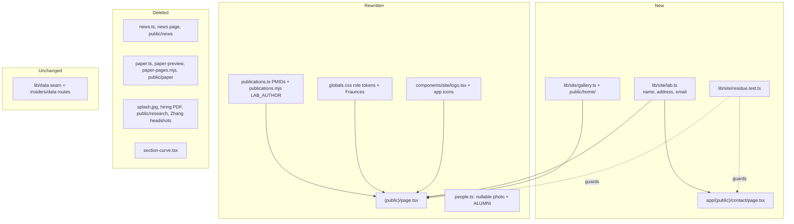

# O'Malley Lab Site Conversion - Plan

## Goal Capsule

- **Objective:** Ronan O'Malley's lab has its own website carrying everything real from its Odoo site: tagline, research statement, team and alumni, publications, contact details, and lab photos. Nothing from the Zhang lab remains, and someone with both sites open can tell them apart at a glance.
- **Means:** convert this repo, a copy of the Zhang site, in place. The data seam, tests and page conventions stay. Content is swapped (KD1–KD4), and a new visual system replaces the Zhang palette, typeface and shapes (KTD2).
- **Authority:** Requirements (R-IDs) win on product behavior. KTDs win on mechanism. `CLAUDE.md` rules (the data seam, read-only app, fail loudly, no research data in git) bind every unit, and this plan changes none of them.
- **Stop conditions:** stop and ask if any of these comes up: a public page needs to import from `lib/data/`; a unit would weaken a both-directions asset test instead of satisfying it; Europe PMC fails to resolve a PMID the plan lists; or a change would alter the insiders data browser's behavior rather than its chrome.
- **Execution profile:** eight units, done in order. Each unit ends with the browser gate in `docs/build-ladder.md`. No unit needs the real database.
- **Who finishes:** `ce-work` implements and verifies locally. The user creates the new O'Malley GitHub repo and pushes (KD4).

---

## Product Contract

### Summary

Turn this Zhang-lab repo into the O'Malley lab site. The public pages are Home, Research, People, Publications and Contact. They are filled only with content taken from Ronan's Odoo site, and they get a plum-and-leaf visual identity that is clearly distinct from Zhang's mint and sage. The insiders area and the DAP-seq browser stay unchanged in behavior, ready for the O'Malley lab's own pipeline data.

### Problem Frame

The lab's current site lives on Odoo's page builder. Its content is thin and partly placeholder: the PI and lab manager are shown with the logo instead of a photo, one student has a stock orchid image, and the contact page carries Odoo's dummy phone number. The Zhang lab site already solved the same problem well: content as checked data, generated publication metadata, asset guards, an insiders area. The O'Malley lab wants the same footing.

Two labs at one university sharing a template will be compared side by side. Nick works in both. If the sites are visually identical, they read as one group's site with the names swapped. The structure can be shared, but the identity should not be.

### Requirements

**Content parity with the Odoo site**

- R1. The landing page carries the lab's tagline from the Odoo home page verbatim ("Our lab develops advanced functional genomics tools to map the cell-type-specific regulatory networks that guide plant development and help them adapt to stresses such as drought, cold, and salinity.").
- R2. The research page carries the Odoo research heading and paragraph verbatim, with the lab's bench photograph.
- R3. The people page lists current members grouped by role, in the Odoo site's order: Ronan O'Malley (PI), Jhong-He Yu (Postdoctoral Scholar), Nick Koranda (Lab Manager), Pinky Lee, Fabian Halblander and Ernesto Gagarin (Ph.D. students), and Hannah Berley (Undergraduate Student).
- R4. The people page lists alumni by name, role and, where the source gives them, years: Lin Yang (Postdoctoral Scholar, 2023–2025), Laura Gerard-Guillard (Lab Manager) and Xiaocheng Yu (Postdoctoral Scholar). Alumni are shown without photographs.
- R5. A member with no supplied photograph gets a visibly generic placeholder drawn in code, never a stock image or someone else's photo.
- R6. The publications page lists one entry per paper, generated from Europe PMC metadata for the PMIDs on the Odoo publications page. Errata, author corrections and preprints are excluded (KTD5).
- R7. A Contact page shows the lab's address (Cummings Life Science Center, 920 E 58th Street, Chicago, IL 60637) and an email action to the address the Odoo site lists. There is no form and no phone number.

**Removal of Zhang content**

- R8. No Zhang-lab name, person, research area, photograph, document, funder mark or email address remains in any served page or file under `public/`. Nick Koranda's own headshot (`public/people/nicholas-koranda.jpg`) is not Zhang content: he is an O'Malley lab member, and the O'Malley roster keeps it.
- R9. The News page and the landing page's featured-paper preview are removed, along with their data modules, assets and tests. Ronan's site has neither.

**Distinct identity**

- R10. The public site uses the plum-and-leaf visual system (KD2): a new palette, a serif display face, near-square buttons (2px radius, as in the approved preview), a white nav bar, and straight rules instead of curved section edges.
- R11. The O'Malley mark (the circle with the leaf and band marks) replaces the brain logo in the header, footer and insiders header. The app icons are redrawn for O'Malley.
- R12. The landing hero pairs the tagline with a grid of the lab's own photographs. Text never sits over a photograph.

**Insiders area**

- R13. `/insiders`, its hub, Protocols, Inventory and the DAP-seq browser keep their current behavior and routes. Only their chrome takes the new identity and name.

### Key Decisions

- KD1. **Keep the insiders area and DAP-seq browser for O'Malley data.** The O'Malley lab created DAP-seq, so the browser fits it. Governs R13. (session-settled: user-directed — chosen over dropping the browser or going public-only: the lab will point it at its own pipeline database)
- KD2. **Plum & leaf identity.** The colours are taken from the purple trays and gloves in the lab's own photos, with Fraunces serif headings and square buttons. Governs R10, R12. (session-settled: user-directed — chosen over teal & coral and soil & terracotta)
- KD3. **Page set is Home, Research, People, Publications, Contact.** News and the paper preview are removed rather than left empty, Contact is address plus mailto because the app is static, and missing headshots get placeholders. Governs R5, R7, R9. (session-settled: user-approved — proposed in the scoping synthesis, confirmed by the user)
- KD4. **The O'Malley site lives in a new repo with fresh history.** Its first commit is the converted tree, so no Zhang headshot, hiring PDF or paper page is ever in its history. Governs R8. (session-settled: user-directed — chosen over repointing the remote and keeping all 94 commits)

### Acceptance Examples

- AE1. Covers R5, R3. **Given** Ronan has no photo file, **when** the people page renders, **then** his frame shows the code-drawn placeholder with his name as its accessible label. Later, adding `ronan-omalley.jpg`, setting his photo field and removing him from the pinned no-photo list replaces the placeholder with no other change.
- AE2. Covers R4. **Given** Laura Gerard-Guillard has no recorded years, **when** the alumni list renders, **then** her row shows name and role with no empty parentheses or dash.
- AE3. Covers R6. **Given** the Odoo list holds both 27203113 (Cell 2016) and 27610578 (the same title's erratum), **when** publications render, **then** only 27203113 appears.
- AE4. Covers R8 (the name check only). **Given** a file containing "Zhuzhu" is added under `app/`, `components/` or `lib/site/`, or a file whose name contains "zhang" is added under `public/`, **when** `npm test` runs, **then** the residue guard fails and names the file.

### Scope Boundaries

- Getting an O'Malley pipeline database into `data/`, recalibrating the real-data tests to it, and the Midway sync (M6) are not part of this plan.
- The converted site cannot be built for production until an O'Malley database and MEME tree are in `data/`, and it is checked under `npm run dev` until then. The Zhang data is never used as a build stand-in, because it would put Zhang samples on unprotected `/insiders` pages and break R8. Making the data routes build without data was considered and not chosen, because it changes browser behavior (KD1).
- Authentication for `/insiders` stays the open register entry. The existing auth plan (`docs/plans/2026-08-10-001-feat-insiders-authentication-plan.md`) is unchanged.
- No new prose is written for the lab. Where the Odoo site is silent (Ronan's appointment, training history, bios), the existing `UNKNOWN` sentinel is used. Alt text written from the photographs is accessibility text and is exempt from this rule.
- A contact form, a map embed and a phone number are left out. The app serves static files, and the only phone number on the Odoo site is its placeholder.
- The historical plans and brainstorms under `docs/` stay as written. They explain why the code is shaped the way it is, and they are not served.
- A runtime check that the build has data was considered and not built. `npm run build` already fails loudly without `data/` (`CLAUDE.md` §8), so a second guard would add nothing.

#### Deferred to Follow-Up Work

- Real photos for Ronan and Ernesto, and Ronan's appointment and training facts. These are a data edit in `lib/site/people.ts` plus one file each.
- Papers from 2025–2026. The Odoo list stops at 2024. Europe PMC already lists candidates under "O'Malley RC", including 42680730, 41271683, 40664840 and 41272269. The lab needs to confirm which ones are Ronan's before they are added with a PMID edit and a generator run.
- Recalibrating the Zhang-run real-data tests and the `CLAUDE.md` §6 facts once an O'Malley database exists (register entry added in U8).
- Removing the unused create-next-app SVGs in `public/`.

### Outstanding Questions

- **Deferred:** whose inbox is `gzy8899@uchicago.edu`? The plan uses it because the Odoo site does. Changing it is a one-constant edit (KTD1).

### Sources

- Odoo pages: `/`, `/research`, `/team`, `/publications`, `/contact` on https://omalleylab.odoo.com, captured 2026-11-09. The images are served at `https://omalleylab.odoo.com/web/image/<id>/<name>`. Source originals are listed in U3, U5 and U7.

---

## Planning Contract

### Key Technical Decisions

- KTD1. **The lab's identity lives in one module.** `lib/site/lab.ts` holds the name, legal name, institution, address lines and contact email. "Zhang Lab" is hardcoded in five files today with no constant. A sixth copy is exactly the drift `lib/site/nav.ts` was created to stop, and the residue guard (KTD7) only works if there is one place to change.
- KTD2. **Palette tokens get role names, not hue names.** `--lab-mint/sage/moss/forest/paper/ink` become role tokens (`--site-ink`, `--site-paper`, `--site-accent`, `--site-link`, `--site-surface`, plus a muted variant) with KD2's values. Keeping `mint` as the name of a plum colour would mislead every future edit. The rename touches about 15 files, all already in this plan's scope, and stays additive so the shadcn tokens under the data table are untouched (`app/globals.css` comment at the `--lab-*` block). Implements R10.
- KTD3. **The logo is traced to one filled path and the icon is a letter.** `lib/site/icons.test.ts` requires the mark to be a single `fill="currentColor"` path of at least 100 characters with `aria-hidden`. The Odoo logo exists only as raster line art (`/web/image/website/1/logo/omalleylab`, 1688px), so it has to be vectorized. That differs from the brain mark, which came from a vector Inkscape export. The result is one path carrying both `fill` and `stroke` in `currentColor`, the same fill-plus-stroke pattern the brain mark uses. The favicon and apple icon use a letter on a plum disc, following the precedent in commit ba97446 (outline art does not survive 16px). The icon test stays as it is. Implements R11.
- KTD4. **Placeholders are a nullable photo, pinned by name.** `Member.photo` becomes a string or `null`. `null` renders a code-drawn placeholder (the O'Malley mark on a muted plum field). The people test's both-directions guard then counts only non-null photos. A pinned list of who has no photo means a newly missing photo is a deliberate edit, not an accident. A shared placeholder file would break the one-file-per-member uniqueness rule. Alumni are a separate `ALUMNI` list with no photo field. `CLAUDE.md` §4 already flags that a departed member's committed photo stays downloadable, and text-only alumni avoids that entirely. Implements R3–R5.
- KTD5. **One entry per paper, the same policy as the template.** Errata (27610578), author corrections (36690743) and unpublished preprints are left out of `PMID_ORDER`. That leaves 50 papers. `LAB_AUTHOR` matches `O'Malley R` and `O'Malley RC` across straight and curly apostrophes and case (the Odoo list has "O'malley RC" on 15466220). When several authors match, the existing `OVERRIDES` mechanism resolves it, and the generator already refuses to guess. Implements R6.
- KTD6. **The landing page is built from data that already exists.** The hero is the tagline plus a photo grid. Below it come an excerpt from the research statement linking to `/research`, the three latest publications from `PUBLICATIONS`, and the address strip from KTD1. Nothing new is written. This fills the space News and the paper preview leave without inventing content, which the template's landing-page parity plan banned. Implements R1, R12.
- KTD7. **A residue guard keeps Zhang-lab tokens out of everything served.** A test scans file contents under `app/`, `components/` and `lib/site/` for `zhuzhu` or `zhang\s*lab` (case-insensitive). It also scans filenames under `public/` for `zhang` or `zhuzhu`, and names every file that matches.
  - The surname "Zhang" alone is not residue. Real O'Malley co-authors carry it (34824476, 36479703, 26976444), and the generator writes their names into `lib/site/publications-records.ts`.
  - The guard's own file is excluded by path, since it has to contain the pattern.
  - Without the guard, nothing would catch a stray alt text or an image path. It stays useful later, because the template keeps evolving in the Zhang repo and changes ported from it can bring names along.
  - `lib/data`, `lib/table` and `docs/` are out of scope. They hold neutral test literals and the history record.
  - It proves only the name check. R8's other categories (research-area text, funder marks, documents) are covered by U8's manual audit.

  Implements R8, AE4.
- KTD8. **Gallery photos follow the both-directions asset rule.** `lib/site/gallery.ts` declares the hero photos (file, alt text, intrinsic size) and the research photo. A test covers both `public/home/` and `public/research/`. It fails on an undeclared file or a declared file that is missing, and caps each file at 500KB, as `people.test.ts` does. `CLAUDE.md` §4 says every committed asset class has this guard, but `public/research/` has none today, so this test closes that gap as well as covering the new hero.

### High-Level Technical Design

What changes, what is deleted, and what stays:

### Assumptions

- The O'Malley pipeline database, when it arrives, comes from the same Snakemake pipeline and schema. That is why KD1 can leave the browser's code untouched. If the schema differs, the seam fails loudly at first read, as designed.
- Europe PMC resolves all the Odoo PMIDs (KTD5's list). The generator fails on any PMID it cannot resolve, which hits the stop condition.

### Sequencing

U1 → U2 → U3 → U4 → U5 → U6 → U7 → U8. Identity and tokens come first so every later page is built once, in its final look. U4 has to land as one change because the nav test ties `PUBLIC_NAV` to the `app/(public)` tree, and the landing page imports the modules being deleted. U8 comes last because the residue guard only passes once everything before it is done.

---

## Implementation Units

### U1. Lab identity module

**Goal:** One source for the lab's name, address and contact email, used everywhere the name appears.

**Requirements:** R7, R8, KTD1

**Dependencies:** none

**Files:**
- Create `lib/site/lab.ts` and `lib/site/lab.test.ts`
- Modify `app/layout.tsx` (metadata title and description), `app/(public)/layout.tsx` (wordmark, footer line), `app/(public)/page.tsx` (metadata, h1), `app/insiders/layout.tsx` (header name)

**Approach:**
- Fields: display name "O'Malley Lab", footer form "O'Malley Laboratory", institution "The University of Chicago", building and street address lines (R7), and the email from the Odoo contact page.
- `app/` imports through `@/lib/site/lab`. Inside `lib/`, use relative `.ts` imports (`CLAUDE.md` §4).
- The apostrophe in the name is a typographic one in rendered text. Use the escaped form in JSX.

**Patterns to follow:** `lib/site/nav.ts` (`INSIDERS_LABEL` as the single-constant precedent).

**Test scenarios:**
- The email is a well-formed address and the `mailto:` helper builds `mailto:<email>`.
- The address has building, street and city lines, none blank.

**Verification:** "Zhang Lab" no longer appears in the four files named (the fifth occurrence, a JSDoc in `components/site/logo.tsx`, goes in U3), and the header, footer, insiders header and tab title show O'Malley in `npm run dev`.

### U2. Plum & leaf visual system

**Goal:** Replace the Zhang palette, typeface and shapes across public and insiders chrome without touching the data table's shadcn tokens.

**Requirements:** R10, R13, KD2, KTD2

**Dependencies:** U1

**Files:**
- Modify `app/globals.css` (role tokens, `--font-display`), `app/layout.tsx` (Fraunces loader replacing Poppins), `app/(public)/layout.tsx`, `app/insiders/layout.tsx`, `app/insiders/page.tsx`, `components/site/page-header.tsx`, `components/site/prose-link.tsx`, `components/site/insiders-nav.tsx`, `components/site/year-group.tsx`, `app/(public)/people/page.tsx`, `app/(public)/research/page.tsx`, `app/(public)/publications/page.tsx`
- Delete `components/site/section-curve.tsx` once its last use goes in U4. Remove it in U4 if it is still imported here.

**Approach:**
1. Token values: ink `#2b1d30`, paper `#f7f3ea`, accent `#b9cf3e`, link and rule `#5c6b2a`. Add a pale plum surface for bands. Exact surface tints are chosen at the browser gate.
2. Fraunces through `next/font/google`, loading only the weights used (600, plus 700 if the h1 needs it). Body stays Geist.
3. Nav: a white bar with a bottom hairline instead of the mint band. Buttons: 2px radius instead of `rounded-full`. Keep the grow-from-left underline motion, which is the chrome's one animation.
4. Re-measure every contrast ratio quoted in comments against the new values and rewrite or delete those comments. Leaving stale ratios is worse than leaving none.
   - Accent on ink and ink on paper must both clear 4.5:1 for body text.
   - The nav underline, the active-page indicator and the keyboard focus ring use the link colour or ink, never the lime accent on a light surface, and each must reach 3:1 against its background.
   - Lime is only for fills that carry ink text.
5. Read the relevant `node_modules/next/dist/docs/` font guide before writing the loader (AGENTS.md). `npm install` comes first, since `node_modules/` is absent.

**Patterns to follow:** the additive-token rule in the `app/globals.css` comment above the `--lab-*` block.

**Test scenarios:** Test expectation: none. This unit is styling only. Verify it through the browser gate and contrast measurements.

**Verification:**
- No `lab-mint`, `lab-sage`, `lab-moss`, `lab-forest`, `lab-paper`, `lab-ink` (and their `--color-lab-*` mappings) or `font-poppins` references remain.
- `/insiders/data` renders with an unchanged table body when data is present.
- Every public page is legible at 390px and at desktop width.

### U3. O'Malley mark and app icons

**Goal:** The O'Malley logo in all three chrome positions, plus new favicon, SVG icon and apple icon.

**Requirements:** R11, KTD3

**Dependencies:** U2

**Files:**
- Modify `components/site/logo.tsx`, `app/icon.svg`, `app/apple-icon.png`, `app/favicon.ico`
- Test: `lib/site/icons.test.ts` (unchanged; it must pass)

**Approach:**
1. Vectorize the Odoo logo into one path. The source is `https://omalleylab.odoo.com/web/image/website/1/logo/omalleylab`; `tets.png` (1920×1784) is the same mark.
   - Threshold it to a bitmap with ImageMagick, which is installed.
   - Trace it with potrace. Potrace is not installed, so install it first.
   - Round the coordinates to two decimals.
   - Set the viewBox from the traced bounds and update the header's `w-auto` aspect comment.
2. Give that path both `fill` and `stroke` in `currentColor`, and choose the stroke weight the way the brain mark's was chosen. Render a weight sweep at 40px and 32px, and keep the heaviest weight whose interior gaps (the band dots, the leaf vein) still survive.
3. Icons: a letter "O" on a plum `#2b1d30` disc with a fixed fill, meeting the icon test's rules (fixed `fill="#…"`, no `currentColor`, apple icon 180×180 with no alpha).
4. Rewrite the logo JSDoc so it describes this mark, not the brain.

**Patterns to follow:** `components/site/logo.tsx` (inline SVG, `currentColor`, why both fill and stroke).

**Test scenarios:**
- `icons.test.ts` passes unchanged: a single filled path of at least 100 characters with `aria-hidden` in the logo, the SVG icon rules, and the apple icon dimensions.

**Verification:** the mark reads dark on the white nav and light on the plum footer at its real sizes, and the favicon is legible in a browser tab.

### U4. Page set: remove News and paper, add Contact

**Goal:** The public nav and tree become Home, Research, People, Publications, Contact in one change.

**Requirements:** R7, R9, KD3

**Dependencies:** U1, U2

**Files:**
- Delete `lib/site/news.ts`, `lib/site/news.test.ts`, `app/(public)/news/`, `public/news/`, `lib/site/paper.ts`, `lib/site/paper.test.ts`, `components/site/paper-preview.tsx`, `scripts/paper-pages.mjs`, `public/paper/`, `components/site/section-curve.tsx`
- Create `app/(public)/contact/page.tsx`
- Modify `lib/site/nav.ts` (drop `/news`, add `/contact`, fix the reading-order JSDoc), `app/(public)/page.tsx` (remove the paper, news and hiring sections and their imports; the hero stays until U7), `app/(public)/research/page.tsx` (CTA goes to `/contact`), `lib/site/group.ts` and `components/site/year-group.tsx` (JSDoc no longer mentions news)
- Tests: `lib/site/nav.test.ts`, `lib/site/boundary.test.ts` (both unchanged; both must pass)

**Approach:**
1. Contact is a server component: a page header, the address as an `<address>` block, the email address as visible selectable text, and a mailto button beside it, all from `lib/site/lab.ts`. A visitor without a configured mail client can still copy the address.
2. Search for `"/news"`, `PaperPreview`, `featuredRecord`, `hiring-positions` and `splash` across `app/` and `components/` and clear every hit. No test checks in-page links.
3. The hiring block goes. Its roles are Zhang's, and the Odoo site posts no openings.

**Patterns to follow:** `app/(public)/research/page.tsx` for a simple RSC page with `PageHeader`.

**Test scenarios:**
- The nav test passes with `contact` and without `news`. This is the test's own directory-to-nav comparison.
- The boundary test passes with the new Contact page in place, which shows it does not reach the data seam.
- The Contact page's email link is built from the lab module rather than written out (covered by `lab.test.ts` plus a review grep).

**Verification:**
- `/news` returns 404.
- `/contact` shows the address and a working mail link.
- The landing page renders hero-only with no console errors.
- `npm test` and `npm run typecheck` pass.

### U5. People and alumni

**Goal:** The O'Malley roster with real headshots where they exist, code-drawn placeholders where they do not, and a text-only alumni list.

**Requirements:** R3, R4, R5, AE1, AE2, KTD4

**Dependencies:** U2, U3 (the placeholder uses the mark)

**Files:**
- Modify `lib/site/people.ts`, `lib/site/people.test.ts`, `app/(public)/people/page.tsx`
- Delete every Zhang headshot in `public/people/` except `nicholas-koranda.jpg`, which is Nick's own photo and is reused
- Add `public/people/jhong-he-yu.jpg`, `pinky-lee.jpg`, `fabian-halblander.jpg` and `hannah-berley.jpg`, downscaled from the Odoo originals (`JhongHe Yu.jpg`, `Pinky-Lab photo.jpg`, `fabian photo website.jpg`, `Hannah.jpg`) to under 500KB

**Approach:**
1. Groups in Odoo order: Principal Investigator; Postdocs & Staff (Jhong-He Yu, Postdoctoral Scholar; Nick Koranda, Lab Manager); Graduate Students; Undergraduate Students. Ronan stays in group 0 so the page's featured-PI treatment applies to him.
2. Ronan's `details` keep the template's labels with `UNKNOWN` values, except any fact the Odoo site states.
3. `photo: null` for Ronan and Ernesto. Ernesto's orchid is a Shutterstock image and is not used.
4. `ALUMNI` entries carry name, role and optional years, rendered as a compact list under its own labelled row.
5. Headshots stay whole frames, downscaled only (`CLAUDE.md` §4).
6. Re-key the people page on `member.name` instead of `member.photo`. That covers the React keys on the portraits and the `order` Map that sets each member's entrance index. Two `null` photos would otherwise collide in that Map. Names are already asserted unique.
7. Fix the pronoun and "nine members" comments in the page and module.

**Patterns to follow:** `lib/site/people.ts` (`UNKNOWN` sentinel, `PHOTO_DIR`), the labelled-row layout in `app/(public)/people/page.tsx`.

**Test scenarios:**
- Covers AE1. Members with `photo: null` are exactly the pinned list (Ronan O'Malley, Ernesto Gagarin). Setting Ronan's photo without updating the pin fails.
- Every non-null photo exists in `public/people/`, and every file there is claimed by exactly one member. This is the existing guard narrowed to non-null photos.
- No file in `public/people/` exceeds 500KB.
- The roster floor drops from the Zhang test's `>= 9` to the O'Malley count of 7.
- Covers AE2. An alumnus without years renders no empty parentheses or separator. Test this at the formatting helper, not by rendering.
- Alumni entries have no `photo` field at the type level, and every alumnus has a non-blank name and role.
- No alumnus also appears in `PEOPLE`.

**Verification:** at desktop and 390px, the people page shows seven members in four groups, with placeholders that read as deliberate, followed by the alumni row.

### U6. Publications

**Goal:** About 50 O'Malley papers generated from Europe PMC, with Ronan's position visible in long author lists.

**Requirements:** R6, AE3, KTD5

**Dependencies:** U4 (`paper.ts` must be gone first, or `featuredRecord()` throws on the missing PMID)

**Files:**
- Modify `lib/site/publications.ts` (`PMID_ORDER`, `OVERRIDES`, JSDoc), `scripts/publications.mjs` (`LAB_AUTHOR`, comments), `lib/site/publications.test.ts`, `app/(public)/publications/page.tsx` (JSDoc only)
- Regenerate `lib/site/publications-records.ts` (never hand-edited)

**Approach:**
1. `PMID_ORDER` holds the Odoo list newest-first, minus 36690743 (correction) and 27610578 (erratum). The bioRxiv preprint 38352548 ("Shoring up the base") is replaced by its published version, PMID 40460244 (2025).
2. Run the generator. It needs network access. Check that Europe PMC's `fullName` form for Ronan matches `LAB_AUTHOR`.
3. Any PMID whose record matches zero or several lab authors goes into `OVERRIDES` with a one-line reason. Candidates are the JGI and microbial-genome papers.
4. Ronan is usually last author. Check that the existing truncation (first three, then the lab author, then "et al.") reads sensibly for a last-author case and a first-author case (27203113).
5. Comments become pronoun-neutral and stop quoting Zhang counts.

**Patterns to follow:** the generated-plus-overrides split described in `lib/site/publications.ts`.

**Test scenarios:**
- Covers AE3. 27610578 and 36690743 are absent from `PMID_ORDER` and `RECORDS`.
- The records and the list agree in both directions and contain no duplicates (existing tests, kept).
- 27203113 (Cell 2016) has the lab author at index 0, and its rendered author line leads with O'Malley.
- 34824476 (Nat Methods 2021) has the lab author last, and the rendered line shows the first three, then O'Malley, then "et al."
- `LAB_AUTHOR` matches `O'Malley RC`, `O’Malley RC`, `O'malley RC` and `O'Malley R`, and does not match `O'Malley M` or `Malley RC`.
- Every `OVERRIDES` key names a listed PMID (existing test, kept).
- The Zhang-pinned cases (the BICCN consortium, the Zhang-ambiguous PMIDs, first-author 34616065) are deleted, not rewritten. Their behaviors are covered by the cases above or have no O'Malley counterpart.

**Verification:** `/publications` lists the papers grouped by year from 2025 back to 2003, with no duplicate titles and Ronan's name emphasised on every entry.

### U7. Landing and research content

**Goal:** A landing page that carries the tagline beside the lab's photos and is filled from existing data, and a research page with the Odoo statement.

**Requirements:** R1, R2, R12, KTD6, KTD8

**Dependencies:** U1, U2, U5, U6

**Files:**
- Create `lib/site/gallery.ts`, `lib/site/gallery.test.ts`, and `public/home/` (hero photos as webp)
- Modify `app/(public)/page.tsx`, `app/(public)/research/page.tsx`
- Delete `public/splash.jpg`, `public/hiring-positions.pdf`, `public/research/addiction.webp`, `public/research/development.webp`
- Add `public/research/bench.webp` from the Odoo research image `1722022768430.jpg`, declared in `gallery.ts`

**Approach:**
1. Hero: the plum text panel holds the eyebrow (institution), the h1 (lab name), the R1 tagline and two buttons (Research, Publications). Beside it, a grid of 4–6 photos from the Odoo home set: `1721681276923.jpg`, `1722022768402.jpg`, `1721924451617.jpg`, `c rub 6 days old after germination - collected.jpg`, `Barssica - may.jpg`, `IMG_3735.JPG`. Layout:
   - From `lg` up, the panel takes about 5/12 of the width and a 2×2 grid takes 7/12.
   - Every tile is cropped to one aspect ratio (4:3) with `object-cover`, because the sources mix portrait and landscape.
   - Below `lg`, the grid becomes 2 columns stacked under the panel.
   - Which four photos to use, and their crop focus, are chosen at the browser gate.

   No text sits over a photo (R12), so no scrim is needed.
2. Below the hero: the first sentence of the research statement with a link to `/research`; the three newest entries from `PUBLICATIONS` with a link to `/publications`; then the address strip from `lib/site/lab.ts`.
3. Alt text describes what each photo shows (strawberry flowers in a growth chamber, Arabidopsis seedlings on plates, a bench of pipette tips…). It is declared in `gallery.ts` so it is reviewed as data.
4. Research: `AREAS` holds one entry with the R2 heading and paragraph and the bench photo. The alternating layout still works with one item. The JSDoc is rewritten.
5. The hero image keeps `loading="eager"` and `fetchPriority="high"` on the first photo only.

**Patterns to follow:** `lib/site/people.ts` plus its test (the declared-assets pattern), the LCP handling of the current hero in `app/(public)/page.tsx`.

**Test scenarios:**
- Every file in `public/home/` and `public/research/` is declared in the gallery, and every declared file exists.
- No file in either directory exceeds 500KB.
- Every gallery entry has non-blank alt text and positive intrinsic width and height.
- The research photo is declared and exists.
- The landing's "latest publications" helper returns exactly three entries in `PMID_ORDER` order (test the helper, not the JSX).

**Verification:**
- At 390px, 768px and desktop width, the hero text clears 4.5:1 on its panel.
- The photos load without layout shift.
- The page has no empty sections.
- The research page reads the Odoo text exactly.

### U8. Residue guard, docs and the new repo

**Goal:** Prove no Zhang content remains, make the project docs describe the O'Malley site, and hand off to a fresh repository.

**Requirements:** R8, AE4, KD4, KTD7

**Dependencies:** U1–U7

**Files:**
- Create `lib/site/residue.test.ts`
- Modify `CLAUDE.md` (§1, §4 tree and the `/public` notes, §8 counts), `docs/build-ladder.md` (an M10 rung for the conversion, recorded as a reorder ahead of M6), `docs/deferred-decisions.md`

**Approach:**
1. The residue test walks the KTD7 scope and reports every match with its path. It skips binary files by content but checks every filename.
2. Manually audit the served pages and `public/` for R8's categories that the name check cannot see: research-area text (brain, addiction, neuroepigenomics), funder marks, documents and email addresses. Record the result in the U8 commit message.
3. In `CLAUDE.md`, §1 becomes the O'Malley lab, and the §4 tree loses news, paper and paper-pages and gains contact, lab and gallery. §6 keeps its facts but states plainly that they describe the Zhang run the browser was built against. Do not rewrite them as O'Malley facts nobody has measured.
4. Register: add an Open entry, "Real-data tests and §6 facts are pinned to the Zhang run". It lists `lib/data/sqlite.test.ts`, `seam.test.ts`, `motifs.test.ts`, `lib/table/filter-integration.test.ts` and `lib/display/column-groups.ts` `TABLE_HIDDEN_BY_DEFAULT`; the trigger is the first O'Malley database in `data/`. Add Resolved entries for the page set (KD3), the identity (KD2), text-only alumni (KTD4) and the residue guard (KTD7).
5. New repo: the user creates the O'Malley GitHub repo. The converted tree goes in as a single initial commit in a fresh repository, with no history carried from this one (KD4). The per-unit commits stay on this checkout's local branch as the working record. This checkout's `origin` still points at the Zhang repo, so nothing is pushed from here at any point in U1–U8.

**Test scenarios:**
- Covers AE4. A temporary file containing "Zhuzhu" under `components/` makes the guard fail and name that path. Run this as a manual check during implementation, then delete the file.
- The regenerated `lib/site/publications-records.ts`, with real co-authors such as "Zhang Y" on 34824476, does not trip the guard.
- The guard passes on the finished tree.
- A file named `zhang-lab.webp` under `public/` fails the guard even though its content is binary.

**Verification:**
- `npm test`, `npm run typecheck` and `npm run lint` all pass.
- Searching the served scope for "Zhang" returns nothing.
- The new repo's first commit contains no Zhang asset. Check its tree for `public/people/zhuzhu-zhang.jpg`, `public/paper/` and `public/hiring-positions.pdf`; none should be there.

---

## Verification Contract

| Gate | Command | Applies | Passing looks like |
|---|---|---|---|
| Dependencies | `npm install` | before U1, since `node_modules/` is absent | completes, and `node_modules/next/dist/docs/` exists |
| Unit tests | `npm test` | every unit | all pass; the real-data tests show as skipped without `data/` |
| Types | `npm run typecheck` | every unit | no errors (type-stripping in `npm test` does not check types) |
| Lint | `npm run lint` | every unit | clean |
| Publications | `node scripts/publications.mjs` | U6 | regenerates records with no unresolved PMID; needs network |
| Browser gate | `npm run dev` and open `/`, `/research`, `/people`, `/publications`, `/contact`, `/insiders` | every unit (`docs/build-ladder.md` gate) | pages render at 390px and desktop width with no console errors |
| Production build | `npm run build` | only when an O'Malley `data/` is present | succeeds; without `data/` it fails at the insiders data routes, which is expected (`CLAUDE.md` §8) |

---

## Definition of Done

- R1–R13 hold, as observed in `npm run dev`.
- Every gate in the Verification Contract that applies has passed, and the residue guard is green.
- No Zhang asset is in `public/`, and none is in the new repo's history.
- `CLAUDE.md`, `docs/build-ladder.md` and `docs/deferred-decisions.md` describe the O'Malley site, and the Zhang-run facts are labelled as such.
- Each unit landed as its own local commit (`CLAUDE.md` §7), nothing was pushed to the Zhang remote, and leftover code from abandoned attempts (unused tokens, orphaned components, dead imports) has been removed.
